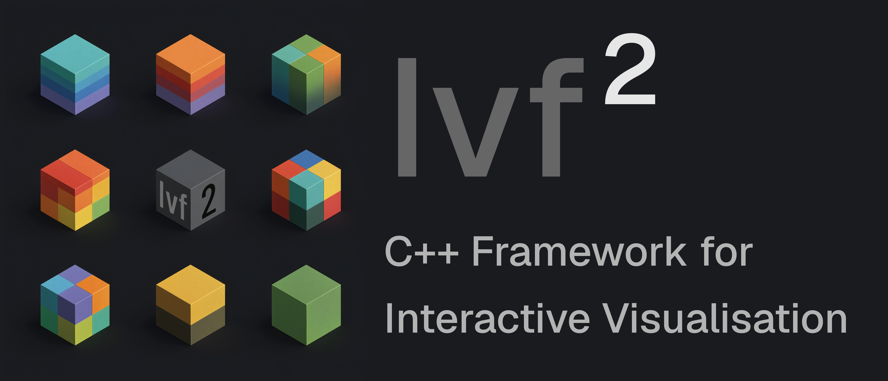

# Interactive Visualisation Framework - Ivf++ 2

[](https://github.com/jonaslindemann/ivf2/actions/workflows/build.yml)
[](https://github.com/jonaslindemann/ivf2/actions/workflows/codeql-analysis.yml)

Lightweight scene graph library and wrapper over modern OpenGL. 



## Features

- **Modern OpenGL wrapper** with scene graph architecture
- **Modern CMake build** - presets, automatic vcpkg detection, `find_package(ivf2)` / FetchContent support
- **Unified library target** (`ivf2::ivf2`) for easy integration
- **Automatic asset management** - shaders, fonts, and models copied automatically
- **Cross-platform** - Windows, Linux, and macOS support
- **Music-driven scenes** (`ivf2::ivfmusic`) - song playback as the master clock, bar-keyed automation with live reload, note events from Renoise songs, presentation mode and frame export
- **Rich examples** demonstrating lighting, animations, physics, UI, and more

# Documentation

Documentation for Ivf++ can be found at https://interactive-visualisation-framework-2.readthedocs.io/en/latest/. The documentation is generated from the source code and is available in the **docs** folder.

# Getting Started

## 1. Clone the repository

```bash
git clone https://github.com/jonaslindemann/ivf2.git
cd ivf2
```

## 2. Install vcpkg

Ivf++ uses vcpkg for dependency management. Installation instructions for your platform can be found here:

https://learn.microsoft.com/sv-se/vcpkg/get_started/overview

The build system automatically detects vcpkg - no manual configuration needed!

## 3. Build the library

See the [Building ivf2](#building-ivf2) section below for detailed instructions.

# Building ivf2

## Prerequisites

1. **CMake** 3.24 or higher (3.26+ recommended)
2. **vcpkg** package manager
3. **Compiler** with C++23 support (`std::expected`):
   - Windows: Visual Studio 2022 or 2026
   - Linux: GCC 12+ or Clang 15+
   - macOS: Xcode 15+ / Apple Clang
4. **Ninja** (optional, recommended on Linux/macOS)

## vcpkg

Dependencies are declared in `vcpkg.json` (manifest mode, pinned with a `builtin-baseline`) and
installed automatically during configuration. The build finds vcpkg in this order:

1. `-DCMAKE_TOOLCHAIN_FILE=...` if given
2. The `VCPKG_ROOT` environment variable (recommended)
3. Common locations: `c:/vcpkg`, `e:/vcpkg` (Windows), `~/vcpkg`, `/usr/local/vcpkg`, `/opt/vcpkg`
4. The vcpkg bundled with Visual Studio, as a last resort

## Quick start with presets

```bash
cmake --list-presets              # show available presets

# Windows (Visual Studio)
cmake --preset vs
cmake --build --preset vs-debug
cmake --build --preset vs-release
ctest --preset vs-debug

# Linux / macOS (Ninja)
cmake --preset release            # or: debug, ninja (multi-config)
cmake --build --preset release
ctest --preset release
```

Each preset builds into `build/<preset>/`. Personal tweaks belong in a `CMakeUserPresets.json`
(ignored by git).

Without presets, the usual commands work too:

```bash
cmake -B build -S . -DCMAKE_BUILD_TYPE=Release
cmake --build build --parallel
```

## Build options

| Option | Default | Description |
|--------|---------|-------------|
| `IVF2_BUILD_EXAMPLES` | ON (top level) | Build the example programs |
| `IVF2_BUILD_TESTS` | ON (top level) | Build the CTest unit tests |
| `IVF2_VISUAL_TESTS` | OFF | Visual regression tests: render the examples and compare with reference images (`ctest -L visual`) |
| `IVF2_BUILD_MUSIC` | ON | Build `ivfmusic` (music-driven scenes) |
| `IVF_WITH_RENOISE` | ON | Renoise song (.xrns) support in ivfmusic (miniz, pugixml) |
| `IVF2_WITH_ASSIMP` | ON | Model loading (`ivf::ModelLoader`) with assimp |
| `IVF2_WITH_FREETYPE` | ON | Text rendering (`ivf::TextNode`) with FreeType |
| `IVF2_WITH_AUDIO` | ON | Audio playback/analysis (`ivf::AudioManager`) with miniaudio; required by ivfmusic |
| `IVF2_WITH_MIDI` | ON | MIDI input (`ivf::MidiController`) with RtMidi |
| `IVF2_INSTALL` | ON (top level) | Install rules and CMake package config |
| `IVF2_USE_PCH` | ON | Precompiled headers |
| `IVF2_WARNINGS` | ON (top level) | Warnings for ivf2's own code: `/W4` (MSVC), `-Wall -Wextra -Wpedantic` |
| `IVF2_WARNINGS_AS_ERRORS` | OFF | Treat those warnings as errors (`/WX`, `-Werror`) |
| `IVF2_OUTPUT_IN_SOURCE_TREE` | OFF | Legacy layout: put binaries in `<source>/bin/<config>` |

The `IVF2_WITH_*` options switch optional dependencies. Each also selects the matching vcpkg
feature, so a disabled library is not downloaded or built. With a feature off, its classes still
exist but log an error and do nothing (`ModelLoader::loadModel` throws). Check what a build
supports with the macros in the generated `<ivf/config.h>` (`IVF2_HAS_ASSIMP`, ...) or with
`find_package(ivf2 REQUIRED COMPONENTS Assimp FreeType Audio Midi Music)`. The `minimal`
preset turns all of them off.

## Build output

Everything goes into the build directory:

- **Executables** and runtime data (shaders, fonts, assets): `build/<preset>/bin/<Config>/`
- **Libraries**: `build/<preset>/lib/<Config>/`
  - `ivf` - core scene graph and rendering
  - `ivfui` - windows, input, cameras, ImGui
  - `ivfmath` - spline and keyframe math
  - `ivfmusic` - music-driven scenes
  - `generator` - procedural geometry
  - `glad` - OpenGL loader
  - Debug builds carry a `d` suffix (`ivfd.lib`)

# Using ivf2 in your own projects

All libraries are exported as `ivf2::` targets. `ivf2::ivf2` links everything except
`ivf2::ivfmusic`.

## As an installed package

```bash
cmake --install build/release --prefix /path/to/ivf2-install
```

```cmake
find_package(ivf2 CONFIG REQUIRED)

add_executable(my_app main.cpp)
target_link_libraries(my_app PRIVATE ivf2::ivf2)
ivf2_copy_runtime_files(my_app)          # copies shaders/ and fonts/ next to my_app
```

Configure your project with the same vcpkg toolchain and add the install prefix to
`CMAKE_PREFIX_PATH`.

## As a subproject (FetchContent / add_subdirectory)

```cmake
include(FetchContent)
FetchContent_Declare(ivf2
    GIT_REPOSITORY https://github.com/jonaslindemann/ivf2.git
    GIT_TAG main)
FetchContent_MakeAvailable(ivf2)       # examples/tests are off when not top level

add_executable(my_app main.cpp)
target_link_libraries(my_app PRIVATE ivf2::ivf2)
ivf2_copy_runtime_files(my_app)
```

The dependencies from ivf2's `vcpkg.json` must be available to the parent project (add them
to your own manifest).

## Music-driven scenes

Link `ivf2::ivfmusic`, or use the `ivfmusic_add_executable()` helper, which also copies the
application's assets:

```cmake
ivfmusic_add_executable(my_scene SOURCES main.cpp ASSETS ${CMAKE_CURRENT_SOURCE_DIR}/assets)
```

## Adding an example to this repository

```cmake
add_ivf2_example(my_example)                                   # uses my_example.cpp
add_ivf2_example(my_example SOURCES main.cpp utils.cpp)
add_ivf2_example(physics_demo SOURCES demo.cpp EXTRA_LIBS ReactPhysics3D::ReactPhysics3D)
```

Examples share one output directory; shaders, fonts and `bin/assets/` are copied there once
per build.

# Troubleshooting

## vcpkg not found

If CMake can't find vcpkg, set the `VCPKG_ROOT` environment variable:

**Windows:**
```powershell
# PowerShell
$env:VCPKG_ROOT = "C:\path\to\vcpkg"

# CMD
set VCPKG_ROOT=C:\path\to\vcpkg
```

**Linux/macOS:**
```bash
export VCPKG_ROOT=/path/to/vcpkg
```

Or specify it directly when configuring:
```bash
cmake -B build -S . -DCMAKE_TOOLCHAIN_FILE=/path/to/vcpkg/scripts/buildsystems/vcpkg.cmake
```

## Build fails with "cannot find library"

Make sure you're using a C++23 compiler and the same vcpkg triplet for ivf2 and your
application. On Windows, the `vs` preset picks the newest installed Visual Studio.

## Examples can't find shaders or assets

Inside this repository, use `add_ivf2_example`. In your own project, call
`ivf2_copy_runtime_files(<target> [ASSETS <dirs...>])` so shaders, fonts and your assets are
copied next to the executable.

## Library naming (Debug vs Release)

- Debug builds automatically append 'd' to library names: `ivfd.lib`, `generatord.lib`, etc.
- Release builds use the base names: `ivf.lib`, `generator.lib`, etc.
- The unified `ivf2::ivf2` target handles this automatically - no need to specify different libraries for different configurations.
