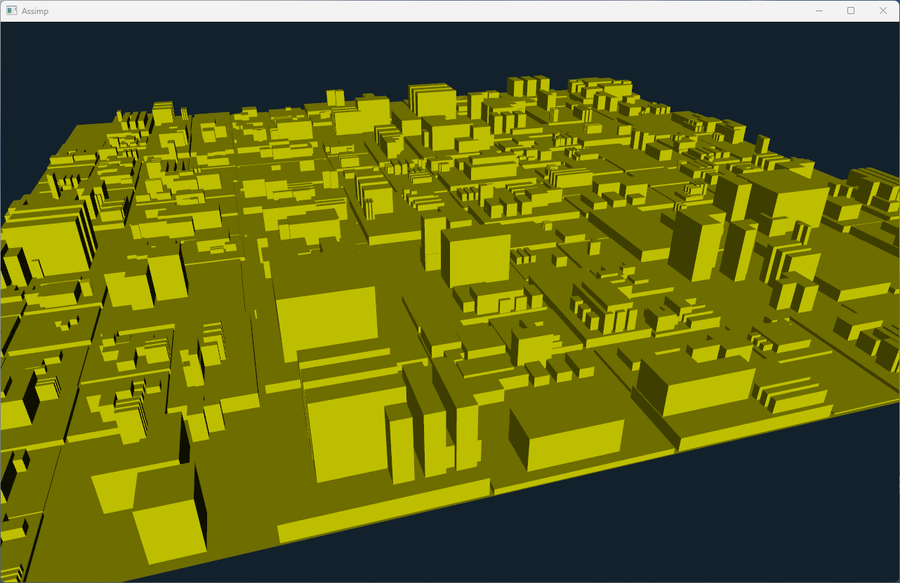

# Model Loading

ivf2 loads 3D models made in other tools, such as Blender exports or downloaded assets, through the [Assimp](https://github.com/assimp/assimp) library. Assimp reads dozens of formats, including OBJ, FBX, glTF/GLB, STL, PLY, 3DS, DAE and Blender files.



## Loading a model

```cpp
#include <ivf/model_loader.h>

try
{
    auto model = ivf::ModelLoader::loadModel("assets/teapot.obj");
    add(model);
}
catch (const std::runtime_error &e)
{
    std::cerr << e.what() << '\n';   // file missing, unsupported or damaged
}
```

`loadModel()` returns a `CompositeNode` that mirrors the structure of the file: each object in the file becomes a `MeshNode` child, positioned as in the original scene. If the file can't be read, it throws a `std::runtime_error` with Assimp's error message, so always wrap the call when the path comes from the user.

While loading, faces are converted to triangles and smooth normals are generated for meshes that have none.

Paths are relative to the working directory, which for the examples is the executable's folder. Files placed in `bin/assets/` are copied next to the executables at build time.

## Materials

Basic material properties from the file (diffuse, specular and ambient colour, shininess and opacity) are converted to ivf2 materials. To give the whole model one look instead, set a material on the returned node:

```cpp
auto steel = ivf::Material::create();
steel->setDiffuseColor({0.6f, 0.6f, 0.65f, 1.0f});
steel->setShininess(80.0f);
model->setMaterial(steel);
```

Textures referenced by the model file are not loaded automatically. Load them with `Texture` and assign them to the mesh nodes yourself; see [Materials and Textures](../core/materials_and_textures.md).

## Placing and framing the model

Models come in every size and position, so a freshly loaded model is often far off-screen or enormous. Use its bounding box to frame it:

```cpp
auto box = model->worldBoundingBox();
if (box.isValid())
{
    cameraManipulator()->setCameraTarget(box.center());
    cameraManipulator()->setCameraPosition({box.center().x, box.center().y, box.max().z * 3.0f});
}
```

Or call `zoomToExtent()` on the window to fit the whole scene into view.

To scale and position the model, set the transform on the returned node with `setPos()`, `setScale()` and `setRotAxis()`/`setRotAngle()`, exactly as for any other node.

## Common problems

| Problem | What to try |
|---------|-------------|
| Model is invisible | Frame it with its bounding box; it may be far away or tiny. Check the log for the number of meshes loaded |
| Model looks inside out or partly missing | Some files have reversed faces; disable back-face culling with `glDisable(GL_CULL_FACE)` |
| Model is lying on its side | The file uses Z as up; rotate the returned node by -90° around X |
| Loading is slow | Convert large files to glTF/GLB or OBJ, and reduce the polygon count in a modelling tool |

## Related

- [Asset Examples](../examples/asset_examples.md) — `assimp1` lets you open any model file through a file dialog
- [Nodes](../core/nodes.md)
