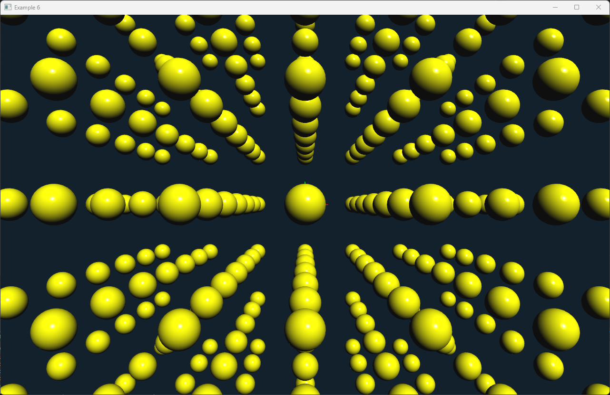

# Selection

Selection tells you which object is under the mouse cursor, so the user can point at things: highlight what they hover over, click to pick an object, or drag a rectangle to select several.

<!-- Run in the browser: generated by docs/tools/make_gallery.py from the Example Index -->
!!! example "Run in the browser"

    [`selection1`](https://jonaslindemann.github.io/ivf2/web/selection1.html) · [`picking1`](https://jonaslindemann.github.io/ivf2/web/picking1.html) · [`editor1`](https://jonaslindemann.github.io/ivf2/web/editor1.html)

<!-- /Run in the browser -->



## How it works

There are two ways to find the object under the mouse:

- **Selection buffer** (the default): the window renders the scene a second time into a hidden buffer, drawing every object in a unique flat colour that encodes its ID, and reads the pixel under the cursor. This is pixel-accurate, also for shader effects that move vertices, and costs one extra render of the scene when the mouse or camera moved.
- **Ray casting**: a ray from the camera through the mouse is tested against the triangles of the meshes on the CPU (see [Ray picking](#ray-picking) below). No extra rendering, and the result includes the exact surface point and normal.

```cpp
setSelectionEnabled(true);
setSelectionMethod(ivfui::SelectionMethod::Ray);   // or SelectionMethod::Buffer (default)
```

Hover and click events work the same with both. Box selection always uses the buffer.

## Hover events

Turn selection on in `onSetup()` and override the three hover callbacks:

```cpp
class ExampleWindow : public ivfui::GLFWSceneWindow {
    ivf::MaterialPtr m_normalMat, m_hoverMat;

    int onSetup() override
    {
        setSelectionEnabled(true);
        // ... create materials and objects ...
        return 0;
    }

    void onEnterNode(ivf::Node *node) override
    {
        node->setMaterial(m_hoverMat);    // cursor moved onto this node
    }

    void onOverNode(ivf::Node *node) override
    {
        // called every frame while the cursor stays on the node
    }

    void onLeaveNode(ivf::Node *node) override
    {
        node->setMaterial(m_normalMat);   // cursor left this node
    }
};
```

The callbacks receive a raw `Node*`. It stays valid as long as the node is in the scene, but don't store it beyond that; keep the `shared_ptr` if you need the object later.

Only the frontmost object under the cursor is reported.

## Clicking to pick

Combine the hover events with `onMouseButton()`: remember the hovered node, and act on it when the button is pressed.

```cpp
ivf::Node *m_hovered{nullptr};
ivf::Node *m_selected{nullptr};

void onEnterNode(ivf::Node *node) override { m_hovered = node; }
void onLeaveNode(ivf::Node *node) override { if (m_hovered == node) m_hovered = nullptr; }

void onMouseButton(int button, int action, int mods) override
{
    if (button == GLFW_MOUSE_BUTTON_LEFT && action == GLFW_PRESS && m_hovered)
    {
        if (m_selected)
            m_selected->setMaterial(m_normalMat);
        m_selected = m_hovered;
        m_selected->setMaterial(m_selectedMat);
    }
}
```

## Box selection

To select several objects at once by dragging a rectangle, enable box selection and override `onBoxSelect()`:

```cpp
int onSetup() override
{
    setSelectionEnabled(true);
    setBoxSelectionEnabled(true);
    return 0;
}

void onBoxSelect(std::vector<ivf::Node *> nodes) override
{
    for (auto node : nodes)
        node->setMaterial(m_selectedMat);
}
```

A drag shorter than a few pixels counts as a click and doesn't trigger a box selection. Only objects that are visible inside the rectangle are returned; objects fully hidden behind others are not.

## Ray picking

`pick(x, y)` returns the nearest object under a window position, with the point that was hit, whether or not selection is enabled:

```cpp
#include <ivf/picking.h>

void onMouseButton(int button, int action, int mods) override
{
    if (button == GLFW_MOUSE_BUTTON_LEFT && action == GLFW_PRESS)
        if (auto hit = pick(mouseX(), mouseY()))
        {
            marker->setPos(hit.position);              // on the surface
            arrow->rotateToVector(hit.normal);         // pointing out of it
            ivf::logInfo(hit.node->name(), "Picking");
        }
}
```

A `RayHit` holds the `node` (the drawn node, as in hover events), the `mesh`, the `point` of a [point cloud](../visualisation/point_clouds.md#picking),the `distance` from the camera, the world-space `position` and `normal` (facing the camera), and the `triangle` with its `barycentric` coordinates. It converts to `false` when nothing was hit.

| Option (`PickOptions`) | Default | Description |
|------------------------|---------|-------------|
| `skip` | - | Function that leaves items out, for example the object being dragged |
| `maxDistance` | infinite | Ignore hits farther away |
| `includeTransparent` | true | Pick transparent objects |
| `boundsFallback` | true | Nodes without triangles (lines, points, custom nodes) are hit at their bounding box (`hit.exact` is false) |

Background objects (a sky) and overlays are never picked. Picking tests the items of the last drawn frame in the transform they were drawn with, so instanced copies, animated nodes, and deformed or skinned meshes (glTF characters) are hit where they appear on screen.

Rays work outside windows too: `ivf::pick(queue, ray)` tests any `RenderQueue`, `pickAll()` returns every hit sorted by distance, and `cameraRay(x, y)` or `ivf::rayFromScreen()` make camera rays. A `Ray` can start anywhere, for example straight down from above to find the ground under an object.

Each mesh keeps a bounding volume hierarchy of its triangles (`Mesh::bvh()`), built the first time the mesh is picked and again after its vertices change. A ray then tests only the few triangles near it, so picking a mesh with hundreds of thousands of triangles takes microseconds. The `picking1` example shows it on primitives, a 65 000 triangle sphere, instanced copies and an animated glTF model.

## The 3D cursor position

`onMousePosition3D(x, y, z)` reports the point in the scene under the mouse cursor, which is useful for placing objects where the user points. Together with grid snapping (`setSnapToGrid(true)`, `setGridSnapValue()`) and the built-in 3D cursor (`enableCursor()`), this is the basis for simple editors. See the `editor1` example.

## Performance

The selection buffer renders the scene again whenever the mouse or camera moved. With very large scenes, use `SelectionMethod::Ray`, or enable selection only while the user is in a picking mode. Ray casting costs CPU time proportional to the number of objects along the ray, plus building each mesh's BVH once (and again for meshes whose vertices change every frame).

## Related

- [Interaction Examples](../examples/interaction_examples.md) — the `selection1` example
- `picking1` in the [examples](../examples/index.md) — ray picking with hit points and normals
- [Scene Window](../ui/scene_window.md)
