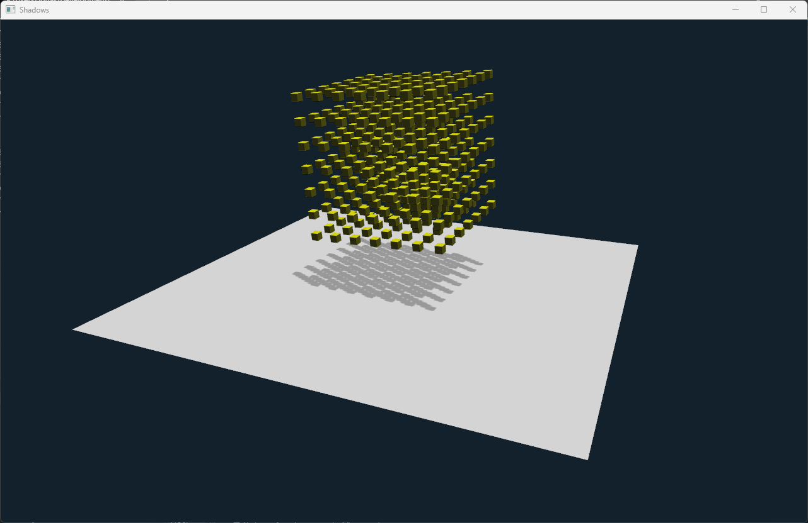

# Shadows

Shadows make it much easier to read where objects are in space: without them, a floating cube and a cube on the floor can look identical. ivf2 uses shadow mapping: the scene is first rendered from the light's point of view to record what the light can see, and every surface the light can't see is darkened.

<!-- Run in the browser: generated by docs/tools/make_gallery.py from the Example Index -->
!!! example "Run in the browser"

    [`shadows1`](https://jonaslindemann.github.io/ivf2/web/shadows1.html) · [`cascaded_shadows1`](https://jonaslindemann.github.io/ivf2/web/cascaded_shadows1.html) · [`point_shadows1`](https://jonaslindemann.github.io/ivf2/web/point_shadows1.html)

<!-- /Run in the browser -->



## Turning shadows on

Shadows need two switches: shadow mapping in the `LightManager`, and shadow casting on the light. Directional, point and spot lights cast shadows, up to four lights at a time.

```cpp
auto lm = renderContext()->lights();
lm->clearLights();
lm->setUseShadows(true);

auto sun = lm->addDirectionalLight();
sun->setDirection({-0.2f, -1.0f, -0.2f});
sun->setDiffuseColor({1.0f, 1.0f, 1.0f});
sun->setAmbientColor({0.3f, 0.3f, 0.3f});
sun->setCastShadows(true);
sun->setShadowStrength(0.6f);

lm->apply();
```

Opaque nodes cast and receive shadows, with the stock, bump and PBR materials. Transparent, background (sky) and overlay nodes cast none. To keep a node and its children out of the shadow maps, call `setCastShadows(false)` on it - for example a lamp bulb around a point light, which would otherwise shadow everything:

```cpp
bulb->setCastShadows(false);
```

Nodes with a `ShaderMaterial` are drawn into the shadow maps with their plain geometry; a vertex shader that moves vertices does not move their shadow.

## Directional lights

A directional light is infinitely far away, so its shadow map has to be fitted to a region of the scene. There are two ways.

### One map for the whole scene

The default (`setShadowCascades(1)`): one map covers the scene bounding box, which the `LightManager` computes every frame from the scene's items (`setAutoCalcBBox(true)`, the default). To fix the region instead:

```cpp
lm->setAutoCalcBBox(false);
lm->setSceneBoundingBox({-30.0f, -30.0f, -20.0f}, {30.0f, 30.0f, 30.0f});
```

- **Too small**, and objects outside it get no shadows or have their shadows cut off.
- **Too large**, and the same shadow map is spread over more space, so shadows get blocky.

This works well for compact scenes. In a large scene the map's texels become large, and nearby shadows get blocky.

### Cascaded shadow maps

For large scenes, split the camera's view range into up to four *cascades*, each with its own part of the shadow map: the nearest covers a few metres in front of the camera with sharp detail, the farthest covers the distance with coarse texels, where they are small on screen.

```cpp
sun->setShadowCascades(4);
sun->setShadowMapSize(4096, 4096); // shared by the cascades: 4 tiles of 2048 x 2048
sun->setShadowNormalBias(1.0f);    // against acne on surfaces at grazing angles
```

| Function | Default | Description |
|----------|---------|-------------|
| `setShadowCascades(n)` | 1 | Number of cascades, 1-4 |
| `setShadowDistance(d)` | 0 (automatic) | How far from the camera shadows reach; 0 reaches the farthest point of the scene, at most the camera's far plane |
| `setCascadeSplitLambda(l)` | 0.75 | Where the cascades split: 1 logarithmic (more resolution near the camera), 0 uniform |

The cascades follow the camera, and their size stays the same while it turns, so shadow edges don't shimmer. `setDebugShadow(5)` colours each cascade (red, green, blue, yellow). The `cascaded_shadows1` example shows a field of trees with a pergola close to the camera.

## Point lights

Point lights cast shadows in all directions: they render six shadow maps, one per face of a cube around the light, packed into one texture.

```cpp
auto lamp = lm->addPointLight();
lamp->setPosition({0.0f, 2.0f, 0.0f});
lamp->setAttenuation(1.0f, 0.14f, 0.07f);
lamp->setCastShadows(true);
lamp->setShadowMapSize(1024, 1024); // six faces of 512 x 512
```

`setShadowRange(r)` sets how far the shadows reach (the far plane of the faces); the default, 0, reaches the farthest point of the scene. A smaller range gives more depth precision. The `point_shadows1` example shows two moving lamps in a room, one inside a cage that throws its pattern on the walls.

## Spot lights

A spot light renders one shadow map: a perspective view along its direction that covers the outer cone (`setCutoff()`). A narrower cone gives sharper shadows from the same map size.

```cpp
auto spot = lm->addSpotLight();
spot->setPosition({-5.0f, 2.5f, 1.5f});
spot->setDirection({1.0f, -0.4f, -0.5f});
spot->setCutoff(18.0f, 24.0f);
spot->setCastShadows(true);
spot->setShadowMapSize(1024, 1024);
```

As for point lights, `setShadowRange(r)` limits how far the shadows reach and `setShadowSoftness()` is the light's radius in world units (default 0.1). `point_shadows1` has a spot light aimed at the brass sphere.

## Soft shadows

`setShadowFilter()` decides how shadow edges are filtered:

| Filter | Look | Settings |
|--------|------|----------|
| `ShadowFilter::Hard` | One sample: sharp, aliased edges | - |
| `ShadowFilter::Pcf` (default) | Percentage-closer filtering: a square of (2r + 1)² samples gives edges of even softness | `setShadowFilterRadius(r)`, texels, default 1, up to 4 |
| `ShadowFilter::Pcss` | Percentage-closer soft shadows: sharp where an object touches the ground, softer the farther the shadow falls from its caster | `setShadowSoftness(s)` |

```cpp
sun->setShadowFilter(ivf::ShadowFilter::Pcss);
sun->setShadowSoftness(0.02f); // directional: tangent of the light's angular radius
lamp->setShadowFilter(ivf::ShadowFilter::Pcss);
lamp->setShadowSoftness(0.1f); // point and spot: radius of the light in world units
```

For a directional light the softness is the tangent of its angular radius: the real sun is about 0.005, an overcast sky much more. The default 0.02 is a clearly visible penumbra. PCSS penumbras are limited to 24 texels, so very soft shadows need a smaller map or cascades. PCSS adds slight noise to the penumbra, which is less visible than banding.

## Quality settings

| Setting | Effect |
|---------|--------|
| `setShadowMapSize(w, h)` | Resolution of the shadow map; default 2048 × 2048 (cascades share it, point lights use six faces of half the width, spot lights one square map). Higher gives sharper shadows and costs memory and time |
| `setShadowStrength(s)` | How dark shadows are, from 0 (none) to 1 (black). Lower values look more natural with ambient light |
| `setShadowBias(b)` | Depth offset against acne, as a fraction of the map's depth range; default 0.001, doubled on surfaces facing away from the light |
| `setShadowNormalBias(t)` | Moves the lookup along the surface normal by `t` texels; default 0. Around 1 removes acne at grazing angles; too much detaches shadows from their casters |
| Light direction | Light coming from steeply above gives the most stable shadows; very low sun angles stretch them |

## Debugging

`LightManager::setDebugShadow(mode)` makes the stock shader show shadow information instead of the lit scene, for the first shadow map:

| Mode | Shows |
|------|-------|
| 0 | Normal rendering |
| 1 | Depth stored in the shadow map, as greyscale |
| 2 | Red where a surface is in shadow, green where it is lit |
| 3 | Shadow map coordinates as colour; values outside 0–1 mean the surface is outside the shadow map |
| 4 | Surface depth (red) against stored depth (green) |
| 5 | The lit scene tinted by cascade (first directional light) |

Modes 1-4 show the first tile of the map (the whole map without cascades). `renderStats().shadow` counts the items drawn into all shadow maps; each item is culled against each cascade or cube face.

Common causes of problems:

| Symptom | Likely cause |
|---------|--------------|
| No shadows at all | `setUseShadows(true)` or `setCastShadows(true)` missing, or more than four shadow-casting lights (a warning is logged) |
| Everything in shadow around a point or spot light | A node encloses the light (a bulb or lamp shade): `setCastShadows(false)` on it |
| Shadows cut off at an edge | The scene bounding box is too small, or `setShadowDistance()` ends the cascades |
| Blocky, jagged shadows | Map too small for the area it covers; use cascades for large scenes |
| Striped patterns on lit surfaces ("shadow acne") | Light at a grazing angle to the surface: raise `setShadowNormalBias()` or `setShadowBias()` |
| Shadows float off their casters ("peter panning") | Bias too large |

## In custom shaders

The stock, bump and PBR shaders sample the shadow maps with functions from `ivf/shadow_shaders.h`. A custom shader (`ShaderMaterial` with `setUseLighting(true)`) can use them too: after the camera and lights blocks, append `ivf::shadow_glsl` and call `ivfShadowFactor()` with the light's `shadowIndex`:

```cpp
const std::string frag = std::string(R"(#version 330 core
in vec3 fragPos;
in vec3 normal;
out vec4 fragColor;
)" IVF_CAMERA_BLOCK_GLSL IVF_LIGHTS_BLOCK_GLSL) + ivf::shadow_glsl + R"(
void main()
{
    vec3 n = normalize(normal);
    vec3 l = normalize(-dirLights[0].direction);
    float shadow = ivfShadowFactor(dirLights[0].shadowIndex, fragPos, n, l); // 0 lit, 1 shadowed
    float light = max(dot(n, l), 0.0) * (1.0 - shadow * dirLights[0].shadowStrength);
    fragColor = vec4(vec3(0.1 + light), 1.0);
}
)";
```

`Program::link()` points the `shadowMaps[]` samplers at their texture units (8-11).

## Related

- [Lighting](../core/lighting.md)
- `shadows1`, `cascaded_shadows1` and `point_shadows1` in the [examples](../examples/index.md)
