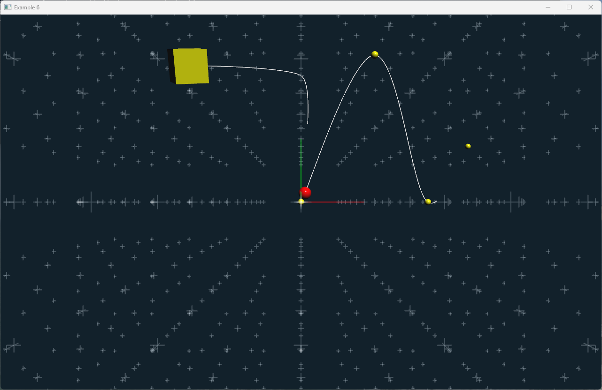

# Keyframe Animation

A keyframe animation moves a node through a series of poses, called keyframes, each pinned to a point in time. ivf2 fills in the frames between them. Use it when you know *where* an object should be *when*, for example a cube that rises, turns and slides away on a fixed schedule.

<!-- Run in the browser: generated by docs/tools/make_gallery.py from the Example Index -->
!!! example "Run in the browser"

    [`animation3`](https://jonaslindemann.github.io/ivf2/web/animation3.html)

<!-- /Run in the browser -->



## The two pieces

Keyframe animation is split into two classes:

| Class | Namespace | Role |
|-------|-----------|------|
| `KeyframeInterpolator` | `ivfmath` | Holds the keyframes and computes the pose at any time. It knows nothing about the scene. |
| `KeyframeAnimation` | `ivf` | Owns a clock and applies the interpolated pose to a `TransformNode` every update. |

Because the interpolator is independent of the scene, you can share one interpolator between several animations, or query it directly with `interpolate(time)` to drive something other than a node.

## Defining keyframes

Each keyframe is a `KeyframeData`:

```cpp
#include <ivfmath/keyframe_data.h>

ivfmath::KeyframeData(
    float     timestamp,              // seconds
    glm::vec3 position = {0, 0, 0},
    glm::vec3 rotation = {0, 0, 0},   // Euler angles in degrees (x, y, z)
    glm::vec3 scale    = {1, 1, 1},
    float     tension  = 0.5f);       // only used by CatmullRom
```

Add keyframes to an interpolator in any order; they are sorted by timestamp as they are added:

```cpp
#include <ivfmath/keyframe_interpolator.h>

using namespace ivfmath;

auto interp = KeyframeInterpolator::create();
interp->addKeyframe(KeyframeData(0.0,  {0, 0, 0},  {0, 0, 0}));
interp->addKeyframe(KeyframeData(5.0,  {0, 2, 0},  {45, 0, 0}));
interp->addKeyframe(KeyframeData(10.0, {-3, 2, 0}, {0, 45, 0}));
interp->addKeyframe(KeyframeData(15.0, {-3, 0, -3}, {0, 0, 45}));
```

The animation's duration is the timestamp of the last keyframe (here 15 seconds). Start the first keyframe at `0.0`.

## Playing it on a node

```cpp
#include <ivf/keyframe_animation.h>

m_anim = ivf::KeyframeAnimation::create(m_cube);
m_anim->setInterpolator(interp);
m_anim->play();
```

Advance it from `onUpdate()`. Pass the frame delta from `TimeController` so the animation follows pause and time scaling:

```cpp
void onUpdate() override
{
    double dt = ivf::TimeController::instance()->delta();
    m_anim->update(static_cast<float>(dt));
}
```

`update()` still applies the current pose while the animation is stopped, so `stop()` freezes the node in place and `play()` continues from the same point.

| Method | Description |
|--------|-------------|
| `play()` / `stop()` | Start or pause the clock |
| `isPlaying()` | Whether the clock is running |
| `currentTime()` | Seconds since the animation started |
| `setNode()` / `setInterpolator()` | Swap the target node or the keyframes |

!!! note "Looping"
    The interpolator wraps time around the duration, so a keyframe animation always loops. To make it loop smoothly, give the last keyframe the same pose as the first.

## Interpolation types

`setInterpolationType()` chooses how the in-between frames are computed:

```cpp
interp->setInterpolationType(InterpolationType::CatmullRom);
```

| Type | Behaviour |
|------|-----------|
| `Linear` | Constant speed between keyframes (default) |
| `EaseIn` | Starts slowly and speeds up into each keyframe |
| `EaseOut` | Starts fast and slows down into each keyframe |
| `EaseInOut` | Slow at both ends of each segment |
| `Step` | Holds each pose, then jumps to the next one |
| `CatmullRom` | A smooth curved path through all keyframe positions |

With `Linear` and the easing types, the node travels in straight lines and changes direction abruptly at each keyframe. Easing is applied per segment, so the object slows down or speeds up around *every* keyframe, not just at the start and end.

`CatmullRom` bends the path so it flows through each keyframe position without corners, which usually looks much more natural for moving objects. It only curves the position; rotation is still blended linearly.

### Tension

With `CatmullRom`, each keyframe's `tension` (0–1) controls how tightly the path bends around it:

- **0** gives a standard, loose Catmull-Rom curve.
- **0.5** (the default) gives a moderately tight curve.
- **1** flattens the tangents so the object eases to a stop at that keyframe.

Set it per keyframe when creating it, or change it afterwards by index:

```cpp
interp->addKeyframe(KeyframeData(5.0, {0, 2, 0}, {45, 0, 0}, {1, 1, 1}, 0.0f));
interp->setKeyframeTension(2, 1.0f);   // stop briefly at the third keyframe
```

## Limitations

- **Rotation** is blended as Euler angles in degrees. Large changes on several axes at once can take an unexpected route; split them over more keyframes if needed.
- **Scale** is interpolated but not yet applied to the node by `KeyframeAnimation`. To animate scale, call `interp->interpolate(t)` yourself and apply `.scale`.

## Related

- [Spline Animation](spline_animation.md) — move along a path at a chosen speed, without timestamps
- [Camera Animation](camera_animation.md) — keyframed camera fly-throughs
- [Animation Examples](../examples/animation_examples.md) — the full `animation3` example
