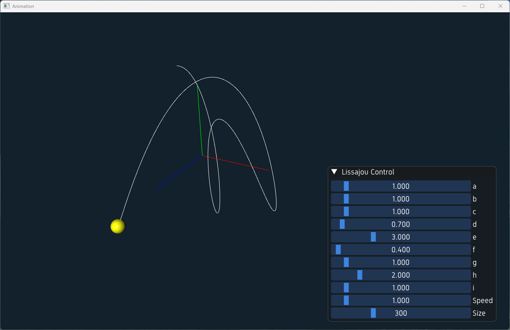

# Lissajous Curves

A Lissajous curve is the path traced by combining sine waves on several axes. Small changes to the frequencies and phases produce very different figures, from simple ellipses to intricate knots, which makes them a quick way to get rich, endlessly repeating motion from a few numbers.

<!-- Run in the browser: generated by docs/tools/make_gallery.py from the Example Index -->
!!! example "Run in the browser"

    [`animation2`](https://jonaslindemann.github.io/ivf2/web/animation2.html)

<!-- /Run in the browser -->



ivf2 has no dedicated Lissajous class; this page shows the pattern used in the `animation2` example. It is a good template for any *procedural animation*, where position is computed from time with a formula instead of keyframes or a spline.

## The formula

In 3D, each axis gets its own sine wave:

```
x(t) = a · sin(b·t + d)
y(t) = c · sin(e·t + f)
z(t) = g · sin(h·t + i)
```

| Parameters | Meaning |
|------------|---------|
| `a`, `c`, `g` | Amplitude on x, y and z: how far the curve reaches |
| `b`, `e`, `h` | Frequency on each axis: how many times it swings per cycle |
| `d`, `f`, `i` | Phase on each axis: shifts the wave in time |

The ratio between the frequencies decides the shape:

- **Whole-number ratios** such as 1 : 2 : 3 give a closed figure that repeats exactly.
- **Irrational ratios** such as 1 : 1.414 never quite repeat, so the curve slowly fills a volume.
- **Phases** turn and twist the figure. Equal frequencies with a phase of π/2 give a circle or ellipse.

## A small curve class

```cpp
#include <cmath>
#include <glm/glm.hpp>

class Lissajous {
public:
    glm::vec3 amplitude{1.0f, 1.0f, 1.0f};
    glm::vec3 frequency{1.0f, 3.0f, 2.0f};
    glm::vec3 phase{0.7f, 0.4f, 1.0f};

    glm::vec3 operator()(float t) const
    {
        return amplitude * glm::sin(frequency * t + phase);
    }
};
```

GLM's `sin` works component-wise on vectors, so all three axes are evaluated in one line.

## Animating a node along it

Evaluate the curve at the current time in `onUpdate()` and place the node there. A `LineTrace` keeps a tail of recent positions so the figure appears as the object moves:

```cpp
class ExampleWindow : public ivfui::GLFWSceneWindow {
    ivf::SpherePtr    m_sphere;
    ivf::LineTracePtr m_trace;
    Lissajous         m_curve;
    float             m_speed{1.0f};

    int onSetup() override
    {
        m_sphere = ivf::Sphere::create(0.1);
        this->add(m_sphere);

        m_trace = ivf::LineTrace::create(300, true);   // last 300 positions
        this->add(m_trace);
        return 0;
    }

    void onUpdate() override
    {
        float t = static_cast<float>(ivf::TimeController::instance()->elapsed());
        glm::vec3 pos = m_curve(t * m_speed);

        m_sphere->setPos(pos);
        m_trace->add(pos);
        m_trace->refresh();
    }
};
```

Because the position depends only on the elapsed time, not on the previous frame, the animation can be paused, slowed down or scrubbed through [Time Control](../core/time_controller.md) and always lands on the right spot.

## Tweaking it live

The `animation2` example adds an ImGui window with a slider for each parameter, plus speed and trace length. When a slider changes, it updates the curve and calls `m_trace->reset()` so the old figure is cleared:

```cpp
if (m_controls->is_dirty())
{
    // ... copy slider values into the curve ...
    m_trace->setSize(m_controls->size());
    m_trace->reset();
}
```

See [UI Windows](../ui/ui_windows.md) for how to build panels like this.

## Ideas to try

| Frequencies (x : y : z) | Phases | Result |
|-------------------------|--------|--------|
| 1 : 1 : 0 | 0, π/2, 0 | A circle in the xy plane |
| 1 : 2 : 0 | π/2, 0, 0 | A figure eight |
| 1 : 3 : 2 | 0.7, 0.4, 1.0 | A closed 3D knot (the `animation2` default) |
| 1 : 1.414 : 1.732 | 0, 0, 0 | A path that never repeats and slowly fills a cube |

Other ways to extend it:

- Animate the phases slowly over time so the figure morphs.
- Drive several objects with the same curve, each offset in time, to form a chain.
- Use the curve as a camera target, or feed it into a [flow field](../creative/flow_field.md) as a moving attractor.

## Related

- [Basic Animation](basic_animation.md) — animating in `onUpdate()`
- [Spline Animation](spline_animation.md) — paths through hand-placed points
- [Animation Examples](../examples/animation_examples.md) — the full `animation2` source
