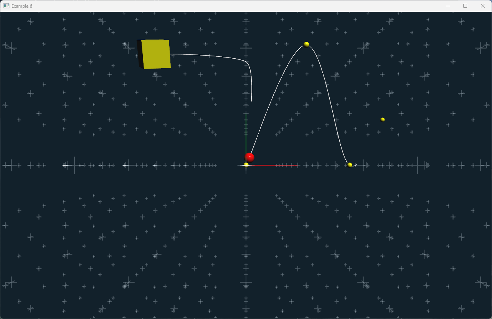

# Spline Animation

A spline animation moves a node along a smooth curve through a set of control points. Unlike [keyframe animation](keyframe_animation.md), there are no timestamps: you define the path and a speed, and choose whether the object stops, loops or bounces at the end.



## Defining the path

`ivfmath::Spline` is a Catmull-Rom spline. The curve passes through every control point you add:

```cpp
#include <ivfmath/spline.h>

auto spline = ivfmath::Spline::create();
spline->addPoint({0.0f, 0.0f,  0.0f});
spline->addPoint({1.0f, 2.0f,  1.0f});
spline->addPoint({2.0f, 0.0f,  0.0f});
spline->addPoint({3.0f, 1.0f, -1.0f});
```

You can also sample the spline directly, for example to place markers or build a tube along it:

| Method | Description |
|--------|-------------|
| `positionByT(t)` | Position at parameter `t`, from `0` (first point) to `size() - 1` (last point) |
| `positionByDistance(d)` | Position `d` world units along the curve from the start |
| `totalLength()` | Length of the whole curve |
| `size()` / `clear()` | Number of control points / remove all points |

## Animating a node

```cpp
#include <ivf/spline_animation.h>

m_splineAnim = ivf::SplineAnimation::create(spline);
m_splineAnim->setAnimatedNode(m_sphere);
m_splineAnim->setInterpolationMode(ivf::SplineInterpolationMode::Distance);
m_splineAnim->setSpeed(1.0);
m_splineAnim->setAnimMode(ivf::SplineAnimMode::PingPong);
```

Advance it every frame from `onUpdate()`:

```cpp
void onUpdate() override
{
    double dt = ivf::TimeController::instance()->delta();
    m_splineAnim->update(dt);
}
```

Using `TimeController::delta()` means the animation pauses and changes speed together with the rest of the scene. There is no separate play or stop; to pause just this animation, stop calling `update()`.

## Speed and interpolation mode

The interpolation mode decides what `speed` measures:

| Mode | Speed means | Result |
|------|-------------|--------|
| `SplineInterpolationMode::Time` (default) | Control points per second | Every segment takes the same time, so the object moves faster on long segments and slower on short ones |
| `SplineInterpolationMode::Distance` | World units per second | Constant speed along the whole path |

`Distance` is what you want for vehicles, cameras and anything that should move steadily. `Time` is useful when the control points are evenly spaced, or when you want each segment to take a fixed amount of time.

## Playback modes

| Mode | At the end of the path |
|------|------------------------|
| `SplineAnimMode::Once` (default) | Stops at the last point |
| `SplineAnimMode::Loop` | Jumps back to the first point |
| `SplineAnimMode::PingPong` | Reverses and travels back, forever |

`Loop` jumps straight from the last point to the first. For a closed circuit with no jump, add the first point again at the end of the spline.

In `PingPong` mode, the animation reverses by flipping the sign of the speed, so `speed()` returns a negative value while the object travels backwards.

## Jumping to a position

`setTime()` moves the animation to a parameter value in `Time` mode, for example `setTime(0.0)` to restart from the beginning. It has no effect in `Distance` mode.

## Showing the path

The `animation3` example traces the moving object with a `LineTrace` so the path is visible:

```cpp
m_trace = ivf::LineTrace::create(300, true);   // keep the last 300 positions
this->add(m_trace);

// in onUpdate(), after m_splineAnim->update(dt):
m_trace->add(m_sphere->pos());
m_trace->refresh();
```

## Limitations

`SplineAnimation` sets only the node's position; the node does not turn to face the direction of travel. For a camera that follows a spline and looks along it, use [Camera Animation](camera_animation.md).

## Related

- [Keyframe Animation](keyframe_animation.md) — poses pinned to timestamps, including rotation
- [Camera Animation](camera_animation.md) — spline-based camera fly-throughs with look-at targets and shake
- [Animation Examples](../examples/animation_examples.md) — the full `animation3` example
