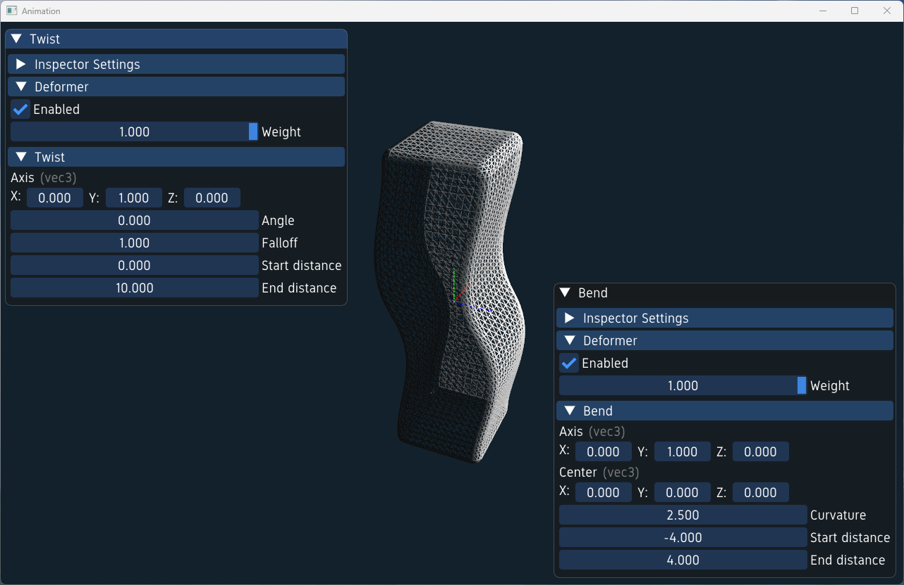

# Deformers

Deformers bend, twist, ripple and roughen geometry by moving its vertices. Several can be stacked on one object, and because they always start from the original shape, you can animate them freely without the shape drifting over time.

<!-- Run in the browser: generated by docs/tools/make_gallery.py from the Example Index -->
!!! example "Run in the browser"

    [`deformer1`](https://jonaslindemann.github.io/ivf2/web/deformer1.html) · [`deformer2`](https://jonaslindemann.github.io/ivf2/web/deformer2.html) · [`deformer3`](https://jonaslindemann.github.io/ivf2/web/deformer3.html)

<!-- /Run in the browser -->



## Making a shape deformable

Deformers work on a `DeformableMeshNode`. The easiest way to get one is to wrap any primitive in `DeformablePrimitive<T>`:

```cpp
#include <ivf/deformable_primitive.h>
#include <ivf/twist_deformer.h>
#include <ivf/bend_deformer.h>

ivf::mmDefaultMeshUsage(GL_DYNAMIC_DRAW);   // meshes created from here on are updated often

m_shape = ivf::DeformablePrimitive<ivf::RoundedBox>::create();
m_shape->primitive()->setSize({1.0f, 1.0f, 4.0f});
m_shape->primitive()->setSegments({10, 10, 40});   // enough vertices to bend smoothly
m_shape->refresh();                                // rebuild after changing the primitive
add(m_shape);
```

Two things matter for good results:

- **Vertex count.** A deformer can only move the vertices that exist. A cube with one segment per side can't bend; give the primitive enough segments along the direction you deform.
- **`refresh()`.** After changing the wrapped primitive through `primitive()`, call `refresh()` so the deformable copy and its stored original shape are rebuilt.

Calling `mmDefaultMeshUsage(GL_DYNAMIC_DRAW)` before creating the shape tells OpenGL the vertex data will change often, which is faster for animated deformations.

## Adding deformers

```cpp
m_twist = ivf::TwistDeformer::create({0, 1, 0});            // axis
m_bend  = ivf::BendDeformer::create({0, 1, 0}, {0, 0, 0});  // axis, centre
m_bend->setCurvature(2.5f);
m_bend->setDistanceRange(-4.0f, 4.0f);

m_shape->addDeformer(m_twist);
m_shape->addDeformer(m_bend);
m_shape->applyDeformers();
```

Deformers run in the order they are added, each working on the result of the previous one. Twisting and then bending gives a different shape from bending and then twisting.

## Updating and animating

Deformers don't update the mesh on their own. After changing a parameter, call `applyDeformers()`:

```cpp
void onUpdate() override
{
    float t = static_cast<float>(ivf::TimeController::instance()->elapsed());
    m_twist->setAngle(std::sin(t) * 1.5f);
    m_shape->applyDeformers();
}
```

Alternatively, `setAutoUpdate(true)` reapplies the deformers every time the node is drawn. That is convenient while experimenting, but wasteful for shapes that rarely change.

Wave, turbulence, random and function deformers have a built-in clock. Advance it with `setTime()`:

```cpp
m_wave->setTime(t);
m_shape->applyDeformers();
```

## Common controls

Every deformer has:

| Method | Description |
|--------|-------------|
| `setEnabled(on)` | Skip the deformer without removing it |
| `setWeight(w)` | Blend between the original (0) and fully deformed (1) shape |

`resetDeformers()` on the node restores the original shape.

## Available deformers

### TwistDeformer

Rotates the shape around an axis, more the further a vertex is from the centre along that axis.

| Setter | Description |
|--------|-------------|
| `setAxis(v)` / `setCenter(p)` | Twist axis and its centre point |
| `setAngle(rad)` | Amount of twist |
| `setDistanceRange(start, end)` | Distances along the axis where the twist starts and reaches full strength |
| `setFalloff(f)` | Shape of the transition between start and end |

### BendDeformer

Bends the shape into an arc around an axis.

| Setter | Description |
|--------|-------------|
| `setAxis(v)` / `setCenter(p)` | Bend axis and centre |
| `setCurvature(c)` | How strongly it bends; 0 is straight |
| `setDistanceRange(start, end)` | Part of the shape that bends |

### ScaleDeformer

Scales the shape around a centre, with an optional falloff so only part of it grows or shrinks, for example to bulge the middle of a cylinder.

| Setter | Description |
|--------|-------------|
| `setCenter(p)` | Centre of scaling |
| `setScale(v)` | Scale factor per axis |
| `setFalloff(f)` | How quickly the effect fades with distance from the centre (default 1; 0 scales everything evenly) |

### WaveDeformer

Moves vertices in a travelling sine wave. Combine several with different directions and frequencies for a water surface; the `deformer2` example layers five.

```cpp
// amplitude, frequency, speed, direction of travel, displacement direction
auto wave = ivf::WaveDeformer::create(0.2f, 0.8f, 1.2f, {1, 0, 0.3f}, {0, 1, 0});
```

| Setter | Description |
|--------|-------------|
| `setAmplitude(a)` | Height of the waves |
| `setFrequency(f)` | Spatial frequency; higher gives shorter waves (wavelength is 2π / f) |
| `setSpeed(s)` | How fast the waves travel |
| `setDirection(v)` | Direction the waves travel in |
| `setWaveVector(v)` | Direction vertices are pushed, usually up |

### TurbulenceDeformer

Displaces vertices with layered noise for a rough, organic surface: rocks, terrain, or a gently boiling blob when animated.

```cpp
// scale, intensity, octaves, persistence, animation speed
auto rough = ivf::TurbulenceDeformer::create(10.0f, 0.01f, 4, 0.5f, 0.001f);
```

| Setter | Description |
|--------|-------------|
| `setScale(s)` | Size of the noise features |
| `setIntensity(i)` | Strength of the displacement |
| `setOctaves(n)` | Layers of detail; more gives finer roughness |
| `setPersistence(p)` | How much each finer layer contributes |
| `setAnimationSpeed(s)` | How fast the noise changes over time |
| `setSeed(n)` | Different seeds give different patterns |

### RandomDeformer

A configurable noise deformer: choose the kind of noise and how it moves the vertices.

| Setting | Options |
|---------|---------|
| `setNoiseType()` | `UNIFORM`, `GAUSSIAN`, `PERLIN` (default), `SIMPLEX`, `CELLULAR`, `FRACTAL` |
| `setDeformationMode()` | `ABSOLUTE`, `ADDITIVE`, `DIRECTIONAL`, `RADIAL`, `SURFACE_NORMAL` |

`SURFACE_NORMAL` pushes vertices in or out along the surface, which keeps the overall shape recognisable; `RADIAL` pushes away from `setCenter()`. Intensity and frequency can be set per axis or uniformly, and the fractal noise settings (`setOctaves`, `setPersistence`, `setLacunarity`) control detail.

### FunctionDeformer

Moves every vertex with your own function, the most flexible option. The function receives a vertex position and returns how far to move it:

```cpp
auto ripple = ivf::FunctionDeformer::create([](const glm::vec3 &p) {
    float r = glm::length(glm::vec2(p.x, p.z));
    return glm::vec3(0.0f, 0.2f * std::sin(r * 4.0f), 0.0f);
});
```

| Setter | Description |
|--------|-------------|
| `setFunction(f)` | The displacement function |
| `setScale(s)` | Multiplier on the displacement, per axis or uniform |
| `setOffset(v)` | Offset added to positions before calling the function, to shift the pattern |
| `setTime(t)` | Time value for animated functions; read it back with `time()` inside the function |

Positions are in the node's local coordinates, so the deformation moves, rotates and scales with the node.

`WaveDeformer` and `TurbulenceDeformer` are built on `FunctionDeformer`.

## Tweaking deformers live

All deformers support property inspection, so an `ObjectInspector` window gives you sliders for every parameter:

```cpp
auto inspector = ivfui::ObjectInspector::create("Twist");
inspector->setObject(m_twist);
inspector->setVisible(true);
addUiWindow(inspector);
```

The inspector changes the parameters but doesn't reapply the deformers, so keep calling `applyDeformers()` in `onUpdate()` or turn on `setAutoUpdate(true)`.

## Related

- [Deformer Examples](../examples/deformer_examples.md): `deformer1` (twist and bend), `deformer2` (layered waves) and `deformer3`
- [Procedural Geometry](procedural_geometry.md) — building shapes from code in the first place
