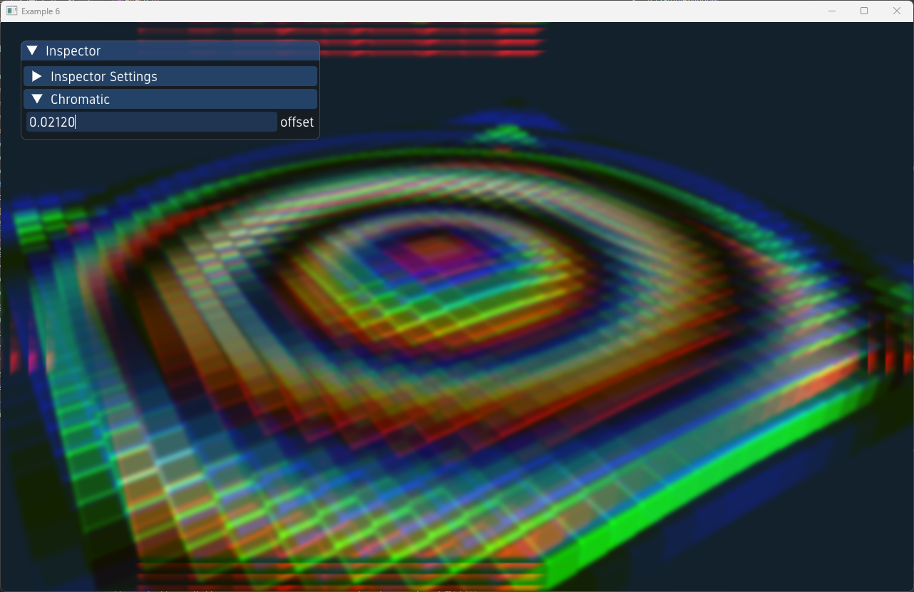

# Post-Processing Effects

Post-processing effects work on the finished image rather than on individual objects. The scene is first rendered into a texture, then each effect in turn reads the previous result and writes a new one, like a stack of filters. This is how you add bloom, fog, film grain, colour grading or stylised looks such as pixelation and halftone.



## Adding an effect

Effects belong to the `GLFWSceneWindow`. Turn on render-to-texture, create the effect, set its parameters, call `load()` to compile its shader, then add it:

```cpp
#include <ivf/vignette_effect.h>

int onSetup() override
{
    setRenderToTexture(true);   // effects only run when the scene renders to a texture

    auto vignette = ivf::VignetteEffect::create();
    vignette->setSize(1.2f);
    vignette->setSmoothness(0.8f);
    vignette->load();            // compile the shader before adding
    addEffect(vignette);

    return 0;
}
```

!!! warning "Remember `load()`"
    `addEffect()` registers the effect's compiled shader, so `load()` must be called first. An effect added without it is silently skipped.

## The effect chain

Effects run in the order you add them. Order matters, because each effect sees the output of the one before it:

1. **Depth-based effects first**: [fog](blur.md#fog) and [depth of field](blur.md#depth-of-field) read the scene depth buffer, which no longer matches the image once a distortion has moved pixels around.
2. **Colour and stylisation**: grading, tint, posterize, halftone and the [distortions](film_effects.md#distortion).
3. **Lens and film**: chromatic aberration, vignette, film grain, scanlines.
4. **Wide bloom last**: [`MipBloomEffect`](blur.md#mipbloomeffect) includes tone mapping, so it should see the final colours.

The scene image and the effects use floating-point colours, so values above 1 survive the whole chain. Tone mapping, exposure, gamma and FXAA run after all effects, as the window's output step: see [HDR and Tone Mapping](hdr.md).

## Controlling effects at runtime

Every added effect gets an index, starting at 0 in the order of `addEffect()` calls. Effects are enabled when added.

| Method | Description |
|--------|-------------|
| `enableEffect(i)` / `disableEffect(i)` | Turn one effect on or off |
| `isEffectEnabled(i)` | Whether an effect is active |
| `disableAllEffects()` | Turn every effect off |
| `reorderEffect(from, to)` | Move an effect to another position in the chain |
| `effect(i)` / `getEffectCount()` | Access effects by index |
| `clearEffects()` | Remove all effects |

To change parameters every frame, for example to pulse the bloom with the music, override `onUpdateEffects()`. It is called just before the effects are applied:

```cpp
void onUpdateEffects() override
{
    float t = static_cast<float>(ivf::TimeController::instance()->elapsed());
    m_bloom->setIntensity(0.6f + 0.3f * std::sin(t * 2.0f));
}
```

### Effect inspector

`showEffectInspector()` opens an ImGui window listing every effect in the chain. You can toggle, reorder and tweak them while the program runs, which is the fastest way to find good values before writing them into code. You can also open it by pressing **E** in the window, or from the main menu.

## Available effects

| Effect | What it does | Guide |
|--------|--------------|-------|
| `BlurEffect` | Gaussian-style blur of the whole image | [Blur, Bloom and Depth](blur.md) |
| `BloomEffect` | Glow around bright areas | [Blur, Bloom and Depth](blur.md) |
| `MipBloomEffect` | Wide, soft bloom with tone mapping | [Blur, Bloom and Depth](blur.md) |
| `DepthOfFieldEffect` | Camera-style focus with bokeh blur | [Blur, Bloom and Depth](blur.md) |
| `FogEffect` | Distance and height fog from the depth buffer | [Blur, Bloom and Depth](blur.md) |
| `MotionBlurEffect` | Smears moving content using the previous frame | [Blur, Bloom and Depth](blur.md) |
| `TintEffect` | Colourise towards a tint colour | [Colour Effects](color_effects.md) |
| `ColorGradingEffect` | Shadows, midtones and highlights, contrast and saturation | [Colour Effects](color_effects.md) |
| `PosterizeEffect` | Reduce the number of colour levels | [Colour Effects](color_effects.md) |
| `DitheringEffect` | Dither pattern that reduces banding | [Colour Effects](color_effects.md) |
| `HalftoneEffect` | Print-style dot screen | [Colour Effects](color_effects.md) |
| `NightVisionEffect` | Green phosphor night-vision look | [Colour Effects](color_effects.md) |
| `EdgeDetectionEffect` | Outlines the edges in the image | [Colour Effects](color_effects.md) |
| `FadeEffect` | Fade to a solid colour | [Colour Effects](color_effects.md) |
| `FilmgrainEffect` | Animated film grain | [Film and Distortion](film_effects.md) |
| `VignetteEffect` | Darkened edges | [Film and Distortion](film_effects.md) |
| `ChromaticEffect` | Chromatic aberration (colour fringing) | [Film and Distortion](film_effects.md) |
| `ScanlineEffect` | CRT scanlines | [Film and Distortion](film_effects.md) |
| `GlitchEffect` | Digital block glitches | [Film and Distortion](film_effects.md) |
| `PixelationEffect` | Large blocky pixels | [Film and Distortion](film_effects.md) |
| `WaveDistortionEffect` | Rippling distortion | [Film and Distortion](film_effects.md) |
| `SwirlEffect` | Twist around the centre | [Film and Distortion](film_effects.md) |
| `KaleidoscopeEffect` | Mirrored kaleidoscope segments | [Film and Distortion](film_effects.md) |
| `FeedbackEffect` | Video feedback: trails, smears and zoom tunnels | [Film and Distortion](film_effects.md) |

To write your own, see [Custom Effects](custom_effects.md).

## Examples

- `effects1` adds all of the stylisation effects with a panel to switch between them. See [Effects Examples](../examples/effects_examples.md).
- `fog1`, `dof1` and `mip_bloom1` each focus on one depth or bloom effect.
- `hdr1` shows bright lights with tone mapping, exposure, bloom in HDR, FXAA and MSAA (see [HDR and Tone Mapping](hdr.md)).
