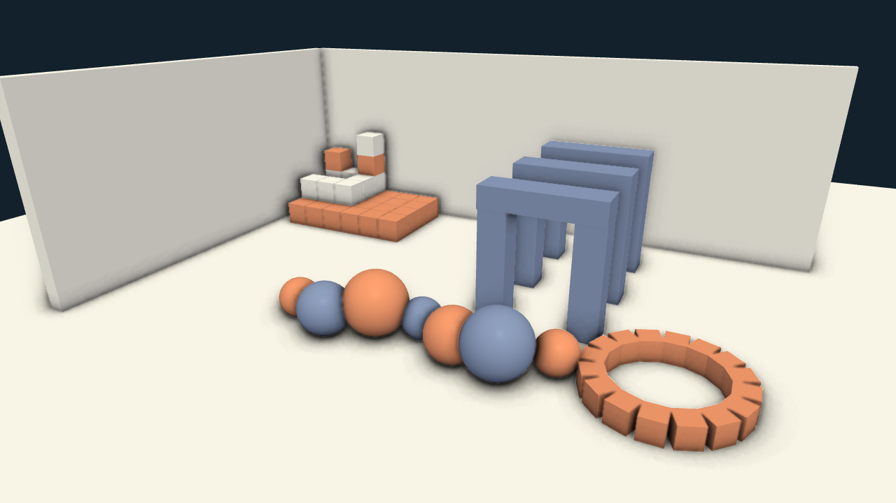
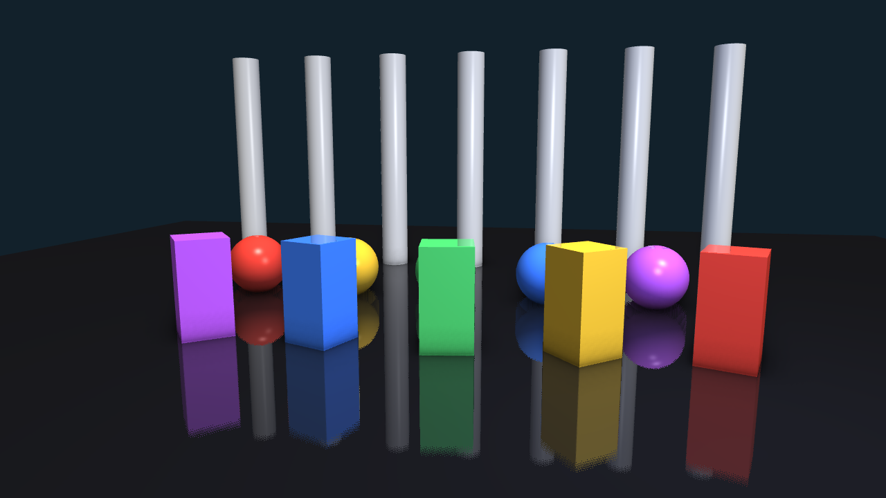

# Ambient Occlusion and Reflections

Two effects add lighting detail from the depth buffer of the rendered image: `SsaoEffect` darkens creases, corners and the ground under objects, and `ScreenSpaceReflectionEffect` reflects the scene in floors and other surfaces facing up. Both are post-processing effects, so they need render to texture and work with any material.

<!-- Run in the browser: generated by docs/tools/make_gallery.py from the Example Index -->
!!! example "Run in the browser"

    [`ssao1`](https://jonaslindemann.github.io/ivf2/web/ssao1.html) · [`ssr1`](https://jonaslindemann.github.io/ivf2/web/ssr1.html)

<!-- /Run in the browser -->

Like all screen-space techniques, they only know what is on screen: objects outside the image or hidden behind others neither occlude nor appear in reflections.

## Ambient occlusion



Ambient light reaches open surfaces from all sides, but less of it gets into corners and gaps. `SsaoEffect` estimates this for every pixel: it tests points in the hemisphere above the surface and counts how many lie behind other surfaces. A blur that stops at depth edges removes the noise of the sampling.

```cpp
#include <ivf/ssao_effect.h>

setRenderToTexture(true);
auto ssao = ivf::SsaoEffect::create();
ssao->setRadius(0.5f);   // world units: the size of the creases that darken
ssao->load();
addEffect(ssao);
```

| Function | Default | Description |
|----------|---------|-------------|
| `setRadius(r)` | 0.5 | How far away (world units) surfaces still occlude. Match it to the scale of the scene's details |
| `setIntensity(i)` | 1 | 0 leaves the image unchanged, 1 applies the full occlusion |
| `setPower(p)` | 1.5 | Contrast: higher values darken deep creases more |
| `setBias(b)` | 0.025 | Depth offset (world units) against flat surfaces darkening themselves |
| `setSamples(n)` | 16 | Samples per pixel, 1-64: more is smoother and slower |
| `setBlurRadius(r)` | 2 | Blur radius in pixels, 0-4 |
| `setShowOcclusion(true)` | false | Show the occlusion as a grey image, for tuning |

Add SSAO as the first effect, before effects that change colours or blur the image. It darkens all light, not only the ambient part; with strong direct light, an intensity below 1 often looks more natural.

## Screen-space reflections



For each pixel of a reflecting surface, `ScreenSpaceReflectionEffect` follows the reflected ray through the depth buffer. Where the ray passes behind a visible surface, that pixel's colour is the reflection. Rough surfaces take it from a blurred version of the image.

```cpp
#include <ivf/screen_space_reflection_effect.h>

auto ssr = ivf::ScreenSpaceReflectionEffect::create();
ssr->setStrength(0.7f);
ssr->setRoughness(0.1f);
ssr->load();
addEffect(ssr);
```

There is no per-material reflectivity: surfaces reflect when their normal is within `setSurfaceAngle()` of `setUpDirection()` - by default everything facing up, such as floors and water. Make reflecting floors dark and smooth-looking; the reflection is mixed over their colour.

| Function | Default | Description |
|----------|---------|-------------|
| `setStrength(s)` | 0.6 | Reflection amount, 0-1 |
| `setRoughness(r)` | 0 | 0 sharp mirror, 1 strongly blurred |
| `setFresnel(f)` | 0.5 | 0 reflects equally at all angles, 1 mostly at grazing angles (like real floors and water) |
| `setMaxDistance(d)` | 20 | Longest reflected ray in world units; reflections fade towards it |
| `setSteps(n)` | 48 | Ray march steps, 4-128: more finds thin objects |
| `setThickness(t)` | 0.5 | How thick surfaces are assumed to be (world units); too small lets rays slip through objects, too large smears them |
| `setSurfaceAngle(deg)` | 25 | Largest angle between a reflecting surface's normal and the up direction |
| `setUpDirection(v)` | (0, 1, 0) | Normal direction of the reflecting surfaces |
| `setEdgeFade(f)` | 0.1 | Fade towards the screen edges, as a fraction of the screen |
| `setShowReflections(true)` | false | Show only the reflections, for tuning |

Reflections fade where the reflected ray leaves the screen; things behind the camera or off screen are not reflected. For an exact mirror of a flat surface, use `PlanarReflection` (see [Shader Materials](../core/shader_materials.md#watermaterial)), which renders the scene a second time.

With both effects, add SSAO first so the reflections show the occluded image.

## Examples

- `ssao1`: blocks, arches, spheres and a ring of cubes in a corner, with sliders for every setting
- `ssr1`: columns, spheres and turning blocks reflected in a dark floor, combined with SSAO

## Related

- [Effects overview](index.md)
- [Custom Effects](custom_effects.md): the depth inputs these effects use
