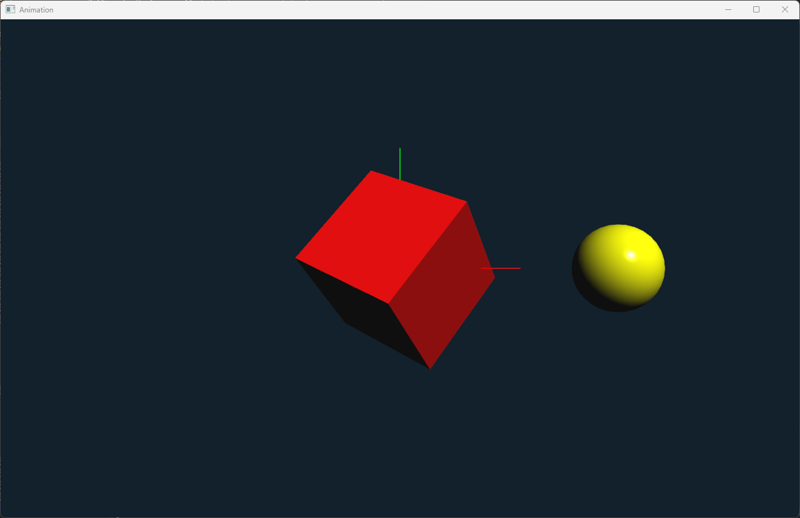
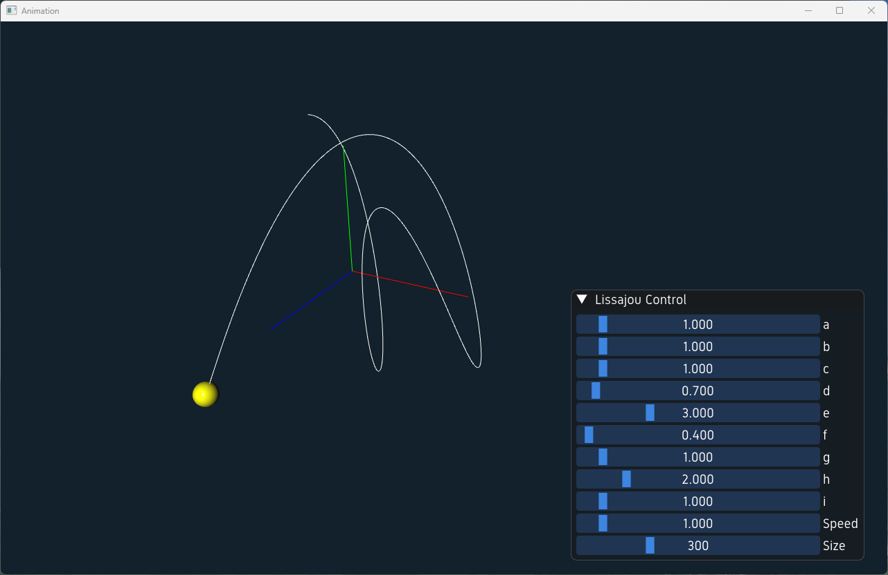
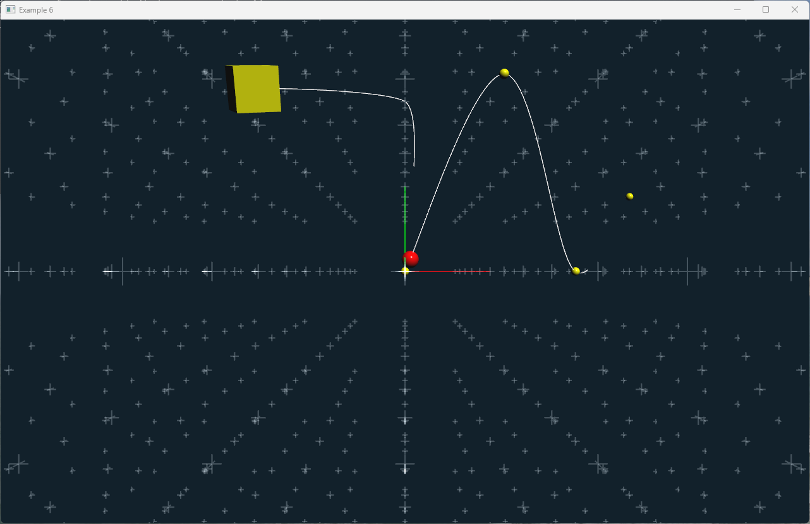

# Animation examples

In the following examples, we will explore how to create animations using the ivf2 library. We will demonstrate how to use the `onUpdate()` function to create smooth animations and how to control animations using ImGui windows.

## Animation using onUpdate()



A cube spins around a diagonal axis while a small sphere orbits it. Both are animated in `onUpdate()` from `elapsedTime()`, so they turn at the same speed on any computer. The orbit comes from putting the sphere in a `Transform` group and rotating the group. See [Basic Animation](../animation/basic_animation.md).

### animation1.cpp

```cpp
--8<-- "examples/animation1/animation1.cpp"
```

## Animation controlled by ImGui Window



A sphere traces a 3D Lissajous curve, leaving a trail drawn with `LineTrace`. An ImGui window has sliders for all nine curve parameters, the speed and the trail length, so you can explore the shapes live. See [Lissajous Curves](../animation/lissajous.md).

### lissajou_window.h 

```cpp
--8<-- "examples/animation2/lissajou_window.h"
```

### lissajou_window.cpp

```cpp
--8<-- "examples/animation2/lissajou_window.cpp"
```

### animation2.cpp

```cpp
--8<-- "examples/animation2/animation2.cpp"
```

## Animation using Splines and Keyframes



In this example, we will create a more complex animation using splines and keyframes. A sphere moves along a spline through four control points, and a cube is animated with keyframes that set its position and rotation over 15 seconds. To illustrate the animation a trace is drawn along both of the object using the `LineTrace` node. 

### animation3.cpp

```cpp
--8<-- "examples/animation3/animation3.cpp"
```

## Related guides

- [Basic Animation](../animation/basic_animation.md)
- [Keyframe Animation](../animation/keyframe_animation.md)
- [Spline Animation](../animation/spline_animation.md)
- [Lissajous Curves](../animation/lissajous.md)
- [Choosing an Animation Tool](../animation/choosing.md)

All examples are listed in the [Example Index](index.md).
