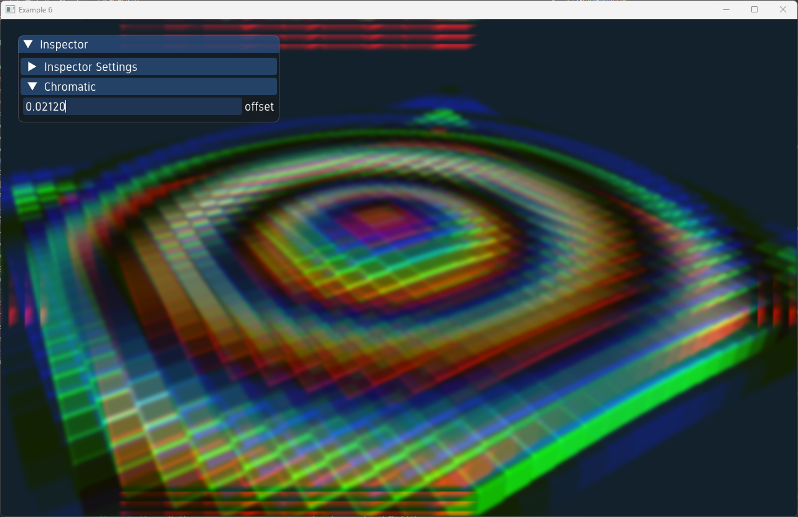
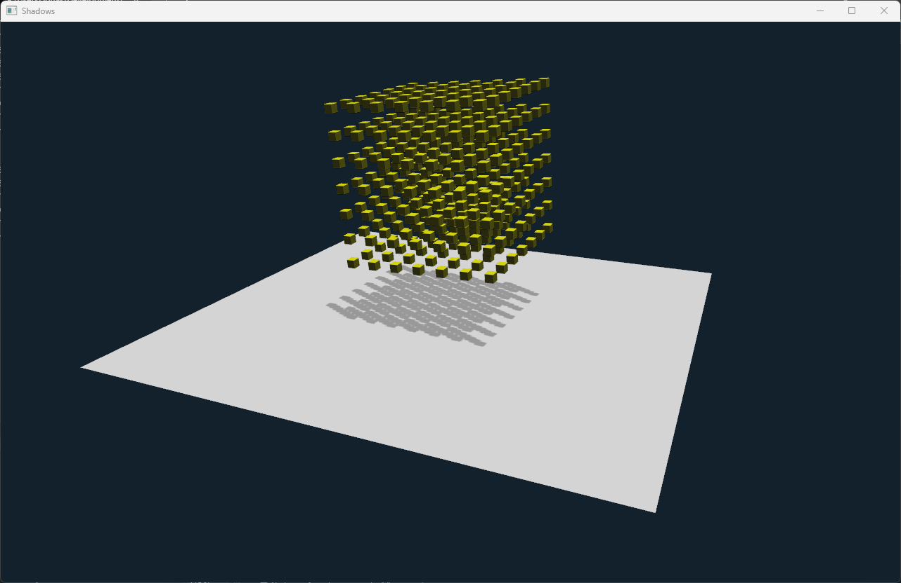

# Effect examples

In this section, we will explore how to create and use effects in the ivf2 library. Effects allow us to apply post-processing effects to the rendered image and add shadows to the scene.


## Post-Processing Effects Example



In this example we illustrate the different post-processing effects available in the ivf2 library. It adds 19 effects, from blur and bloom to kaleidoscope, glitch and halftone, and lets you switch between them while it runs. Press **E** to open the effect inspector and tweak the parameters.

### effects1.cpp

```cpp
--8<-- "examples/effects1/effects1.cpp"
```

## Shadow Mapping Example



In this example, we demonstrate how to implement shadow mapping in the ivf2 library. The scene includes a textured cube and a sphere, with shadows cast by a directional light source. 

### shadows1.cpp

```cpp
--8<-- "examples/shadows1/shadows1.cpp"
```

## Related guides

- [Post-Processing Effects](../effects/index.md)
- [Shadows](../advanced/shadows.md)

All examples are listed in the [Example Index](index.md).
