# Example Gallery

<!-- Generated by docs/tools/make_gallery.py from the Example Index; edit the index, not this page. -->

Every example with a picture of what it draws, grouped like the [Example Index](index.md). Click a picture for the guide that explains it (or the source, if there is no guide); hover for a short description. The pictures are the reference images of the visual tests, so they show exactly what each program renders.

## Getting started

- [ hello_ivf](../getting_started/basic_concepts.md "A scene built by hand in a plain GLFWWindow: shaders, lights, a scene graph and drawing it yourself")
- [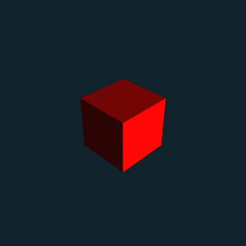 hello_pipeline](../getting_started/basic_concepts.md "The minimal rendering pipeline, step by step")

## Geometry

- [ primitives1](primitives_examples.md "All the basic primitives")
- [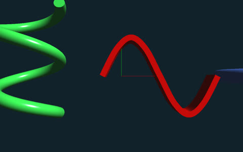 extrusions1](primitives_examples.md "Profiles swept along paths")
- [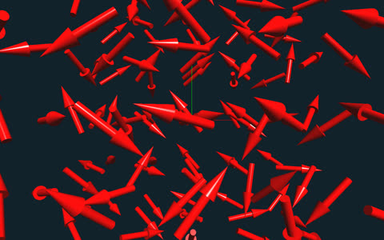 transforms1](primitives_examples.md "A grid of arrows with random orientations")
- [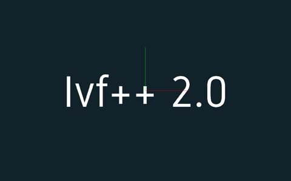 text1](../primitives/text.md "3D text with live editing")
- [ custom_mesh1](https://github.com/jonaslindemann/ivf2/tree/main/examples/custom_mesh1 "DynamicMesh for generated geometry: a Lissajous curve and a Lorenz attractor")
- [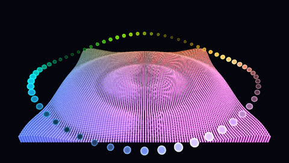 instancing1](https://github.com/jonaslindemann/ivf2/tree/main/examples/instancing1 "Thousands of copies of a mesh with InstancedMeshNode")
- [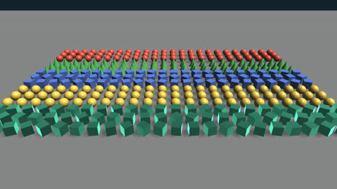 auto_instancing1](../core/nodes.md#instancenode-class "InstanceNode copies merged into instanced draw calls automatically; on/off switch and statistics")
- [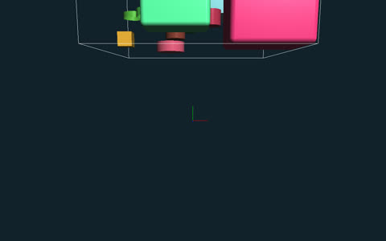 bbox1](../core/nodes.md "Bounding boxes of nested nodes")
- [ deformer1](../core/deformers.md "Twist and bend deformers with inspectors")
- [ deformer2](../core/deformers.md "Layered wave deformers for a water surface")
- [ deformer3](../core/deformers.md "Random and noise deformers")

## Materials, textures and lighting

- [ textures1](texture_examples.md "Image textures and texture modes")
- [ textures2](../core/materials_and_textures.md "Multitexturing with blend modes")
- [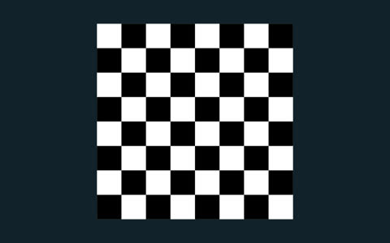 textures3](https://github.com/jonaslindemann/ivf2/tree/main/examples/textures3 "Textures generated on the GPU")
- [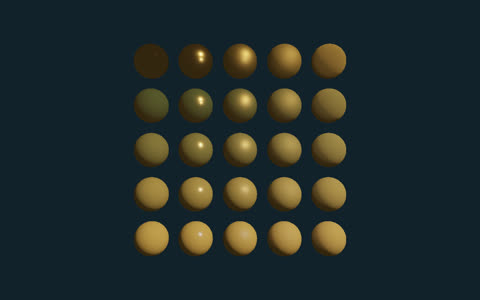 textures4](../core/pbr_and_ibl.md "PBRMaterial: a grid of spheres from rough to smooth and dielectric to metal")
- [ ibl1](../core/pbr_and_ibl.md "PBR spheres lit by an HDR environment (procedural sky or .hdr file), with the environment as skybox")
- [ procedural1](https://github.com/jonaslindemann/ivf2/tree/main/examples/procedural1 "Textures generated on the CPU: noise, marble, wood")
- [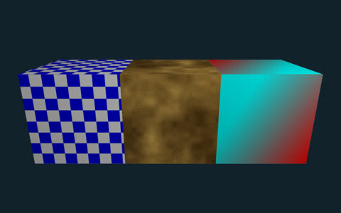 procedural2](https://github.com/jonaslindemann/ivf2/tree/main/examples/procedural2 "Animated GPU procedural textures")
- [ bump1](https://github.com/jonaslindemann/ivf2/tree/main/examples/bump1 "Normal maps with BumpMaterial")
- [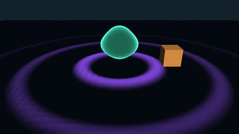 shader_material1](../core/shader_materials.md "Your own GLSL shaders on nodes, reloaded on save")
- [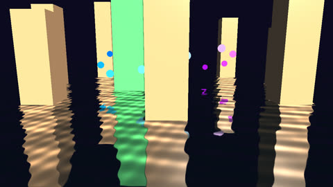 reflection1](../core/shader_materials.md#watermaterial "Reflecting water with PlanarReflection and WaterMaterial")
- [ skybox1](https://github.com/jonaslindemann/ivf2/tree/main/examples/skybox1 "A cubemap sky behind the scene")
- [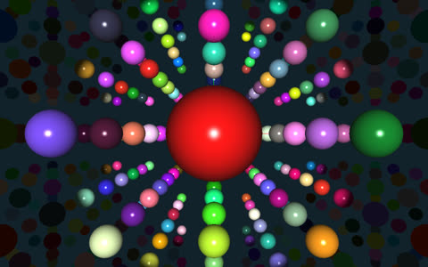 lighting1](../core/lighting.md "Point, directional and spot lights with editing windows")
- [ shadows1](../advanced/shadows.md "Shadow mapping from a directional light")
- [ cascaded_shadows1](../advanced/shadows.md#cascaded-shadow-maps "Cascaded shadow maps and PCF/PCSS soft shadows for a sun over a large scene")
- [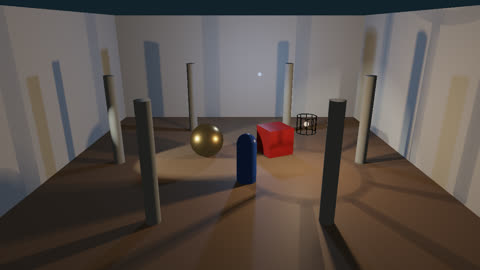 point_shadows1](../advanced/shadows.md#point-lights "Point lights casting soft shadows in all directions, and a spot light, onto PBR materials")
- [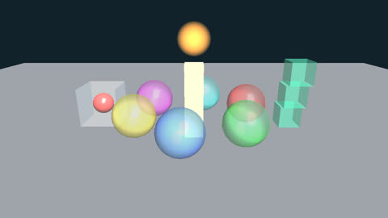 transparency1](../core/materials_and_textures.md#transparency "Transparent materials, a transparent group and a glow orb, sorted back to front")

## Effects

- [ effects1](../effects/index.md "Every stylisation effect, switchable from a panel")
- [ hdr1](../effects/hdr.md "Lights brighter than white with tone mapping (None, Reinhard, ACES, AgX), exposure, bloom in HDR, FXAA and MSAA")
- [ fog1](../effects/blur.md#fog "Distance and height fog")
- [ dof1](../effects/blur.md#depth-of-field "Depth of field")
- [ ssao1](../effects/screen_space.md#ambient-occlusion "Screen-space ambient occlusion")
- [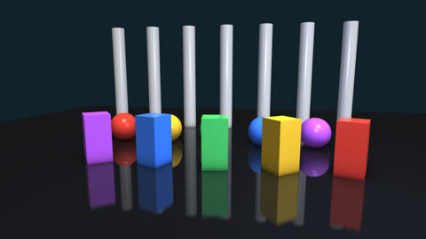 ssr1](../effects/screen_space.md#screen-space-reflections "Screen-space reflections on a polished floor, with SSAO")
- [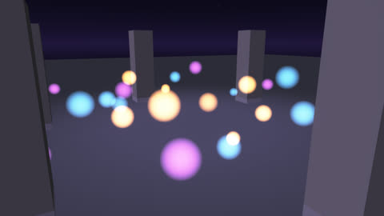 mip_bloom1](../effects/blur.md#mipbloomeffect "Wide bloom with glow, mist and sky materials and a guided camera")

## Animation and time

- [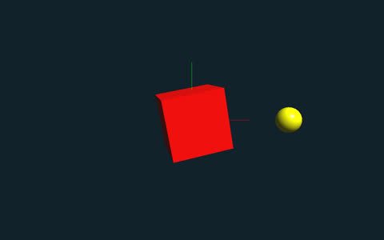 animation1](../animation/basic_animation.md "Animating in onUpdate()")
- [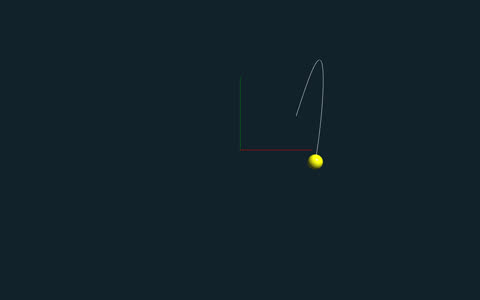 animation2](../animation/lissajous.md "A Lissajous curve with parameter sliders")
- [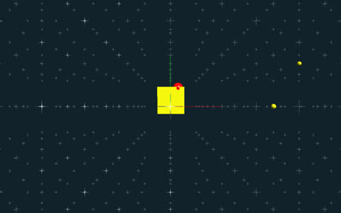 animation3](../animation/keyframe_animation.md "Spline and keyframe animation with traces")
- [ tweening1](../animation/choosing.md#tweens "Tweens with every easing curve")
- [ timeline1](../animation/choosing.md#scene-timelines "A sequence of three scripted scenes")
- [ camera_anim1](../animation/camera_animation.md "Camera fly-through with shake")
- [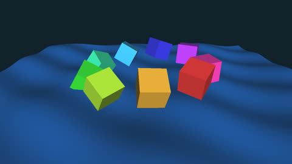 time_control1](../core/time_controller.md "Pause, slow motion and time scaling for a whole scene")
- [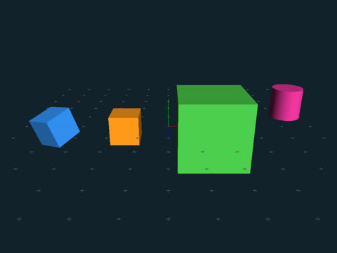 behaviors1](https://github.com/jonaslindemann/ivf2/tree/main/examples/behaviors1 "Reusable behaviours attached to nodes: spin, pulse, follow a spline")

## Creative coding and sound

- [ flow_field1](../creative/flow_field.md "8 000 particles steered by curl noise")
- [ particles1](https://github.com/jonaslindemann/ivf2/tree/main/examples/particles1 "Interactive fire and sparks with ParticleSystem")
- [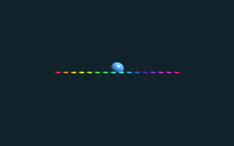 audio_reactive1](https://github.com/jonaslindemann/ivf2/tree/main/examples/audio_reactive1 "Visuals reacting to music or the microphone")
- [ music_scene1](../creative/music_scenes.md "A scene driven by a song, with automation and a camera path")
- [ frame_export1](https://github.com/jonaslindemann/ivf2/tree/main/examples/frame_export1 "Exporting a PNG sequence at an exact frame rate for video")
- [ solar_system](https://github.com/jonaslindemann/ivf2/tree/main/examples/solar_system "A small solar system simulation with its own control panel")

## Interaction and UI

- [ selection1](../advanced/selection.md "Highlighting objects under the mouse")
- [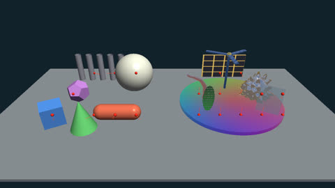 picking1](../advanced/selection.md#ray-picking "Ray picking: hit points, normals and triangles on primitives, instances and an animated glTF model")
- [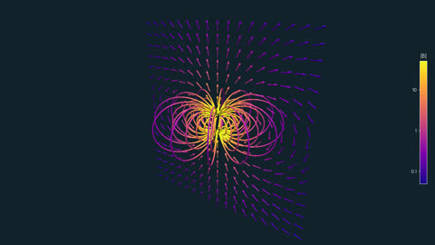 vis_vectors1](../visualisation/vector_fields.md "ivfvis: arrow glyphs and field-line tubes of a magnetic dipole, coloured on a log scale; click an arrow for its vector")
- [ vis_scalar1](../visualisation/scalar_fields.md "ivfvis: isosurfaces (a translucent shell and a surface coloured by height) and contoured slice planes through a 3D field, with live sliders")
- [ vis_points1](../visualisation/point_clouds.md "ivfvis: half a million points of the Lorenz attractor, coloured by speed on the GPU; sizes, shapes, transparency and point picking")
- [ vis_colormaps1](../visualisation/colormaps.md "ivfvis: the built-in colormaps on a height field, vertex colouring from grid data, and a colour bar")
- [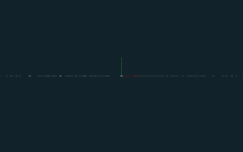 editor1](../advanced/selection.md#the-3d-cursor-position "Starting point for an editor: floor grid and the 3D mouse position")
- [ ui1](../ui/ui_windows.md "ImGui windows combined with a scene")
- [ ui2](../ui/ui_windows.md "ImGui windows combined with a scene")
- [ scene_ui1](../ui/ui_windows.md "ImGui windows combined with a scene")
- [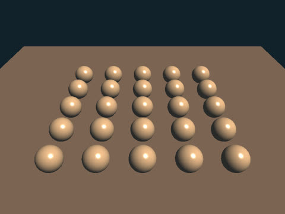 multi_window1](../advanced/render_context.md "Two windows, each with its own scene, lights and user interface")
- [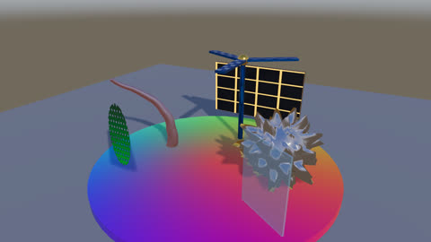 gltf1](../advanced/model_loading.md#gltf-models "A glTF 2.0 model with PBR textures, alpha, a skinned tentacle, morph targets and animations (or any .glb given on the command line)")
- [ assimp1](../advanced/model_loading.md "Opening any model file through a file dialog")
- [ serialization1](https://github.com/jonaslindemann/ivf2/tree/main/examples/serialization1 "Saving, loading and clearing a scene as JSON")
- [ hot_reload1](../advanced/hot_reload.md "A model, a texture and a shader that reload when their files are saved")
- [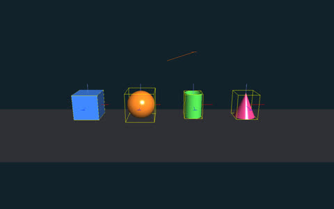 debug_draw1](https://github.com/jonaslindemann/ivf2/tree/main/examples/debug_draw1 "Immediate-mode debug lines and shapes")
- [ rigid_body1](https://github.com/jonaslindemann/ivf2/tree/main/examples/rigid_body1 "Rigid-body physics with ReactPhysics3D")

