# Example Gallery

<!-- Generated by docs/tools/make_gallery.py from the Example Index; edit the index, not this page. -->

Every example with a picture of what it draws, grouped like the [Example Index](index.md). Click a picture for the guide that explains it (or the source, if there is no guide); hover for a short description. The pictures are the reference images of the visual tests, so they show exactly what each program renders.

**▶ Run** opens the example in your browser (WebGL 2), built from the current sources; all of them are on the [start page of the live examples](https://jonaslindemann.github.io/ivf2/web/). See [Running in the Browser](../getting_started/web.md).

## Getting started

- [ hello_ivf](../getting_started/basic_concepts.md "A scene built by hand in a plain GLFWWindow: shaders, lights, a scene graph and drawing it yourself") [▶ Run](https://jonaslindemann.github.io/ivf2/web/hello_ivf.html){ .ivf-run title="Run hello_ivf in the browser" }
- [ hello_pipeline](../getting_started/basic_concepts.md "The minimal rendering pipeline, step by step") [▶ Run](https://jonaslindemann.github.io/ivf2/web/hello_pipeline.html){ .ivf-run title="Run hello_pipeline in the browser" }

## Geometry

- [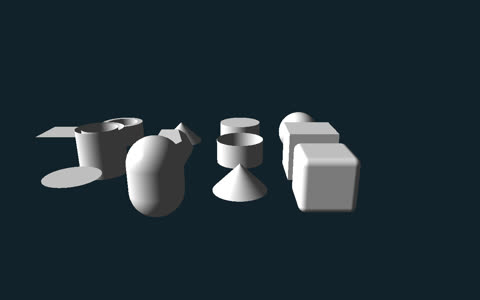 primitives1](primitives_examples.md "All the basic primitives") [▶ Run](https://jonaslindemann.github.io/ivf2/web/primitives1.html){ .ivf-run title="Run primitives1 in the browser" }
- [ extrusions1](primitives_examples.md "Profiles swept along paths") [▶ Run](https://jonaslindemann.github.io/ivf2/web/extrusions1.html){ .ivf-run title="Run extrusions1 in the browser" }
- [ transforms1](primitives_examples.md "A grid of arrows with random orientations") [▶ Run](https://jonaslindemann.github.io/ivf2/web/transforms1.html){ .ivf-run title="Run transforms1 in the browser" }
- [ text1](../primitives/text.md "3D text with live editing") [▶ Run](https://jonaslindemann.github.io/ivf2/web/text1.html){ .ivf-run title="Run text1 in the browser" }
- [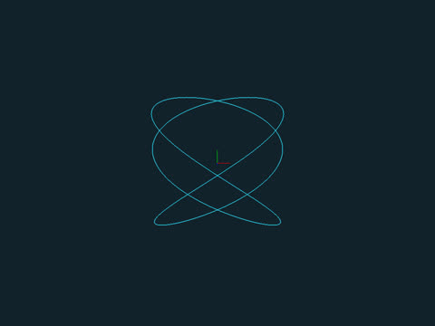 custom_mesh1](https://github.com/jonaslindemann/ivf2/tree/main/examples/custom_mesh1 "DynamicMesh for generated geometry: a Lissajous curve and a Lorenz attractor") [▶ Run](https://jonaslindemann.github.io/ivf2/web/custom_mesh1.html){ .ivf-run title="Run custom_mesh1 in the browser" }
- [ instancing1](https://github.com/jonaslindemann/ivf2/tree/main/examples/instancing1 "Thousands of copies of a mesh with InstancedMeshNode") [▶ Run](https://jonaslindemann.github.io/ivf2/web/instancing1.html){ .ivf-run title="Run instancing1 in the browser" }
- [ auto_instancing1](../core/nodes.md#instancenode-class "InstanceNode copies merged into instanced draw calls automatically; on/off switch and statistics") [▶ Run](https://jonaslindemann.github.io/ivf2/web/auto_instancing1.html){ .ivf-run title="Run auto_instancing1 in the browser" }
- [ bbox1](../core/nodes.md "Bounding boxes of nested nodes") [▶ Run](https://jonaslindemann.github.io/ivf2/web/bbox1.html){ .ivf-run title="Run bbox1 in the browser" }
- [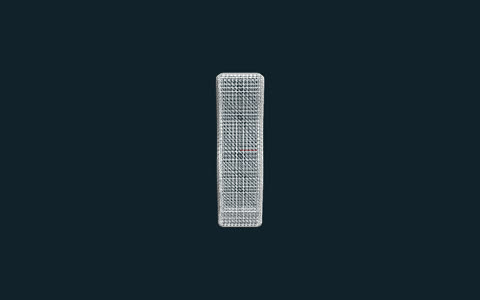 deformer1](../core/deformers.md "Twist and bend deformers with inspectors") [▶ Run](https://jonaslindemann.github.io/ivf2/web/deformer1.html){ .ivf-run title="Run deformer1 in the browser" }
- [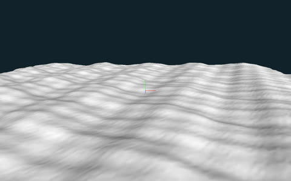 deformer2](../core/deformers.md "Layered wave deformers for a water surface") [▶ Run](https://jonaslindemann.github.io/ivf2/web/deformer2.html){ .ivf-run title="Run deformer2 in the browser" }
- [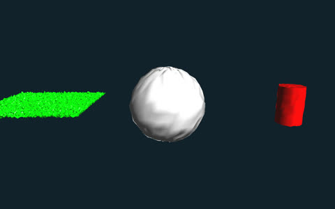 deformer3](../core/deformers.md "Random and noise deformers") [▶ Run](https://jonaslindemann.github.io/ivf2/web/deformer3.html){ .ivf-run title="Run deformer3 in the browser" }

## Materials, textures and lighting

- [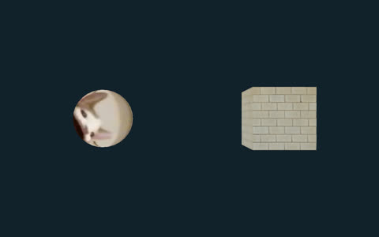 textures1](texture_examples.md "Image textures and texture modes") [▶ Run](https://jonaslindemann.github.io/ivf2/web/textures1.html){ .ivf-run title="Run textures1 in the browser" }
- [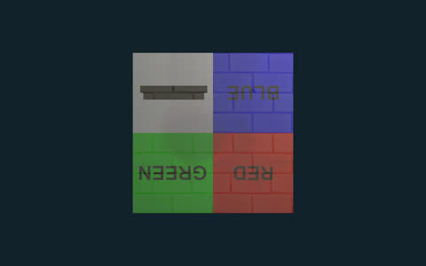 textures2](../core/materials_and_textures.md "Multitexturing with blend modes") [▶ Run](https://jonaslindemann.github.io/ivf2/web/textures2.html){ .ivf-run title="Run textures2 in the browser" }
- [ textures3](https://github.com/jonaslindemann/ivf2/tree/main/examples/textures3 "Textures generated on the GPU") [▶ Run](https://jonaslindemann.github.io/ivf2/web/textures3.html){ .ivf-run title="Run textures3 in the browser" }
- [ textures4](../core/pbr_and_ibl.md "PBRMaterial: a grid of spheres from rough to smooth and dielectric to metal") [▶ Run](https://jonaslindemann.github.io/ivf2/web/textures4.html){ .ivf-run title="Run textures4 in the browser" }
- [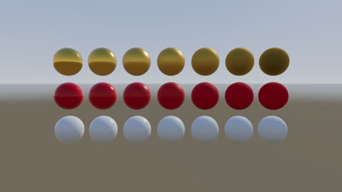 ibl1](../core/pbr_and_ibl.md "PBR spheres lit by an HDR environment (procedural sky or .hdr file), with the environment as skybox") [▶ Run](https://jonaslindemann.github.io/ivf2/web/ibl1.html){ .ivf-run title="Run ibl1 in the browser" }
- [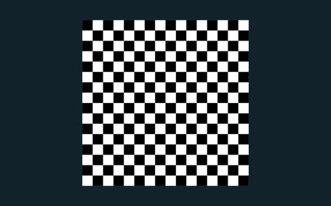 procedural1](https://github.com/jonaslindemann/ivf2/tree/main/examples/procedural1 "Textures generated on the CPU: noise, marble, wood") [▶ Run](https://jonaslindemann.github.io/ivf2/web/procedural1.html){ .ivf-run title="Run procedural1 in the browser" }
- [ procedural2](https://github.com/jonaslindemann/ivf2/tree/main/examples/procedural2 "Animated GPU procedural textures") [▶ Run](https://jonaslindemann.github.io/ivf2/web/procedural2.html){ .ivf-run title="Run procedural2 in the browser" }
- [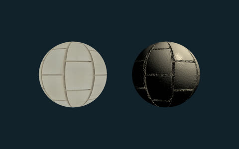 bump1](https://github.com/jonaslindemann/ivf2/tree/main/examples/bump1 "Normal maps with BumpMaterial") [▶ Run](https://jonaslindemann.github.io/ivf2/web/bump1.html){ .ivf-run title="Run bump1 in the browser" }
- [ shader_material1](../core/shader_materials.md "Your own GLSL shaders on nodes, reloaded on save") [▶ Run](https://jonaslindemann.github.io/ivf2/web/shader_material1.html){ .ivf-run title="Run shader_material1 in the browser" }
- [ reflection1](../core/shader_materials.md#watermaterial "Reflecting water with PlanarReflection and WaterMaterial") [▶ Run](https://jonaslindemann.github.io/ivf2/web/reflection1.html){ .ivf-run title="Run reflection1 in the browser" }
- [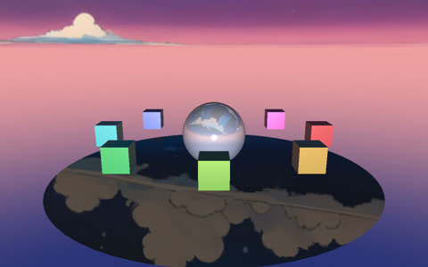 skybox1](https://github.com/jonaslindemann/ivf2/tree/main/examples/skybox1 "A cubemap sky behind the scene") [▶ Run](https://jonaslindemann.github.io/ivf2/web/skybox1.html){ .ivf-run title="Run skybox1 in the browser" }
- [ lighting1](../core/lighting.md "Point, directional and spot lights with editing windows") [▶ Run](https://jonaslindemann.github.io/ivf2/web/lighting1.html){ .ivf-run title="Run lighting1 in the browser" }
- [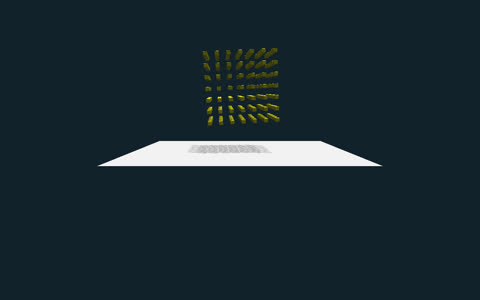 shadows1](../advanced/shadows.md "Shadow mapping from a directional light") [▶ Run](https://jonaslindemann.github.io/ivf2/web/shadows1.html){ .ivf-run title="Run shadows1 in the browser" }
- [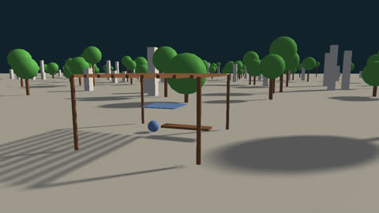 cascaded_shadows1](../advanced/shadows.md#cascaded-shadow-maps "Cascaded shadow maps and PCF/PCSS soft shadows for a sun over a large scene") [▶ Run](https://jonaslindemann.github.io/ivf2/web/cascaded_shadows1.html){ .ivf-run title="Run cascaded_shadows1 in the browser" }
- [ point_shadows1](../advanced/shadows.md#point-lights "Point lights casting soft shadows in all directions, and a spot light, onto PBR materials") [▶ Run](https://jonaslindemann.github.io/ivf2/web/point_shadows1.html){ .ivf-run title="Run point_shadows1 in the browser" }
- [ transparency1](../core/materials_and_textures.md#transparency "Transparent materials, a transparent group and a glow orb, sorted back to front") [▶ Run](https://jonaslindemann.github.io/ivf2/web/transparency1.html){ .ivf-run title="Run transparency1 in the browser" }

## Effects

- [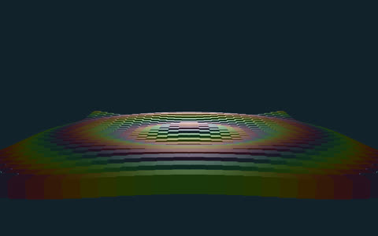 effects1](../effects/index.md "Every stylisation effect, switchable from a panel") [▶ Run](https://jonaslindemann.github.io/ivf2/web/effects1.html){ .ivf-run title="Run effects1 in the browser" }
- [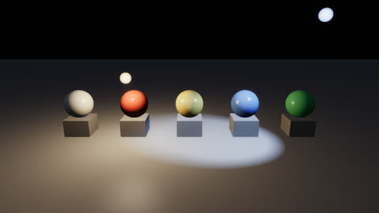 hdr1](../effects/hdr.md "Lights brighter than white with tone mapping (None, Reinhard, ACES, AgX), exposure, bloom in HDR, FXAA and MSAA") [▶ Run](https://jonaslindemann.github.io/ivf2/web/hdr1.html){ .ivf-run title="Run hdr1 in the browser" }
- [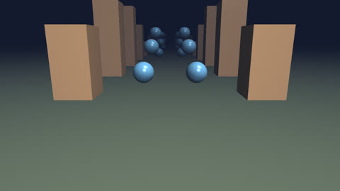 fog1](../effects/blur.md#fog "Distance and height fog") [▶ Run](https://jonaslindemann.github.io/ivf2/web/fog1.html){ .ivf-run title="Run fog1 in the browser" }
- [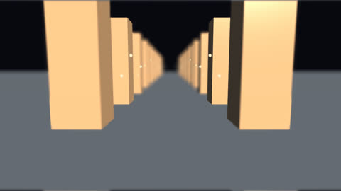 dof1](../effects/blur.md#depth-of-field "Depth of field") [▶ Run](https://jonaslindemann.github.io/ivf2/web/dof1.html){ .ivf-run title="Run dof1 in the browser" }
- [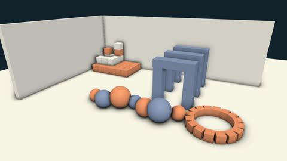 ssao1](../effects/screen_space.md#ambient-occlusion "Screen-space ambient occlusion") [▶ Run](https://jonaslindemann.github.io/ivf2/web/ssao1.html){ .ivf-run title="Run ssao1 in the browser" }
- [ ssr1](../effects/screen_space.md#screen-space-reflections "Screen-space reflections on a polished floor, with SSAO") [▶ Run](https://jonaslindemann.github.io/ivf2/web/ssr1.html){ .ivf-run title="Run ssr1 in the browser" }
- [ mip_bloom1](../effects/blur.md#mipbloomeffect "Wide bloom with glow, mist and sky materials and a guided camera") [▶ Run](https://jonaslindemann.github.io/ivf2/web/mip_bloom1.html){ .ivf-run title="Run mip_bloom1 in the browser" }

## Animation and time

- [ animation1](../animation/basic_animation.md "Animating in onUpdate()") [▶ Run](https://jonaslindemann.github.io/ivf2/web/animation1.html){ .ivf-run title="Run animation1 in the browser" }
- [ animation2](../animation/lissajous.md "A Lissajous curve with parameter sliders") [▶ Run](https://jonaslindemann.github.io/ivf2/web/animation2.html){ .ivf-run title="Run animation2 in the browser" }
- [ animation3](../animation/keyframe_animation.md "Spline and keyframe animation with traces") [▶ Run](https://jonaslindemann.github.io/ivf2/web/animation3.html){ .ivf-run title="Run animation3 in the browser" }
- [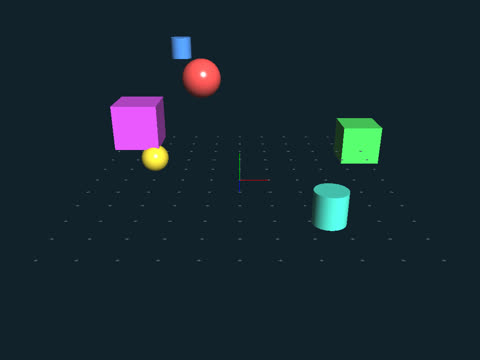 tweening1](../animation/choosing.md#tweens "Tweens with every easing curve") [▶ Run](https://jonaslindemann.github.io/ivf2/web/tweening1.html){ .ivf-run title="Run tweening1 in the browser" }
- [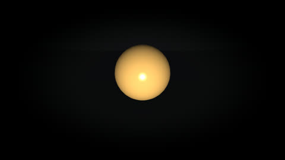 timeline1](../animation/choosing.md#scene-timelines "A sequence of three scripted scenes") [▶ Run](https://jonaslindemann.github.io/ivf2/web/timeline1.html){ .ivf-run title="Run timeline1 in the browser" }
- [ camera_anim1](../animation/camera_animation.md "Camera fly-through with shake") [▶ Run](https://jonaslindemann.github.io/ivf2/web/camera_anim1.html){ .ivf-run title="Run camera_anim1 in the browser" }
- [ time_control1](../core/time_controller.md "Pause, slow motion and time scaling for a whole scene") [▶ Run](https://jonaslindemann.github.io/ivf2/web/time_control1.html){ .ivf-run title="Run time_control1 in the browser" }
- [ behaviors1](https://github.com/jonaslindemann/ivf2/tree/main/examples/behaviors1 "Reusable behaviours attached to nodes: spin, pulse, follow a spline") [▶ Run](https://jonaslindemann.github.io/ivf2/web/behaviors1.html){ .ivf-run title="Run behaviors1 in the browser" }

## Scientific visualisation

- [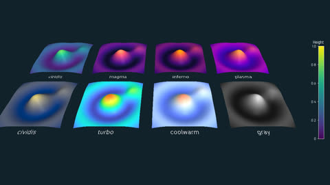 vis_colormaps1](../visualisation/colormaps.md "The built-in colormaps on a height field, vertex colouring from grid data, and a colour bar") [▶ Run](https://jonaslindemann.github.io/ivf2/web/vis_colormaps1.html){ .ivf-run title="Run vis_colormaps1 in the browser" }
- [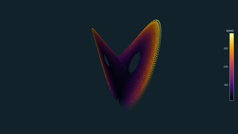 vis_points1](../visualisation/point_clouds.md "Half a million points of the Lorenz attractor, coloured by speed on the GPU; sizes, shapes, transparency and point picking") [▶ Run](https://jonaslindemann.github.io/ivf2/web/vis_points1.html){ .ivf-run title="Run vis_points1 in the browser" }
- [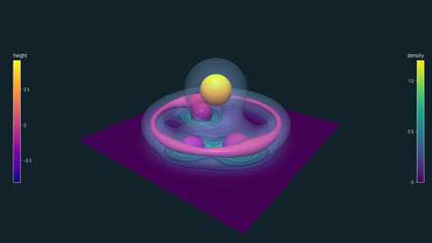 vis_scalar1](../visualisation/scalar_fields.md "Isosurfaces (a translucent shell and a surface coloured by height) and contoured slice planes through a 3D field, with live sliders") [▶ Run](https://jonaslindemann.github.io/ivf2/web/vis_scalar1.html){ .ivf-run title="Run vis_scalar1 in the browser" }
- [ vis_vectors1](../visualisation/vector_fields.md "Arrow glyphs and field-line tubes of a magnetic dipole, coloured on a log scale; click an arrow for its vector") [▶ Run](https://jonaslindemann.github.io/ivf2/web/vis_vectors1.html){ .ivf-run title="Run vis_vectors1 in the browser" }
- [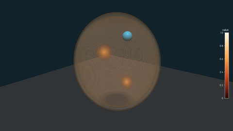 vis_volume1](../visualisation/volumes.md "Volume rendering of a CT-like scan with an opacity transfer function, mixed with an opaque isosurface and a floor") [▶ Run](https://jonaslindemann.github.io/ivf2/web/vis_volume1.html){ .ivf-run title="Run vis_volume1 in the browser" }
- [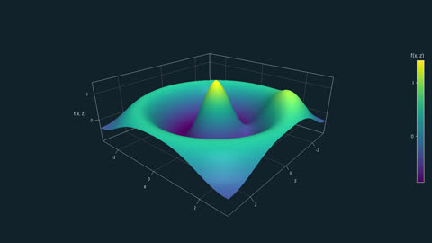 vis_axes1](../visualisation/axes.md "A surface plot with 3D axes: grid walls, ticks and labels in data units that follow the camera") [▶ Run](https://jonaslindemann.github.io/ivf2/web/vis_axes1.html){ .ivf-run title="Run vis_axes1 in the browser" }
- [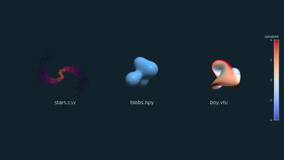 vis_readers1](../visualisation/readers.md "Reading a CSV table as a point cloud, a NumPy array as an isosurface and a VTK XML mesh coloured by curvature") [▶ Run](https://jonaslindemann.github.io/ivf2/web/vis_readers1.html){ .ivf-run title="Run vis_readers1 in the browser" }
- [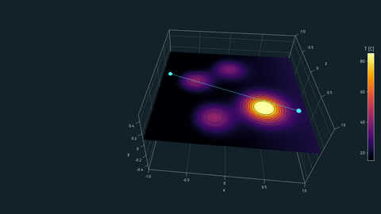 vis_dashboard1](../visualisation/plots.md "A 3D slice linked to ImPlot plots: a probe profile and a histogram whose drag lines set the colour range") [▶ Run](https://jonaslindemann.github.io/ivf2/web/vis_dashboard1.html){ .ivf-run title="Run vis_dashboard1 in the browser" }

## Physics

- [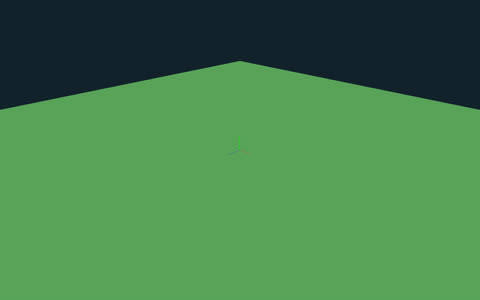 rigid_body1](../physics/index.md "A pile of bodies whose shapes come from their nodes; dragging, throwing, the debug view and statistics") [▶ Run](https://jonaslindemann.github.io/ivf2/web/rigid_body1.html){ .ivf-run title="Run rigid_body1 in the browser" }
- [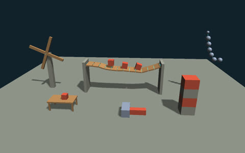 physics_joints1](../physics/joints.md "Joints, motors, breakable welds and compound bodies: a bridge, a chain, a windmill, a piston, a tower and a table") [▶ Run](https://jonaslindemann.github.io/ivf2/web/physics_joints1.html){ .ivf-run title="Run physics_joints1 in the browser" }
- [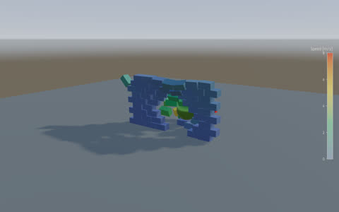 physics_sandbox1](../physics/interaction.md "An interactive physics sandbox: presets, throwing, dragging, bodies coloured by speed") [▶ Run](https://jonaslindemann.github.io/ivf2/web/physics_sandbox1.html){ .ivf-run title="Run physics_sandbox1 in the browser" }

## Creative coding and sound

- [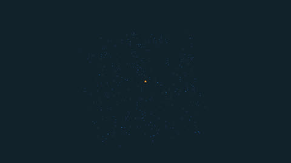 flow_field1](../creative/flow_field.md "8 000 particles steered by curl noise") [▶ Run](https://jonaslindemann.github.io/ivf2/web/flow_field1.html){ .ivf-run title="Run flow_field1 in the browser" }
- [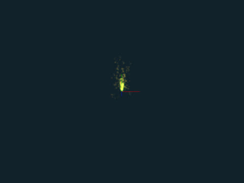 particles1](https://github.com/jonaslindemann/ivf2/tree/main/examples/particles1 "Interactive fire and sparks with ParticleSystem") [▶ Run](https://jonaslindemann.github.io/ivf2/web/particles1.html){ .ivf-run title="Run particles1 in the browser" }
- [ audio_reactive1](https://github.com/jonaslindemann/ivf2/tree/main/examples/audio_reactive1 "Visuals reacting to music or the microphone")
- [ music_scene1](../creative/music_scenes.md "A scene driven by a song, with automation and a camera path")
- [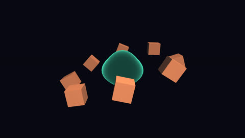 frame_export1](https://github.com/jonaslindemann/ivf2/tree/main/examples/frame_export1 "Exporting a PNG sequence at an exact frame rate for video") [▶ Run](https://jonaslindemann.github.io/ivf2/web/frame_export1.html){ .ivf-run title="Run frame_export1 in the browser" }
- [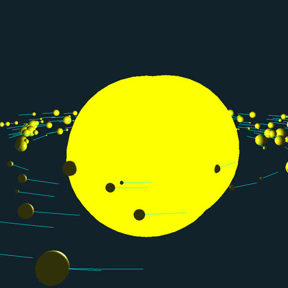 solar_system](https://github.com/jonaslindemann/ivf2/tree/main/examples/solar_system "A small solar system simulation with its own control panel") [▶ Run](https://jonaslindemann.github.io/ivf2/web/solar_system.html){ .ivf-run title="Run solar_system in the browser" }

## Interaction and UI

- [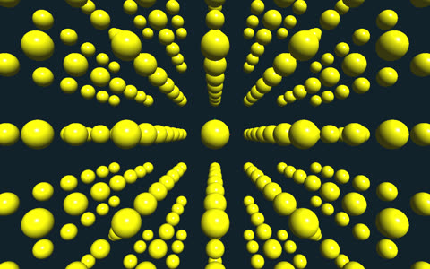 selection1](../advanced/selection.md "Highlighting objects under the mouse") [▶ Run](https://jonaslindemann.github.io/ivf2/web/selection1.html){ .ivf-run title="Run selection1 in the browser" }
- [ picking1](../advanced/selection.md#ray-picking "Ray picking: hit points, normals and triangles on primitives, instances and an animated glTF model") [▶ Run](https://jonaslindemann.github.io/ivf2/web/picking1.html){ .ivf-run title="Run picking1 in the browser" }
- [ editor1](../advanced/selection.md#the-3d-cursor-position "Starting point for an editor: floor grid and the 3D mouse position") [▶ Run](https://jonaslindemann.github.io/ivf2/web/editor1.html){ .ivf-run title="Run editor1 in the browser" }
- [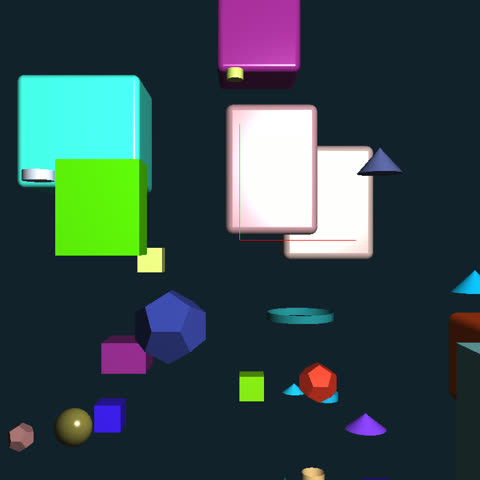 ui1](../ui/ui_windows.md "ImGui windows combined with a scene") [▶ Run](https://jonaslindemann.github.io/ivf2/web/ui1.html){ .ivf-run title="Run ui1 in the browser" }
- [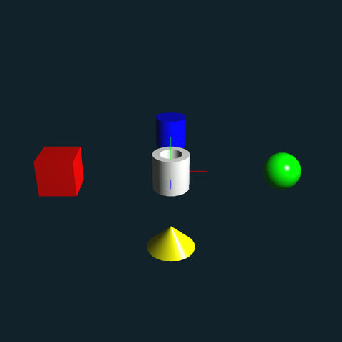 ui2](../ui/ui_windows.md "ImGui windows combined with a scene") [▶ Run](https://jonaslindemann.github.io/ivf2/web/ui2.html){ .ivf-run title="Run ui2 in the browser" }
- [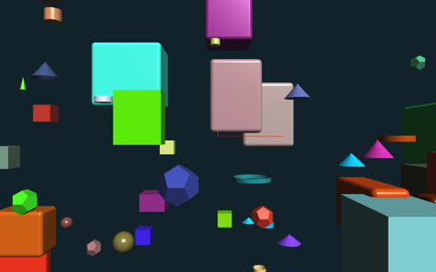 scene_ui1](../ui/ui_windows.md "ImGui windows combined with a scene") [▶ Run](https://jonaslindemann.github.io/ivf2/web/scene_ui1.html){ .ivf-run title="Run scene_ui1 in the browser" }
- [ multi_window1](../advanced/render_context.md "Two windows, each with its own scene, lights and user interface")
- [ gltf1](../advanced/model_loading.md#gltf-models "A glTF 2.0 model with PBR textures, alpha, a skinned tentacle, morph targets and animations (or any .glb given on the command line)") [▶ Run](https://jonaslindemann.github.io/ivf2/web/gltf1.html){ .ivf-run title="Run gltf1 in the browser" }
- [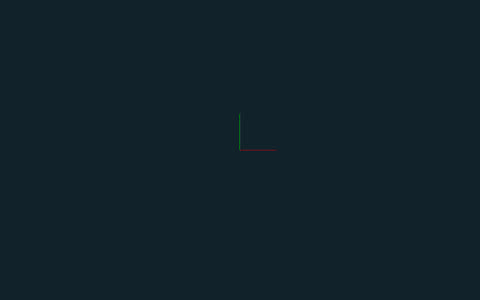 assimp1](../advanced/model_loading.md "Opening any model file through a file dialog")
- [ serialization1](https://github.com/jonaslindemann/ivf2/tree/main/examples/serialization1 "Saving, loading and clearing a scene as JSON") [▶ Run](https://jonaslindemann.github.io/ivf2/web/serialization1.html){ .ivf-run title="Run serialization1 in the browser" }
- [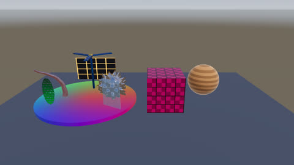 hot_reload1](../advanced/hot_reload.md "A model, a texture and a shader that reload when their files are saved") [▶ Run](https://jonaslindemann.github.io/ivf2/web/hot_reload1.html){ .ivf-run title="Run hot_reload1 in the browser" }
- [ debug_draw1](https://github.com/jonaslindemann/ivf2/tree/main/examples/debug_draw1 "Immediate-mode debug lines and shapes") [▶ Run](https://jonaslindemann.github.io/ivf2/web/debug_draw1.html){ .ivf-run title="Run debug_draw1 in the browser" }

