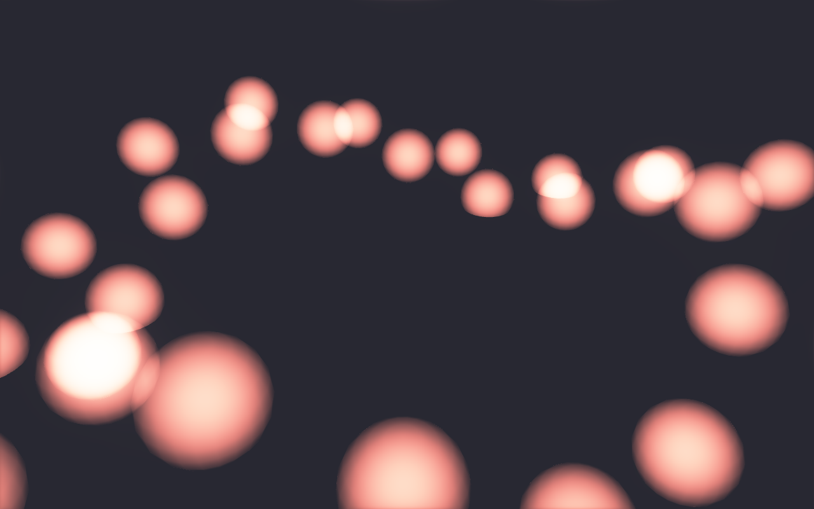

# Music Scene Examples

## music_scene1: A Scene Driven by a Song



This example shows the ivfmusic library. A ring of glowing orbs pulses on every beat. Their colour, the bloom intensity, the pulse strength and the rotation speed follow an automation file, and the camera flies a spline path defined in the same file. See [Music-Driven Scenes](../creative/music_scenes.md) for the concepts.

**Scene setup:**

- `GLFWMusicSceneWindow` with `assets/sounds/pf.mp3` at an assumed 120 BPM
- A `GradientSkyMaterial` sky dome with stars; its horizon glows faintly in the orb colour
- 32 spheres sharing one `GlowMaterial`, whose brightness flashes on every beat
- `MipBloomEffect` whose intensity follows the `bloom` parameter
- Rotation from `Automation::integral("spin", ...)`, so the angle stays a function of the song position
- Camera path from the `cameraPos` / `cameraTarget` spline keys
- Live control from `assets/music_scene1_controls.json`: faders for bloom, pulse and colour, pads for blackout, strobe, freeze and a `burst` trigger that pushes the orbs outwards (read with `triggerAge()`), and transport buttons. The numbers are those of a KORG nanoKONTROL2 and an Akai MPD218; adapt them to your controllers with the MIDI monitor (F5)

**Controls:**

| Key | Action |
|-----|--------|
| `P` | Play / pause |
| `Left` / `Right` | Seek 5 s (`Shift`: one bar) |
| `PgUp` / `PgDn` | Previous / next marker |
| `M` | Mute |
| `F1` / `F3` / `F4` | Overlay / automation panel / free camera |
| `F5` / `F6` | Live panel / record a take into `music_scene1.take.json` |
| Left / right mouse drag, wheel | Look around / float away from the camera path |

Try editing `examples/music_scene1/assets/music_scene1.json` while the example runs. The changes appear within half a second. Run `music_scene1 --help` for the command-line options, e.g. `--present` or `--export frames --start 30 --end 40`.

### music_scene1.cpp

```cpp
--8<-- "examples/music_scene1/music_scene1.cpp"
```

### music_scene1.json

```json
--8<-- "examples/music_scene1/assets/music_scene1.json"
```

### music_scene1_controls.json

```json
--8<-- "examples/music_scene1/assets/music_scene1_controls.json"
```

## mip_bloom1: Wide Glow, Blending and a Guided Camera

A night scene with `GlowMaterial` orbs, a `MistMaterial` layer, a ring of pillars and a starry `GradientSkyMaterial` sky, shown under `MipBloomEffect`. None of the materials needs shader code in the example. The camera follows an orbit through `PathCameraManipulator`.

**What to try:**

- Change threshold, intensity, spread and exposure of the bloom in the **Mip Bloom** panel
- Switch the orbs between the `Additive`, `Alpha` and `Background` blend modes
- Drag with the left mouse button to look around, with the right button or the wheel to float away from the orbit; the camera drifts back after a moment
- Turn off **Guided camera path** to use the normal orbit camera

The orb brightness is shaped with `Easing::SmoothStep` through `ivf::detail::applyEasing()`.

### mip_bloom1.cpp

```cpp
--8<-- "examples/mip_bloom1/mip_bloom1.cpp"
```

## Related guides

- [Music-Driven Scenes](../creative/music_scenes.md)
- [Shader Materials](../core/shader_materials.md)
- [Blur, Bloom and Depth](../effects/blur.md)

All examples are listed in the [Example Index](index.md).
