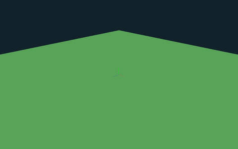
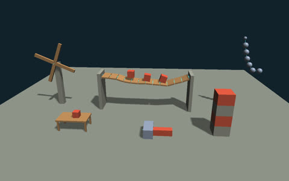
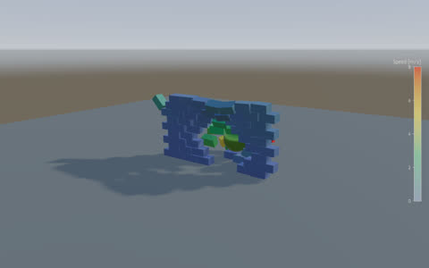

# Physics Examples

The `ivfphysics` examples, from the smallest complete program to a full sandbox application. All three run in the browser, and all are repeatable: the same run gives the same picture, which the visual tests check. See [Physics](../physics/index.md) for the guide.

## rigid_body1 — Bodies on scene nodes

A pile of boxes, spheres, capsules and capped cylinders falls onto a ground box and tumbles. Every body takes its shape from its node, and the cylinders become convex hulls. Drag bodies with the left mouse button, throw balls with **Space**, and switch on the debug view with **L**. The panel shows the world's statistics and has sliders for time scale and gravity.

**Shows:** `PhysicsWorld::step()`, `addBody()` with `Shape::fromNode()`, `DragController`, `throwBody()`, `drawDebug()`, `stats()`, `reset()`.

**Keys:** **D** drops another body, **Space** throws a ball, **L** debug view, **P** pause, **N** one step, **R** reset.

## physics_joints1 — Joints and compound bodies

Six small machines:

- a rope bridge of hinged planks with crates dropped on it;
- a chain on ball and socket joints;
- a windmill, whose cross is one compound body turned by a hinge motor;
- a piston on a slider with limits, pushing crates;
- a tower of blocks welded together with breakable fixed joints;
- a table built from one compound shape.

Throw balls at the tower to break its welds; the panel counts them, and **R** mends them.

**Shows:** `addHingeJoint()`, `addBallSocketJoint()`, `addSliderJoint()`, `addFixedJoint()`, `setLimits()`, `setMotor()`, `JointDesc::breakForce`, `setJointBreakCallback()`, `Shape::compound()`.

## physics_sandbox1 — An interactive sandbox

The complete physics application, with five presets that each start in motion:

1. A steel ball rolling into a brick wall.
2. A domino run along an S-curve.
3. A log tower and a wrecking ball on a joint.
4. A Newton's cradle and a falling chain.
5. A ramp course with balls, capsules and cylinders rolling into a bin.

Bodies are coloured by their speed through an `ivfvis` colormap with a colour bar, under a procedural sky with shadows and ACES tone mapping.

**Shows:** presets built from bodies and joints, `DragController` with the wheel for distance, throwing, sliders for gravity, friction, bounciness, simulation speed and throw speed, colour by speed (`ivfvis::Colormap`, `ColorBar`), compound static ramps, removing bodies that fell off. See [Interaction and Debugging](../physics/interaction.md#building-a-sandbox).

**Keys:** **1**–**5** presets, left mouse drags (wheel: nearer or farther), **Ctrl** + click or **Space** throws, **P** pause, **N** one step, **R** rebuild the preset, **L** debug view. `IVF2_SANDBOX_PRESET=1..5` chooses the preset at start; in the browser add it to the page URL, e.g. `physics_sandbox1.html?IVF2_SANDBOX_PRESET=4`.
