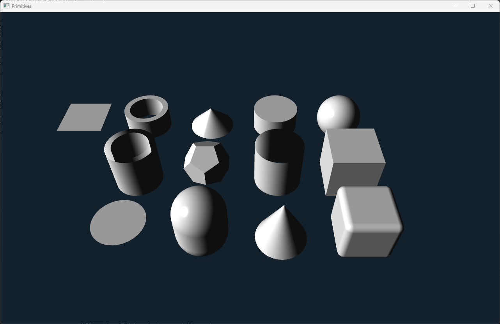
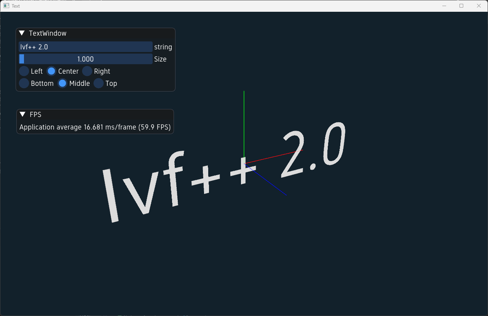
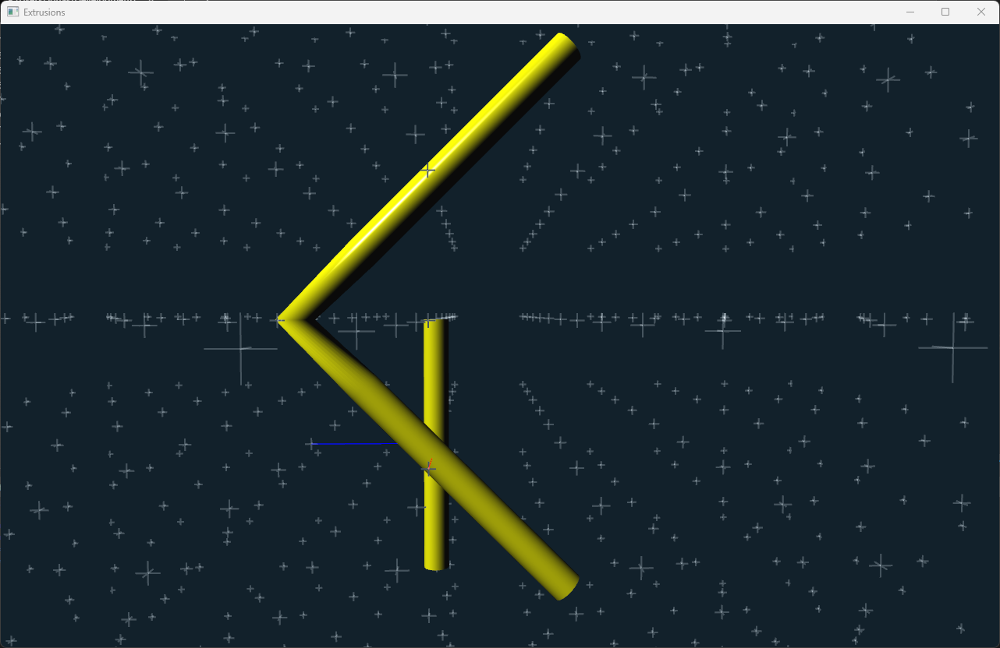
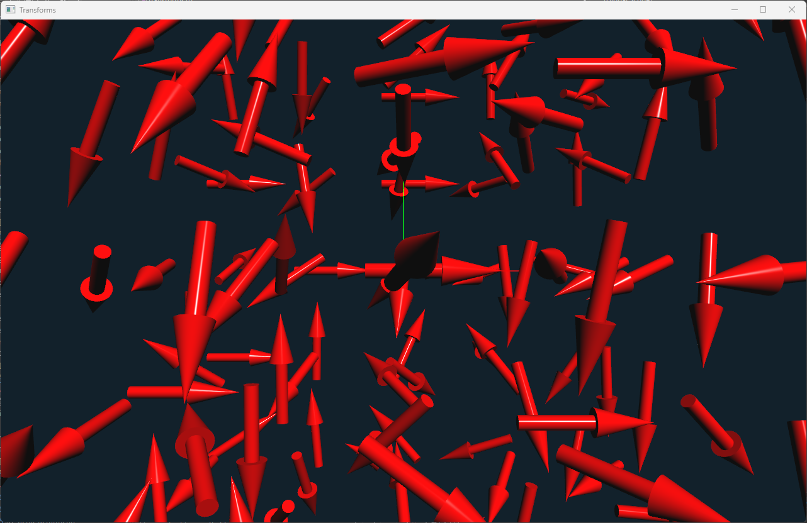

# Primitives Examples

In this chapter we will explore how to create and use various primitive shapes in the ivf2 library. Primitives are basic geometric shapes that can be used as building blocks for more complex models. The ivf2 library provides a variety of primitives, including boxes, spheres, cylinders, cones, tubes, planes, disks, capsules and dodecahedrons, with capped and rounded variants. There are also primitives for text and more complex shapes.

<!-- Run in the browser: generated by docs/tools/make_gallery.py from the Example Index -->
!!! example "Run in the browser"

    [`primitives1`](https://jonaslindemann.github.io/ivf2/web/primitives1.html) · [`extrusions1`](https://jonaslindemann.github.io/ivf2/web/extrusions1.html) · [`transforms1`](https://jonaslindemann.github.io/ivf2/web/transforms1.html)

<!-- /Run in the browser -->

## Available Primitives



This example shows every basic primitive: Box, RoundedBox, Sphere, Capsule, Cylinder, CappedCylinder, Cone, CappedCone, Tube, CappedTube, Plane, Disk and Dodecahedron.

### primitives1.cpp

```cpp
--8<-- "examples/primitives1/primitives1.cpp"
```

## Text Primitive Example



In this example, we will create a text primitive using the `Text` node. 

## text1.cpp

```cpp
--8<-- "examples/text1/text1.cpp"
```

## Extrusions Example



In this example, we will create an extrusion primitive using the `Extrusion` node. The extrusion will be created from a 2D shape and extruded along a specified path.

### extrusions1.cpp

```cpp
--8<-- "examples/extrusions1/extrusions1.cpp"
```

## Transformations Example



In this example, we will demonstrate how to apply transformations to primitive shapes. We will create a scene with multiple primitives and apply various transformations such as translation, rotation, and scaling to each primitive.

### transforms1.cpp

```cpp
--8<-- "examples/transforms1/transforms1.cpp"
```

## Related guides

- [Basic Primitives](../primitives/basic_primitives.md)
- [Complex Primitives](../primitives/complex_primitives.md)
- [Text](../primitives/text.md)

All examples are listed in the [Example Index](index.md).
