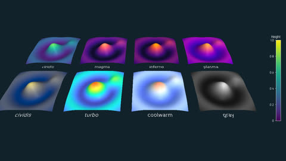
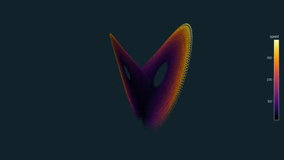
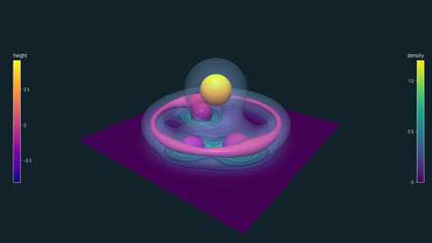
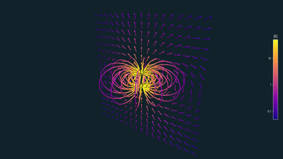
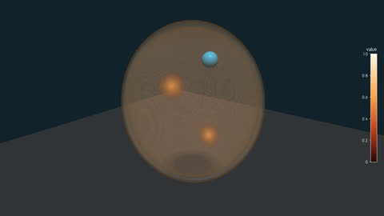
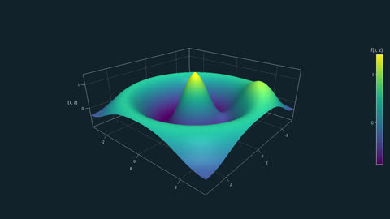
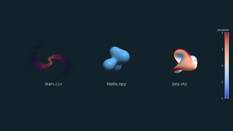
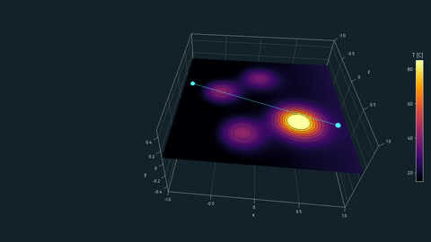

# Visualisation Examples

The `ivfvis` examples, from the basics (colormaps) to complete applications (a dashboard). Each one uses analytic or bundled data, so they run without downloads. See [Scientific Visualisation](../visualisation/index.md) for the guide.

## vis_colormaps1 — Colormaps and colour bars

The eight built-in colormaps on the same height field, stored in a `UniformGrid` and sampled at the mesh vertices with `colorVertices()`. Click a surface to show its colormap in the `ColorBar`; the panel changes the range, reverses the maps, splits them into steps and switches to a log scale.

**Shows:** `Colormap`, `colorVertices()`, `useVertexColors()`, `ColorBar` and its placements.

## vis_points1 — Point clouds

Half a million points along a trajectory of the Lorenz attractor, drawn with one draw call. The points are coloured by speed, time or height through a colormap looked up on the GPU and sized by height. Click a point to read its index and values.

**Shows:** `PointSet`, `PointCloud` (world or pixel sizes, disc, sphere and square shapes, opacity), point picking (`RayHit::point`).

## vis_scalar1 — Isosurfaces and slices

A 96³ density field of blobs and a ring. A translucent outer isosurface encloses an inner one coloured by height; slice planes perpendicular to the axes show the density with contour lines. Sliders move the iso values and the slices.

**Shows:** `Isosurface` (marching cubes, colouring by another array), `SlicePlane` (contours), two colour bars.

## vis_vectors1 — Glyphs and field lines

The field of a magnetic dipole: a plane of arrows of equal length coloured by field strength on a logarithmic colormap, and field lines traced from rings around the dipole, drawn as tubes. Click an arrow to read its vector.

**Shows:** `VectorField::fromFunction()`, `Glyphs`, `Streamlines` (tubes, `seedCircle()`), log-scale colormaps.

## vis_volume1 — Volume rendering

A CT-like scan on a 128³ grid rendered as a semi-transparent volume. Opacity bands select soft tissue, organs and the outer shell; an opaque isosurface inside the volume and a floor cutting through it show the volume mixing correctly with geometry.

**Shows:** `Volume` (transfer function with a custom colormap and an opacity curve, density, samples, shading), `Texture3D`.

## vis_axes1 — Axes and labels

A surface plot of a function of two variables with 3D axes around it: grid lines on the walls behind the surface, ticks in data units on the outer edges, and labels that stay readable while the camera turns.

**Shows:** `Axes3D`, `ColorBar`, surfaces built from `MeshData`.

## vis_readers1 — Reading data files

One file of each kind from `assets/data`: a CSV table of stars shown as a point cloud, a NumPy array shown as an isosurface, and a VTK XML unstructured grid (Boy's surface) coloured by its curvature. The data is written by `make_data.py`.

**Shows:** `readCsv()`, `pointsFromTable()`, `readNpy()`, `gridFromNpy()`, `readVtk()`, `createMeshNode()`.

## vis_dashboard1 — Dashboard with 2D plots

A temperature field shown by a slice with contours and 3D axes, next to an ImGui dashboard with ImPlot charts: the temperature along a probe line (moved and turned with sliders), and a histogram of the whole field whose two drag lines set the colormap range. The picture above is the 3D view; the plots are in the program's window.

**Shows:** `sampleLine()`, `histogram()`, ImPlot plots and drag lines, linking plots and colormaps.
