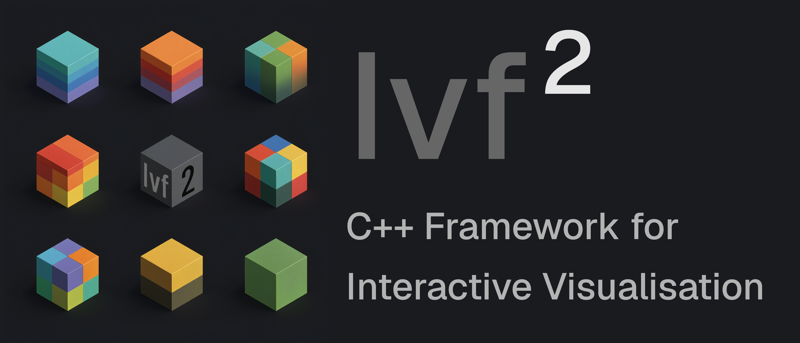
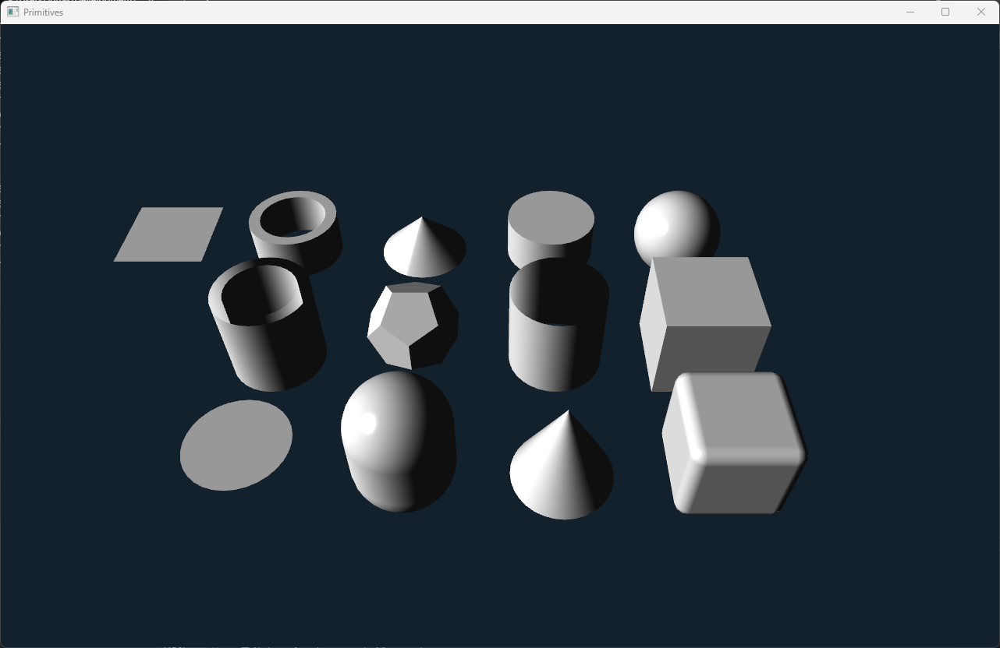
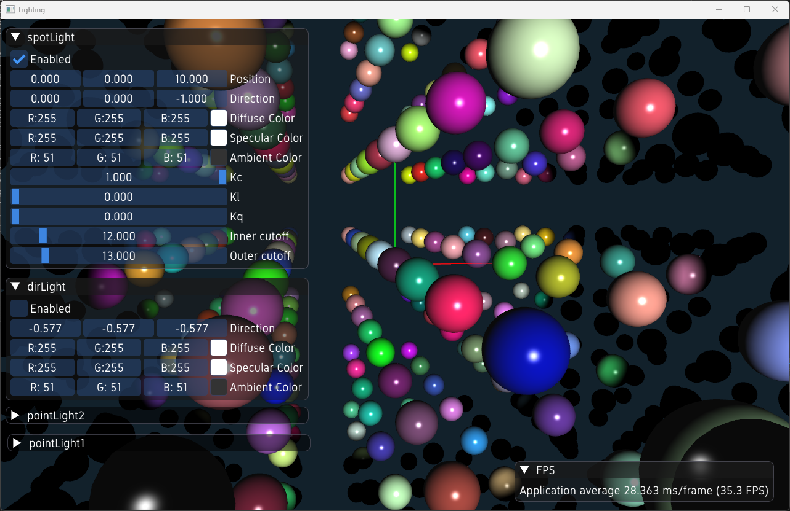
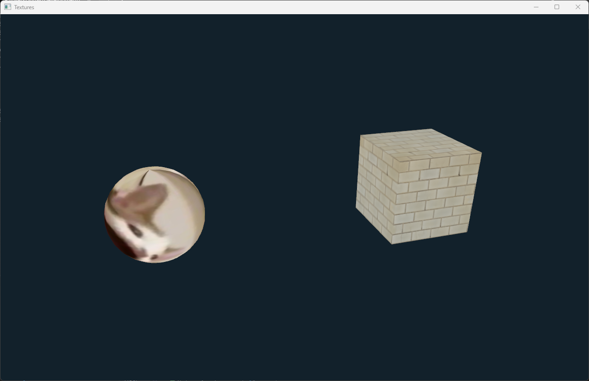
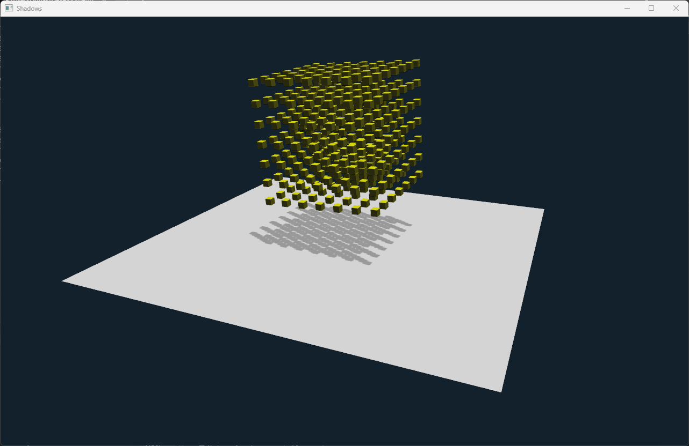
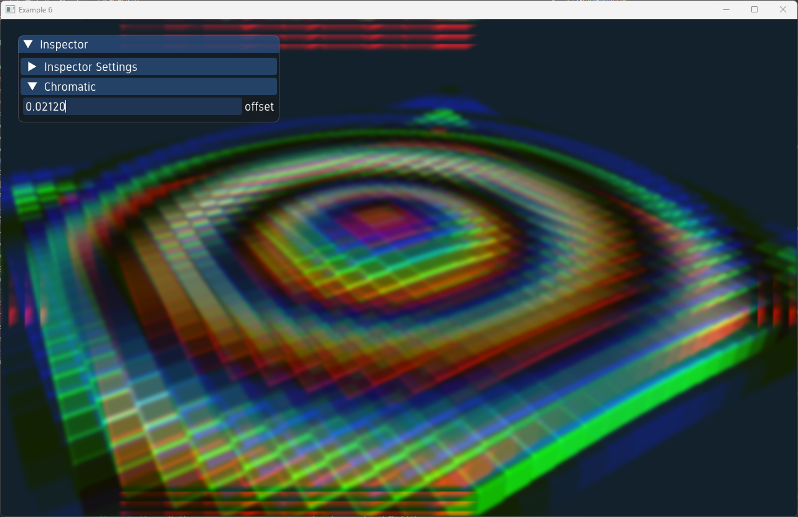
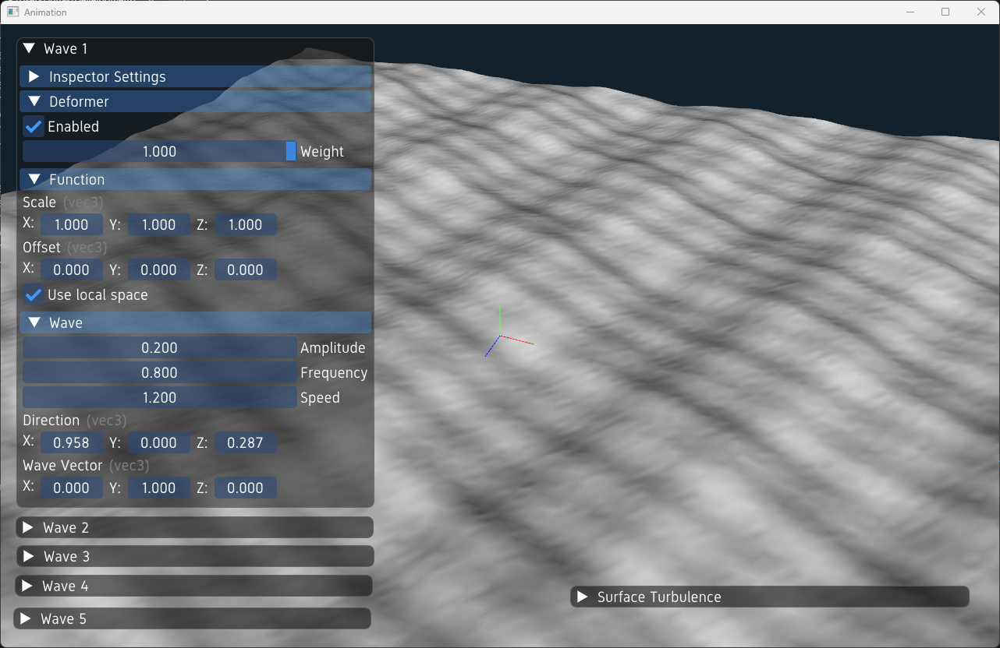
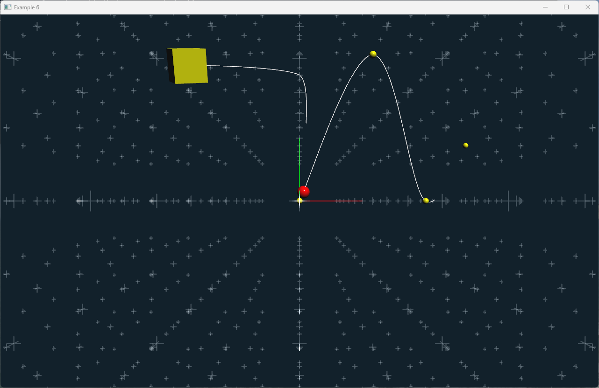
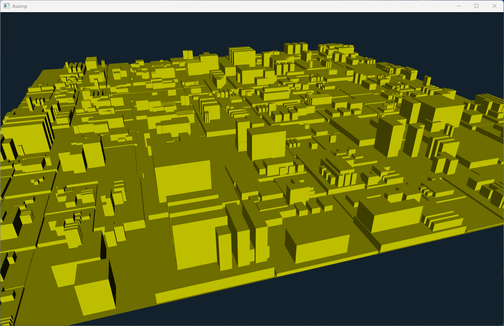

# Interactive Visualisation Framework 2

ivf2 is a modern C++20 library for real-time 3D graphics, visualisation and creative coding, built on OpenGL 3.3+. You build a scene from nodes, such as primitives, models, text and lights, give them materials and effects, and animate them over time. A thin application layer handles windows, input and ImGui panels, so a working interactive scene takes only a few dozen lines.

ivf2 is a complete rewrite of [ivfplusplus](https://github.com/jonaslindemann/ivfplusplus), the C++ OpenGL wrapper behind [ObjectiveFrame](https://jonaslindemann.github.io/objectiveframe/). It aims to be easy to start with and easy to extend, for teaching, research visualisation and generative art alike.

- [ Primitives](examples/primitives_examples.md)
- [ Lighting](examples/lighting_examples.md)
- [ Textures](examples/texture_examples.md)
- [ Shadows](examples/effects_examples.md)
- [ Effects](examples/effects_examples.md)
- [ Deformers](examples/deformer_examples.md)
- [ Animation](examples/animation_examples.md)
- [ Models](examples/asset_examples.md)

## Features

### Scene and geometry

- A [scene graph](core/nodes.md) of nodes, transforms and groups, with `create()` factories and `shared_ptr` throughout
- [Basic primitives](primitives/basic_primitives.md) such as cubes, spheres, cylinders and cones, and [complex ones](primitives/complex_primitives.md) such as extrusions, rounded boxes, capsules and polyhedra
- [Procedural geometry](core/procedural_geometry.md) from the bundled `generator` library, with around 80 composable shapes, paths and meshes
- [3D text](primitives/text.md), and [model loading](advanced/model_loading.md) through Assimp
- [Lighting](core/lighting.md) with point, directional and spot lights, plus [shadow mapping](advanced/shadows.md)

### Materials and effects

- [Materials and textures](core/materials_and_textures.md), including physically based and normal-mapped materials, plus custom GLSL with [`ShaderMaterial`](core/shader_materials.md)
- Additive and alpha blending with `BlendShaderMaterial`, and [ready-made glow, mist, gradient sky and water materials](core/shader_materials.md#ready-made-materials)
- [Over 20 post-processing effects](effects/index.md): bloom with tone mapping, depth of field, fog, colour grading, film grain, chromatic aberration, halftone, kaleidoscope, glitch, video feedback and more, or [your own](effects/custom_effects.md)
- [Mesh deformers](core/deformers.md): twist, bend, scale, wave, turbulence, noise and custom functions

### Animation and time

- [Keyframe](animation/keyframe_animation.md) and [spline](animation/spline_animation.md) animation, and procedural motion such as [Lissajous curves](animation/lissajous.md)
- [Camera fly-throughs](animation/camera_animation.md) along splines, with look-at targets and shake
- [Tweens](animation/choosing.md#tweens) with shared easing curves, and a [scene timeline](animation/choosing.md#scene-timelines) for sequencing
- [Global time control](core/time_controller.md): pause, slow motion and time scaling for the whole scene

### Creative coding

- [Flow fields](creative/flow_field.md): curl-noise particle motion that looks organic and fluid
- [Music-driven scenes](creative/music_scenes.md): the song is the clock. Parameters are keyed to bars in a JSON file that reloads while the music plays, notes from Renoise songs drive values, and MIDI controllers can be played live and recorded. Frame export renders the same picture as playback.

### User interface

- [GLFW windows](ui/scene_window.md) with built-in camera control and input events
- [ImGui panels](ui/ui_windows.md) that you compose into your own tools, [ready-made widgets](ui/widgets.md), and [built-in inspectors](ui/scene_ui_integration.md) for the scene, effects and camera
- Mouse [selection](advanced/selection.md) of objects, by hover, click or rectangle

## Getting started

1. [Install](getting_started/installation.md) the dependencies and build the library and examples.
2. Read [Basic Concepts](getting_started/basic_concepts.md) for how scenes, nodes and windows fit together.
3. Build [your first application](getting_started/your_first_app.md).

Then browse the [Example Index](examples/index.md). Every example is a small, standalone program you can run and change. The [Cheat Sheet](reference/cheat_sheet.md) lists every class on one page. For generative and music-driven work, start with [Creative Programming](creative/index.md).

## API reference

Every class is documented in the [API Reference](api/index.md), which is generated from the source with Doxygen.
