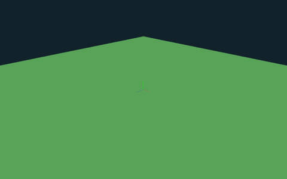
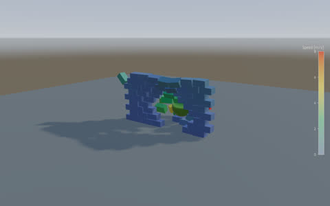
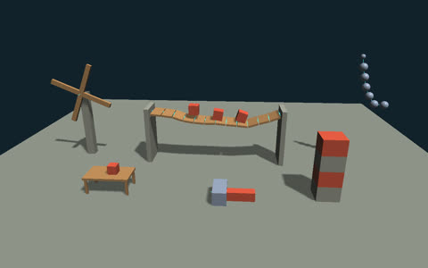

# Physics

`ivfphysics` adds rigid-body physics to the scene graph. A rigid body attached to a `TransformNode` falls, collides, slides and tumbles, and the node shows where it is. Bodies can be joined by hinges, sliders and other joints, queried with rays, and grabbed and thrown with the mouse. The `rigid_body1` example is the smallest complete program.

<!-- Run in the browser: generated by docs/tools/make_gallery.py from the Example Index -->
!!! example "Run in the browser"

    [`rigid_body1`](https://jonaslindemann.github.io/ivf2/web/rigid_body1.html)

<!-- /Run in the browser -->



`ivfphysics` is a separate library on top of `ivf`. Link it next to ivf2:

```cmake
target_link_libraries(my_app PRIVATE ivf2::ivf2 ivf2::ivfphysics)
```

```cpp
#include <ivfphysics/ivfphysics.h>
```

It is built by default; `-DIVF2_BUILD_PHYSICS=OFF` leaves it out. The simulation is done by [ReactPhysics3D](https://www.reactphysics3d.com), which vcpkg installs (feature `physics`). The engine stays hidden behind the ivfphysics classes, so applications never include its headers. An installed ivf2 provides it as `find_package(ivf2 REQUIRED COMPONENTS Physics)`.

<div class="ivf-gallery" markdown>

- [ Bodies and shapes](bodies_and_shapes.md)
- [ Queries and events](events.md)
- [ Joints and compound bodies](joints.md)
- [ Interaction and debugging](interaction.md)

</div>

## A first simulation

A complete program: a ground box and a leaning stack of cubes that topples.

```cpp
#include <ivfui/ui.h>
#include <ivf/nodes.h>
#include <ivfphysics/ivfphysics.h>

class FallingWindow : public ivfui::GLFWSceneWindow {
    ivfphysics::PhysicsWorldPtr m_world;

public:
    using GLFWSceneWindow::GLFWSceneWindow;

    int onSetup() override
    {
        m_world = ivfphysics::PhysicsWorld::create();

        // A static ground: a thin box (ivf::Box takes half extents) with its top at y = 0
        auto ground = ivf::Box::create({10.0f, 0.1f, 10.0f});
        ground->setPos({0.0f, -0.1f, 0.0f});
        add(ground);
        static_cast<void>(m_world->addBody(ground, {.type = ivfphysics::BodyType::Static})); // shape from the node

        // Ten cubes in a leaning stack
        for (int i = 0; i < 10; ++i)
        {
            auto cube = ivf::Cube::create(); // edge length 1
            const float k = static_cast<float>(i);
            cube->setPos({0.15f * k, 0.5f + 1.01f * k, 0.0f}); // each one overhangs the one below
            add(cube);
            m_world->addBody(cube, ivfphysics::Shape::box(glm::vec3(0.5f)), {.mass = 1.0f});
        }

        cameraManipulator()->setCameraPosition({10.0f, 7.0f, 14.0f});
        cameraManipulator()->setCameraTarget({0.0f, 3.0f, 0.0f});
        cameraManipulator()->saveState();
        return 0;
    }

    void onUpdate() override
    {
        m_world->step(frameTime()); // fixed steps up to the frame time; the cubes follow
    }
};

int main()
{
    auto app = ivfui::GLFWApplication::create();
    app->addWindow(std::make_shared<FallingWindow>(1280, 800, "Physics"));
    return app->loop();
}
```

Each frame, `step(frameTime())` advances the simulation and writes the new position and rotation of every moving body to its node. Nothing else in the scene changes: materials, shadows, effects and picking work on the nodes as usual.

## How the simulation runs

**Fixed steps.** The world advances in steps of fixed length, 1/240 s by default (`PhysicsSettings::fixedTimeStep`). `step(dt)` runs as many steps as are needed to reach the new time, at most `maxSubSteps` (16) per call; time beyond that is dropped, so a slow frame does not make the next one slower. Fixed steps make the simulation stable and the same on every machine.

**Interpolation.** The last step usually lies a little beyond the frame time. Each node is placed between the last two steps (`PhysicsSettings::interpolate`), so motion stays smooth at any frame rate, also when it does not divide 240.

**Repeatable runs.** The same calls give the same result: the visual tests rely on this. Use the window's `frameTime()`, which `IVF2_FIXED_TIMESTEP` fixes, not the wall clock.

**No OpenGL.** The world never touches OpenGL. You can create and step it before the window opens, in a test, or on a thread of its own (then keep the node updates on the main thread).

```cpp
ivfphysics::PhysicsSettings settings;
settings.gravity = {0.0f, -9.81f, 0.0f};   // the default
settings.fixedTimeStep = 1.0 / 120.0;      // fewer steps: faster, less accurate stacking
auto world = ivfphysics::PhysicsWorld::create(settings);

world->setPaused(true);       // step() does nothing
world->stepOnce();            // exactly one step, also when paused
world->setTimeScale(0.25);    // slow motion
world->reset();               // every body back where it was added, at rest; time 0
```

`reset()` returns every body to where it was added, at rest; property changes made since (mass, friction) stay. It is the "start again" button of most physics applications. Bodies you added later, such as thrown balls, stay in the world; remove them yourself.

## Nodes and bodies

A body belongs to a `TransformNode`, which it either drives or follows:

- A **dynamic** body is moved by the simulation and sets its node's position and rotation after each step. The rotation is written as a quaternion, so set the node's Euler angles before adding the body, not after.
- A **kinematic** body follows its node: move the node, and the body gets the velocity that takes it there in the next step, pushing dynamic bodies out of the way (a paddle, a moving platform).
- A **static** body never moves (ground, walls, ramps).

Bodies live in world coordinates, so their nodes belong directly in the scene or in groups that are not moved, rotated or scaled. Other nodes, without bodies, can sit anywhere; to attach decoration to a body, update it from the body's position each frame.

## Next

- [Bodies and Shapes](bodies_and_shapes.md): body types and properties, collision shapes, forces and impulses, sleeping.
- [Queries and Events](events.md): raycasts, contact and trigger callbacks, collision filtering, per-step forces, statistics.
- [Joints and Compound Bodies](joints.md): ball and socket, hinge, slider and fixed joints with limits, motors and breaking; bodies made of several shapes.
- [Interaction and Debugging](interaction.md): dragging and throwing with the mouse, the debug view, and the patterns of the sandbox example.
- [Physics Examples](../examples/physics_examples.md): the three example programs.
