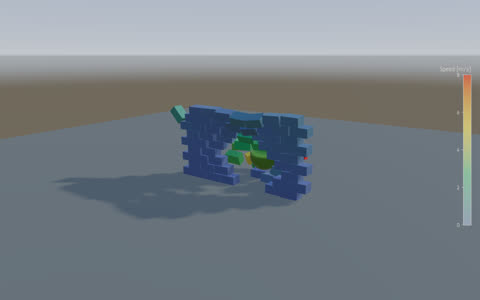

# Interaction and Debugging

Physics is most fun when you can touch it: grab a body and swing it, throw a ball into a wall, change gravity while things fly. `ivfphysics` has the pieces for that, without OpenGL: a drag controller and a throw function that take camera rays, and a debug view that draws colliders, contacts, joints and velocities. `physics_sandbox1` puts them together into a complete application.

<!-- Run in the browser: generated by docs/tools/make_gallery.py from the Example Index -->
!!! example "Run in the browser"

    [`physics_sandbox1`](https://jonaslindemann.github.io/ivf2/web/physics_sandbox1.html)

<!-- /Run in the browser -->



## Dragging bodies

`DragController` holds a body with a damped spring between a point on the body and a target that follows the mouse. The body is still simulated: it collides, pushes others and swings on its joints while you hold it.

```cpp
class SandboxWindow : public ivfui::GLFWSceneWindow {
    ivfphysics::PhysicsWorldPtr m_world;
    ivfphysics::DragControllerPtr m_drag;
    // ...
    int onSetup() override
    {
        m_world = ivfphysics::PhysicsWorld::create();
        m_drag = ivfphysics::DragController::create(m_world);
        // ...
    }

    void onMouseButton(int button, int action, int mods) override
    {
        if (button == GLFW_MOUSE_BUTTON_LEFT)
        {
            if (action == GLFW_PRESS && !ImGui::GetIO().WantCaptureMouse &&
                m_drag->grab(cameraRay(mouseX(), mouseY())))
                cameraManipulator()->setManipulationBlocked(true);   // the mouse moves the body, not the camera
            else if (action == GLFW_RELEASE && m_drag->isDragging())
            {
                m_drag->release();
                cameraManipulator()->setManipulationBlocked(false);
            }
        }
        GLFWSceneWindow::onMouseButton(button, action, mods);
    }

    void onMousePosition(double x, double y) override
    {
        if (m_drag->isDragging())
            m_drag->drag(cameraRay(x, y));
        GLFWSceneWindow::onMousePosition(x, y);
    }

    void onScroll(double dx, double dy) override
    {
        if (m_drag->isDragging())    // the wheel moves the body nearer or farther
            m_drag->setDistance(m_drag->distance() * (1.0f + 0.1f * static_cast<float>(dy)));
        else
            GLFWSceneWindow::onScroll(dx, dy);
    }
};
```

`grab()` casts the ray and takes the nearest body if it is dynamic: it returns false for the ground, so a click on it still turns the camera. `drag()` moves the target along later rays at the distance at which the body was grabbed. `setTarget()` moves it anywhere, for example to follow a VR controller. `body()`, `anchor()` and `target()` tell what is held and where.

The spring acts before every fixed step through a [step callback](events.md#forces-every-step), so dragging feels the same at any frame rate. It is normalised by the body's mass, so light and heavy bodies follow alike. `DragSettings` tunes it:

| Setting | Default | Effect |
|---------|---------|--------|
| `frequency` | 5 Hz | How fast the body follows |
| `dampingRatio` | 0.9 | 1 follows without overshoot; lower values swing |
| `maxAcceleration` | 200 | Limits the pull, so a body caught under a pile is not flung out |
| `angularDamping` | 3 | Calms spinning while held; restored on release |

## Throwing

`throwBody()` launches a body from the origin of a ray along its direction:

```cpp
void throwBall()
{
    auto ball = ivf::Sphere::create(0.3);
    ball->setMaterial(m_ballMaterial);
    add(ball);
    auto body = m_world->addBody(ball, ivfphysics::Shape::sphere(0.3f), {.mass = 4.0f, .bounciness = 0.3f});
    ivfphysics::throwBody(body, cameraRay(mouseX(), mouseY()), 25.0f);   // 25 units/s
    m_thrown.push_back(body);   // to remove them on reset
}
```

It moves the body to the ray origin, sets its velocity (and an optional spin), and wakes it. Because camera rays start on the near plane, the ball comes out of the camera towards the mouse position. Heavy, fast balls knock over walls; light ones bounce off. Keep the thrown bodies to remove them on reset (`world->reset()` keeps every body, thrown ones included).

## The debug view

`drawDebug()` draws the world as lines through the window's `DebugDraw`: collider wireframes coloured by body type (dynamic, sleeping, kinematic, static, trigger), contact points with their normals, joint anchors and axes, velocity arrows and centres of mass. Call it every frame from `onUpdate()`; the window draws the lines after the scene.

```cpp
ivfphysics::DebugViewOptions m_debugOptions;   // colliders, contacts and joints by default
bool m_debugView{false};

void onUpdate() override
{
    m_world->step(frameTime());
    auto debug = renderContext()->debugDraw();
    if (m_debugView)
        ivfphysics::drawDebug(*m_world, *debug, m_debugOptions);
    ivfphysics::drawDebug(*m_drag, *debug);   // the drag spring, while a body is held
}
```

`DebugViewOptions` switches the parts on and off (`colliders`, `staticBodies`, `contacts`, `velocities`, `centersOfMass`, `joints`) and sets sizes and colours. A large ground box drawn as a wireframe hides little, but `staticBodies = false` leaves static bodies out. Triangle meshes with more than `maxTriangles` triangles are drawn as their bounds.

The debug view answers most "why does it do that" questions: a collider that does not match its node (a forgotten scale, half extents given as full sizes), bodies that sleep too early, contact normals pointing the wrong way, a joint anchor in the wrong place.

## Keys

`GLFWSceneWindow` handles some keys for its own tools before `onKey()` sees them: V, S, E, A, G, C, T, H, F and Ctrl+R open the camera window, the scene inspector, the effects and the other built-in tools. Ctrl+0–9 saves the camera to a slot, and a plain digit recalls a saved slot. The physics examples therefore use **Space** to throw, **P** to pause, **N** to step, **R** to reset and **L** for the debug view. The sandbox picks its presets with 1–5, which works as long as no camera slot has been saved under those digits.

## Building a sandbox

`physics_sandbox1` combines all of this with `ivfvis` and PBR rendering. The parts worth copying:

**Presets.** Each preset is a function that builds a scene from bodies and joints. All its nodes go into one `CompositeNode` at the origin, which leaves the bodies in world coordinates. Switching presets releases the drag, removes that group from the scene, and creates a new world and drag controller before building the next preset. Each one starts in motion, for example a ball already rolling towards the wall, so there is something to see at once. `IVF2_SANDBOX_PRESET=1..5` selects the start preset, also as a page URL parameter in the browser (`physics_sandbox1.html?IVF2_SANDBOX_PRESET=4`).

**Colour by speed.** Every body has its own `PBRMaterial`, and each frame its colour comes from a colormap. A custom colormap that starts at slate blue keeps bodies at rest readable, where a map that starts at black would not. A `ColorBar` shows the scale:

```cpp
m_colormap = ivfvis::Colormap::create("speed", {{0.0f, {0.42f, 0.5f, 0.68f, 1.0f}},
                                                {0.35f, {0.3f, 0.75f, 0.45f, 1.0f}},
                                                {0.65f, {0.98f, 0.8f, 0.2f, 1.0f}},
                                                {1.0f, {0.9f, 0.18f, 0.12f, 1.0f}}});
m_colormap->setRange(0.0f, 8.0f);
m_colorBar = ivfvis::ColorBar::create(m_colormap);
m_colorBar->setTitle("Speed [m/s]");
add(m_colorBar);

// in onUpdate(), after step():
for (auto &item : m_items)
    item.material->setAlbedo(m_colormap->color(glm::length(item.body->linearVelocity())));
```

**Strings.** Pendulum strings are not bodies: they are `DebugDraw` lines from each joint's `anchor()` to its bodies, drawn every frame.

**Clean-up.** Bodies that fall off the ground are removed once they are far below it (`position().y < -20`), node and body together, so a long session does not fill up with falling objects.

**World controls.** Sliders call `setGravity()`, `setTimeScale()` and, for every body, `setFriction()` and `setBounciness()`; the panel shows `stats()`.
