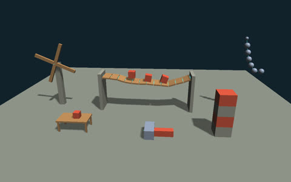

# Joints and Compound Bodies

Joints connect bodies to each other or to the world: a door on its hinge, a chain of links, a piston on its slider, a weld that breaks when hit hard. Compound shapes build one body out of several shapes, for objects no single convex shape fits. The `physics_joints1` example shows a rope bridge, a chain, a motor-driven windmill, a piston, a welded tower and a table.

<!-- Run in the browser: generated by docs/tools/make_gallery.py from the Example Index -->
!!! example "Run in the browser"

    [`physics_joints1`](https://jonaslindemann.github.io/ivf2/web/physics_joints1.html)

<!-- /Run in the browser -->



## Creating joints

Every joint is created from an anchor point (and, for hinges and sliders, an axis) in world coordinates, with the bodies where they are at that moment:

```cpp
using namespace ivfphysics;

// A door: a hinge along its left edge, held to the world (nullptr)
auto hinge = world->addHingeJoint(door, nullptr, {-0.5f, 1.0f, 0.0f}, {0.0f, 1.0f, 0.0f});

// Two links of a chain sharing a point
world->addBallSocketJoint(link1, link2, sharedPoint);

// A drawer sliding along x out of a static cabinet
auto slide = world->addSliderJoint(cabinet, drawer, drawerPos, {1.0f, 0.0f, 0.0f});

// Glue: the bodies move as one
world->addFixedJoint(block1, block2, seam);
```

| Joint | Keeps | Leaves free | Limits | Motor |
|-------|-------|-------------|--------|-------|
| `addBallSocketJoint()` | A shared point | All rotation | A cone (`setConeLimit()`) | |
| `addHingeJoint()` | A shared point and axis | Rotation about the axis | Angle range | Speed and torque |
| `addSliderJoint()` | Rotation and the line of the axis | Translation along the axis | Distance range | Speed and force |
| `addFixedJoint()` | Everything | Nothing | | |

With `nullptr` as the second body, the joint holds the first body to the world at the anchor, as for the door above. The joined bodies do not collide with each other; set `JointDesc::collideConnected` for joints where they should, such as a ball joint between two parts that may touch.

`world->removeJoint(joint)` removes a joint, and removing a body removes its joints. `world->joints()` lists them all. A joint knows its `type()`, `body1()`, `body2()`, and its current `anchor()` and `axis()` in world coordinates.

!!! tip "Leave small gaps"
    Bodies joined in a row, such as bridge planks, chain links or a Newton's cradle, work best with a small gap between neighbours. Touching neighbours are solved as one contact group and jam or pass impulses on wrongly. In `physics_joints1` each plank is 4 cm shorter than the distance between its hinges.

## Limits

Angles and translations are measured from the pose at creation, which counts as 0:

```cpp
hinge->setLimits(glm::radians(-10.0f), glm::radians(100.0f));   // the door opens to 100°
slide->setLimits(0.0f, 0.4f);                                    // the drawer opens 40 cm
ballJoint->setConeLimit(glm::radians(30.0f));                    // a shoulder

float doorAngle = hinge->angle();          // -pi to pi
float opened = slide->translation();
float swing = ballJoint->coneAngle();

hinge->setLimitsEnabled(false);            // swing freely again
```

The range must contain 0, the pose at creation; values outside are clamped to it. Hinge limits lie within one turn in each direction (−2π to 2π). The angle is that of the second body relative to the first, or of the first body relative to the world for a joint held to the world.

## Motors

Hinges and sliders can drive their bodies at a speed, with at most a given torque or force:

```cpp
auto axle = world->addHingeJoint(rotor, nullptr, hub, {0.0f, 0.0f, 1.0f});
axle->setMotor(1.2f, 80.0f);           // 1.2 rad/s with at most 80 N m

piston->setMotor(-1.5f, 400.0f);       // back at 1.5 units/s with at most 400 N
piston->setMotorEnabled(false);        // coast
```

The maximum force decides what the motor can push: with too little, the motor slows down or stalls under load, as a real one would. A motor with speed 0 and a large force acts as a brake. Combined with limits, a slider motor makes a piston: `physics_joints1` reverses the speed when `translation()` reaches either limit.

## Breaking joints

A joint with a break force or torque breaks when holding the bodies together would take more than that:

```cpp
const JointDesc weld{.breakForce = 400.0f, .breakTorque = 150.0f};
auto j = world->addFixedJoint(below, block, seam, weld);

world->setJointBreakCallback([this](const JointPtr &joint) {
    ++m_broken;                                    // after the step in which it broke
});
```

A broken joint stops acting but stays in the world: `isBroken()` is true until `world->reset()` mends it. `reactionForce()` and `reactionTorque()` tell how hard a joint pulls in each step, which helps choose thresholds: the welded tower of `physics_joints1` stands under its own weight, but breaks when a ball is thrown at it.

## Compound bodies

A compound shape is one body made of several shapes, each placed by its offset. It suits objects that are not convex: a table, a hammer, a chair, a ramp with rails.

```cpp
// The node: a group whose children sit where the parts are
auto table = ivf::CompositeNode::create();
auto top = ivf::Box::create({1.0f, 0.05f, 0.6f});
top->setPos({0.0f, 0.75f, 0.0f});
table->add(top);

auto topShape = Shape::box({1.0f, 0.05f, 0.6f});
topShape->setOffset({0.0f, 0.75f, 0.0f});
std::vector<ShapePtr> parts{topShape};

for (float x : {-0.9f, 0.9f})
    for (float z : {-0.5f, 0.5f})
    {
        auto leg = ivf::Box::create({0.05f, 0.35f, 0.05f});
        leg->setPos({x, 0.35f, z});
        table->add(leg);

        auto legShape = Shape::box({0.05f, 0.35f, 0.05f});
        legShape->setOffset({x, 0.35f, z});
        parts.push_back(legShape);
    }

table->setPos({-4.5f, 0.3f, 3.5f});
scene->add(table);
world->addBody(table, Shape::compound(parts), {.mass = 15.0f});
```

The body drives the group node, and the children follow it in the group's coordinates: the parts' offsets are the children's positions. The mass is spread over the parts by volume, so the centre of mass and inertia come out right. Parts can be any shape, compounds included. A part that is a triangle mesh makes the whole body static, which is how the ramps of `physics_sandbox1` are built: one static body each, with a floor, two rails and a back wall.

Each part collides on its own, so a table standing on the floor has four contacts. Compounds are much cheaper than triangle meshes and, unlike them, can be dynamic.

## Patterns

- **Pendulum or rope:** a ball and socket joint to the world at the pivot. Draw the string with `DebugDraw` lines from `joint->anchor()` to the body each frame, as `physics_sandbox1` does.
- **Chain:** bodies joined in a row by ball and socket joints at the points between them, the first one held to the world.
- **Bridge:** planks joined by hinges along the bridge's width, both ends held to the world.
- **Wheel:** a hinge between the axle body and the wheel, with a motor for drive.
- **Ragdoll:** ball and socket joints with cone limits for shoulders and hips, hinges with limits for elbows and knees.
- **Destructible structure:** blocks joined by fixed joints with break thresholds; `reset()` rebuilds it.
