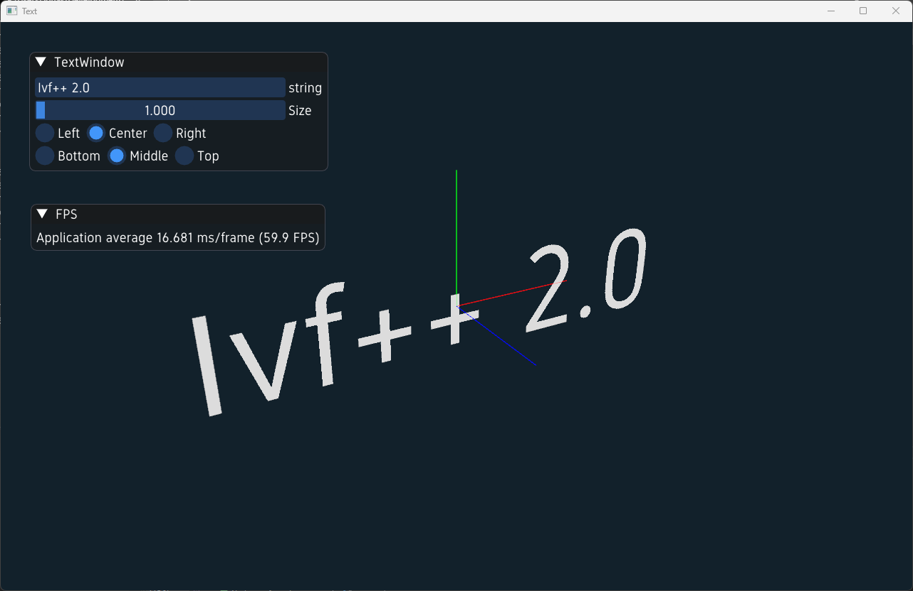

# Text

`TextNode` draws text as flat geometry in the 3D scene. It moves, rotates and scales like any other node, takes materials and lighting, and can be animated, which makes it suitable for labels, titles and typographic pieces. For text that should always face the camera or sit on top of the view, see the alternatives at the end of this page.



## Loading a font

Text needs a font, loaded once through the window's `FontManager` before any text node is created (`GLFWSceneWindow` already loads Gidole as `"gidole"`):

```cpp
renderContext()->fonts()->loadFace("fonts/Gidole-Regular.ttf", "gidole");
```

Any TrueType (`.ttf`) or OpenType (`.otf`) font works. The most recently loaded font is used for new text. ivf2 ships with Gidole, Gidolinya and Roboto in `data/fonts/`, which are copied next to the executables at build time.

## Creating text

```cpp
#include <ivf/text_node.h>

auto material = ivf::Material::create();
material->setDiffuseColor({1.0f, 1.0f, 1.0f, 1.0f});

auto title = ivf::TextNode::create();
title->setText("Hello ivf2");
title->setSize(1.0f);
title->setAlignX(ivf::TextAlignX::CENTER);
title->setAlignY(ivf::TextAlignY::MIDDLE);
title->setMaterial(material);
title->setPos({0.0f, 2.0f, 0.0f});
add(title);
```

| Method | Description |
|--------|-------------|
| `setText(s)` | The text to show; can be changed at any time |
| `setSize(s)` | Height of the text in world units (default 1.0) |
| `setAlignX(a)` | `TextAlignX::LEFT` (default), `CENTER` or `RIGHT` relative to the node's position |
| `setAlignY(a)` | `TextAlignY::BOTTOM` (default), `MIDDLE` or `TOP` |
| `setColor(c)` | Draw in a fixed colour, independent of material and lighting (`setUseColor(false)` goes back to the material) |
| `setResolution(px)` | Pixel size the glyphs are rasterised at (default 400); see [screen text](#text-on-screen) |
| `textWidth()` / `textHeight()` | Size of the current text, for layout |

The text lies in the node's XY plane, facing along +Z. Rotate the node to place it elsewhere, for example flat on the ground:

```cpp
label->setRotAxis({1.0f, 0.0f, 0.0f});
label->setRotAngle(-90.0f);
```

## Colour and materials

The text's colour comes from its material, so it is lit like other surfaces. For text that should stay bright regardless of lighting, give the material a strong ambient colour with `setAmbientColor()`.

## Text on screen

For labels in window pixels (HUDs, legends), put text nodes in an [`OverlayNode`](../visualisation/colormaps.md#overlays): one unit is then one pixel. Set the resolution to the size, so each glyph texel lands on one pixel and the text stays sharp:

```cpp
label->setSize(14.0f);
label->setResolution(14);
label->setColor({1.0f, 1.0f, 1.0f});
label->setPos({20.0f, 20.0f, 0.0f});   // whole pixels
```

Glyph textures are created once per font and resolution and shared by all text in a window.

## Updating text

`setText()` is cheap enough to call every frame, so live values are easy:

```cpp
void onUpdate() override
{
    m_counter->setText(std::to_string(m_particles->count()) + " particles");
}
```

For many labels that change every frame, update only the ones whose value changed.

## Alternatives

| Need | Use |
|------|-----|
| Text inside the 3D scene | `TextNode` (this page) |
| A label that always faces the camera | A `TextNode` whose rotation you update towards the camera, or a `Billboard` with a texture |
| Overlay text on top of the view: values, help, instructions | ImGui in a [UI window](../ui/ui_windows.md) |

## Related

- [Primitive Examples](../examples/primitives_examples.md) — the `text1` example, with a window for editing the text live
- [Basic Primitives](basic_primitives.md)
