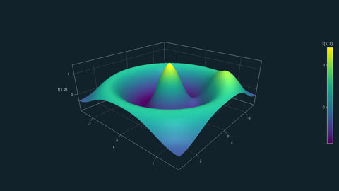

# Axes and Labels

`Axes3D` puts a box of axes around data: grid lines on the walls behind it, tick marks and labels in data units along its outer edges, and axis titles. The `vis_axes1` example shows a surface plot with axes.



```cpp
auto plot = makeSurface();                               // any node
auto axes = ivfvis::Axes3D::create(plot->worldBoundingBox());
axes->setTitles("x [m]", "f(x, z)", "z [m]");
add(axes);
```

## Following the camera

The axes adapt to the view every frame, so they never hide the data:

- **Walls**: only the three walls facing away from the camera are drawn, with their grid lines, so the grid is always behind the data.
- **Ticks and labels**: each axis is labelled along one edge of the box's outline: the lowest edge on screen for x and z, the leftmost for y. Labels sit just outside the box, pushed away from it on screen.
- **Looking along an axis** (or from inside the box), that axis has no outline edge and gets no labels.

Labels are drawn in screen space at a fixed pixel size, sharp and always facing the viewer, whatever the distance.

| Method | Default | Description |
|--------|---------|-------------|
| `setBounds(box)` | - | The box the axes enclose (in the coordinates of the axes' parent) |
| `setTitles(x, y, z)` | "x", "y", "z" | Axis titles; empty strings for none |
| `setTickCount(n)` | 5 | Approximate number of ticks per axis ("nice" values: 1, 2 or 5 times a power of ten) |
| `setGrid(flag)` | true | Grid lines on the walls (their outlines stay) |
| `setTickLength(fraction)` | 0.025 | Tick marks as a fraction of the box's largest side |
| `setColor(rgb)` | light grey | Edges and tick marks |
| `setGridColor(rgb)` | dark grey | Grid lines |
| `setTextColor(rgb)` | white | Labels and titles |
| `setTextSize(px)` | 13 | Label height in pixels; titles are 2 pixels larger |

`ticks(axis)` returns the tick values, and `ivfvis::axisEdge()` tells which edge an axis is labelled on for a given camera.

The axes use the box's coordinates as data units. To show data that is scaled for display (for example heights multiplied by 10), put the data and the axes in a transformed `CompositeNode` and give the axes the unscaled box: the labels then show the original values.

## Labels at 3D points

The labels are an [`OverlayNode`](colormaps.md#overlays) that places its text at 3D points. Your own overlays can do the same: in `onLayout()`, `project(point)` gives the pixel position of a point (in the coordinates of the overlay's parent), and `sceneView()`/`sceneProjection()` the camera.

```cpp
class PeakLabel : public ivf::OverlayNode {
protected:
    void onLayout(int /*width*/, int /*height*/) override
    {
        if (auto pixel = project(m_peak))           // std::nullopt behind the camera
            m_text->setPos({std::round(pixel->x + 8.0f), std::round(pixel->y), 0.0f});
    }
    ...
};
```
