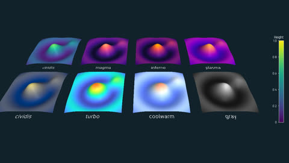

# Colormaps and Colour Bars

A colormap turns values into colours; a colour bar shows which colour means which value. The `vis_colormaps1` example shows all built-in colormaps on the same data set.



## Colormaps

```cpp
auto cmap = ivfvis::Colormap::create(ivfvis::BuiltinColormap::Viridis);
cmap->setRange(0.0f, 250.0f);              // values mapped to the first and last colour

glm::vec4 c = cmap->color(42.0f);           // the colour of a value
```

### Built-in colormaps

| Name | Kind | Use for |
|------|------|---------|
| `Viridis` (default) | Sequential, perceptually uniform | Most data: blue (low) to yellow (high) |
| `Magma`, `Inferno`, `Plasma` | Sequential, perceptually uniform | Data on dark backgrounds, heat-like data |
| `Cividis` | Sequential, perceptually uniform | Readable with colour vision deficiencies |
| `Turbo` | Rainbow with smooth lightness | When many distinguishable hues help (a better "jet") |
| `Coolwarm` | Diverging blue - white - red | Values around a centre (deviations, signed data) |
| `Gray` | Black to white | Greyscale output, masks |

The perceptually uniform maps change lightness evenly, so equal steps in value look like equal steps in colour, and they stay readable in greyscale. For data with a meaningful centre (zero, a reference value), use `Coolwarm` with a range symmetric around the centre.

Colormaps can also be looked up by name, for example from a settings file or a UI:

```cpp
if (auto cmap = ivfvis::Colormap::named("magma"))   // ivf::Result<ColormapPtr>
    use(*cmap);
for (const auto &name : ivfvis::Colormap::builtinNames())
    ...
```

The colour data of viridis, magma, inferno and plasma (CC0), cividis and turbo (Apache 2.0) and coolwarm comes from matplotlib, sampled at 256 entries.

### Settings

| Setting | Description |
|---------|-------------|
| `setRange(min, max)` | Values mapped to the first and last colour (default 0 to 1) |
| `setScale(ColormapScale::Log)` | Spread values evenly in log10 (the range must be positive) |
| `setReversed(true)` | Flip the colours |
| `setSteps(n)` | `n` discrete colour bands instead of a continuous map (0: continuous) |
| `setOutOfRangeColors(below, above)` | Colours for values outside the range (default: the end colours) |
| `setNanColor(color)` | Colour of NaN values (default mid grey) |

`normalize(value)` gives the position of a value in the range (0 to 1), `colorAt(t)` the colour at a position, `table(n)` and `rgba8(n)` the whole map as `n` colours (for a texture or a UI widget).

### Your own colormaps

From colour stops at positions (any scale; they are mapped to 0..1), or from evenly spaced colours:

```cpp
auto ice = ivfvis::Colormap::create("ice", {
    {0.0f, {0.0f, 0.0f, 0.2f, 1.0f}},
    {0.6f, {0.2f, 0.5f, 0.9f, 1.0f}},
    {1.0f, {0.9f, 1.0f, 1.0f, 1.0f}}});

auto traffic = ivfvis::Colormap::create("traffic", std::vector<glm::vec3>{
    {0.1f, 0.7f, 0.2f}, {0.95f, 0.8f, 0.1f}, {0.85f, 0.15f, 0.1f}});
```

## Colouring meshes

`colorVertices()` sets the vertex colours of a mesh from values through a colormap. The node's material must use vertex colours; `useVertexColors()` switches that on (and creates a material if the node has none). Lighting still applies: the vertex colour replaces the material's diffuse and ambient colour.

```cpp
auto surface = ivf::Plane::create(4.0, 4.0, 64, 64);

// From a function of the vertex position (in the node's own coordinates)
ivfvis::colorVertices(*surface, [](const glm::vec3 &p) { return p.x * p.z; }, *cmap);

// From grid data, sampled at the vertices (meshToGrid maps mesh to grid coordinates)
ivfvis::colorVertices(*surface, *grid, "temperature", *cmap);

// From values, one per vertex of a mesh
ivfvis::colorVertices(*surface->mesh(), values, *cmap);

ivfvis::useVertexColors(*surface);
```

Colours are computed when you call `colorVertices()`: after changing the colormap's settings, call it again. Colours are interpolated between vertices, so with `setSteps()` the band edges follow the triangles of the mesh; use a finer mesh for crisper bands.

## Colour bars

A `ColorBar` shows a colormap with tick labels and a title at an edge of the window. It is an `ivf::OverlayNode`: add it to the scene like any node, and it is drawn on top in pixel coordinates.

```cpp
auto bar = ivfvis::ColorBar::create(cmap);
bar->setTitle("Temperature [K]");
scene->add(bar);
```

The bar follows its colormap: changing the range, scale, steps or colours of the colormap updates the bar on the next frame. Ticks are "nice numbers" (multiples of 1, 2 or 5 times a power of ten); with a log scale, powers of ten.

| Setting | Default | Description |
|---------|---------|-------------|
| `setPlacement()` | `Right` | `Right`, `Left` (vertical) or `Bottom`, `Top` (horizontal) |
| `setLength(fraction)` | 0.5 | Length as a fraction of the window height (vertical) or width |
| `setThickness(px)` | 20 | Width of the bar |
| `setMargin(px)` | 24 | Distance from the window edge |
| `setTickCount(n)` | 5 | Approximate number of ticks |
| `setTicks(values)` | automatic | Your own tick values |
| `setTextSize(px)` | 14 | Label height (the title is 2 pixels larger) |
| `setTextColor(color)` | white | Colour of labels, ticks and frame |
| `setFrame(flag)` | true | Frame around the bar |

The tick functions are available on their own for axes and labels: `niceTicks(min, max, count)`, `logTicks(min, max)` and `formatTick(value, step)` in `ivfvis/ticks.h`.

## Overlays

`ColorBar` is built on `ivf::OverlayNode`, a group whose children are drawn in window pixel coordinates (origin at the bottom left, y up) after the 3D scene, without depth testing. Overlays are not drawn into shadow maps, reflections or the selection buffer, and are not picked. Use one for your own HUD elements:

```cpp
auto hud = ivf::OverlayNode::create();

auto label = ivf::TextNode::create();
label->setText("Frame 1");
label->setSize(16.0f);
label->setResolution(16);            // glyphs rasterised at the drawn size: sharp text
label->setColor({1.0f, 1.0f, 1.0f}); // fixed colour, independent of lighting
label->setPos({20.0f, 20.0f, 0.0f});
hud->add(label);

scene->add(hud);
```

Subclasses place their children in `onLayout(width, height)`, which receives the viewport size before each draw. Overlays are part of the scene image, so effects and the window's tone mapping apply to them too.
