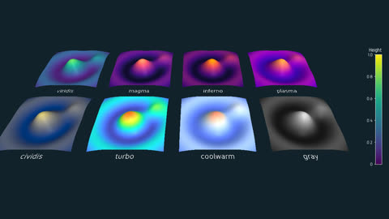
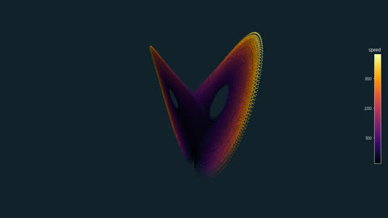
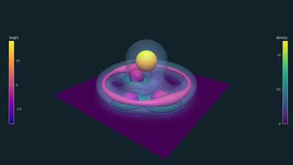
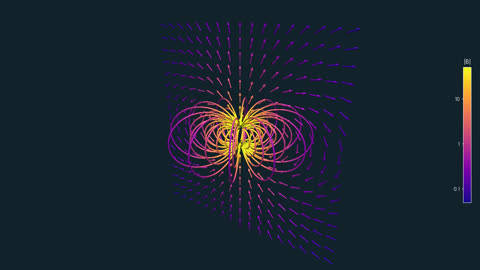
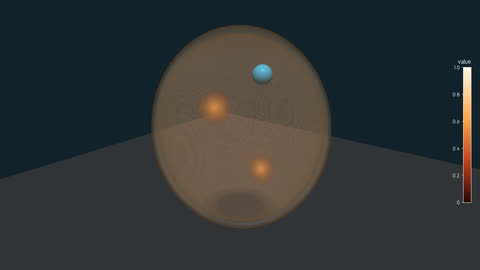
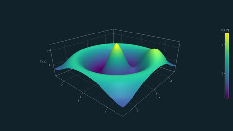
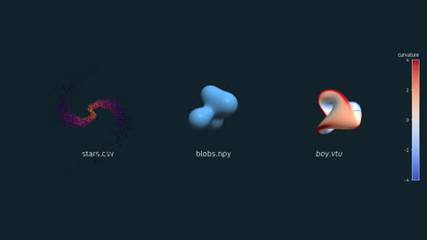
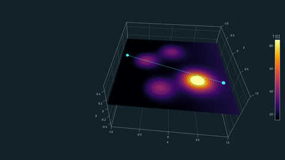

# Scientific Visualisation

`ivfvis` is ivf2's module for visualising data: values on grids and at scattered points, coloured through colormaps and explained by colour bars. It builds on the scene graph, so visualisations combine freely with everything else in ivf2: lights, shadows, effects, picking and animation.

`ivfvis` is a separate library. Link it next to ivf2:

```cmake
target_link_libraries(my_app PRIVATE ivf2::ivf2 ivf2::ivfvis)
```

```cpp
#include <ivfvis/ivfvis.h>
```

It is built by default; `-DIVF2_BUILD_VIS=OFF` leaves it out. It needs no libraries beyond ivf itself; reading VTK XML files uses pugixml and miniz (`IVF2_WITH_VTK_XML`), and 2D plots use ImPlot in ivfui (`IVF2_WITH_IMPLOT`), both on by default.

<div class="ivf-gallery" markdown>

- [ Colormaps and colour bars](colormaps.md)
- [ Point clouds](point_clouds.md)
- [ Isosurfaces and slices](scalar_fields.md)
- [ Glyphs and streamlines](vector_fields.md)
- [ Volume rendering](volumes.md)
- [ Axes and labels](axes.md)
- [ Reading data files](readers.md)
- [ 2D plots](plots.md)

</div>

## A first visualisation

A complete program: a density field on a grid, shown by an isosurface and a contoured slice, with axes and a colour bar.

```cpp
#include <ivfui/ui.h>
#include <ivfvis/ivfvis.h>

#include <cmath>

class FieldWindow : public ivfui::GLFWSceneWindow {
public:
    using GLFWSceneWindow::GLFWSceneWindow;

    int onSetup() override
    {
        // Data: a density field on a 64^3 grid
        auto grid = ivfvis::UniformGrid::create({64, 64, 64}, ivf::BoundingBox({-1, -1, -1}, {1, 1, 1}));
        grid->fillScalars("density", [](const glm::vec3 &p) {
            const glm::vec3 q = p - glm::vec3(0.5f);
            return std::exp(-4.0f * glm::dot(p, p)) + 0.5f * std::exp(-20.0f * glm::dot(q, q));
        });

        auto cmap = ivfvis::Colormap::create(ivfvis::BuiltinColormap::Viridis);
        cmap->setRange(grid->range("density"));

        // A surface of constant density, a cut through the field, axes and a colour bar
        add(ivfvis::Isosurface::create(grid, "density", 0.4f));
        auto slice = ivfvis::SlicePlane::create(grid, "density", cmap);
        slice->setAxis(ivfvis::SliceAxis::Z, -0.3f);
        slice->setContours(6);
        add(slice);
        add(ivfvis::Axes3D::create(grid->bounds()));
        add(ivfvis::ColorBar::create(cmap));

        cameraManipulator()->setCameraPosition({2.4f, 1.6f, 3.2f});
        return 0;
    }
};

int main()
{
    auto app = ivfui::GLFWApplication::create();
    app->addWindow(std::make_shared<FieldWindow>(1280, 720, "My first visualisation"));
    return app->loop();
}
```

Link it with `ivf2::ivf2` and `ivf2::ivfvis`. The rest of this section explains the parts: [data sets](#data-sets) hold the values, [colormaps](colormaps.md) turn them into colours, and the nodes ([point clouds](point_clouds.md), [isosurfaces and slices](scalar_fields.md), [glyphs and streamlines](vector_fields.md), [volumes](volumes.md), [axes](axes.md)) draw them. Data can also come from [files](readers.md), and [2D plots](plots.md) go next to the 3D view. The [Visualisation Examples](../examples/visualisation_examples.md) show each part in a complete program.

## Data sets

A data set is a set of points with named arrays of values: **scalars** (one `float` per point) and **vectors** (one `glm::vec3` per point).

| Class | Points |
|-------|--------|
| `UniformGrid` | A regular 3D grid: dimensions (points per axis), origin and spacing. A dimension of 1 makes a 2D grid. |
| `PointSet` | Points at arbitrary positions (measurements, particles, point clouds). |

```cpp
// 64 x 64 x 64 points covering [-1, 1]^3
auto grid = ivfvis::UniformGrid::create({64, 64, 64}, ivf::BoundingBox({-1, -1, -1}, {1, 1, 1}));

// Fill arrays from functions of the position ...
grid->fillScalars("density", [](const glm::vec3 &p) { return std::exp(-4.0f * glm::dot(p, p)); });
grid->fillVectors("velocity", [](const glm::vec3 &p) { return glm::vec3(-p.y, p.x, 0.0f); });

// ... or write the values directly (point i + nx * (j + ny * k))
auto temperature = grid->addScalars("temperature");
temperature[grid->index(3, 4, 5)] = 293.0f;

// Derived arrays and value ranges
grid->addMagnitude("velocity", "speed");
ivfvis::ValueRange range = grid->range("speed");   // range.min, range.max
```

`UniformGrid::sample()` and `sampleVector()` interpolate an array at any position (trilinearly; positions outside the grid are clamped to it), and `gradient()` gives the gradient of a scalar array. Point arrays are stored with x varying fastest, the layout of VTK image data and of C-ordered NumPy arrays indexed `[k][j][i]`.

Looking up an array that does not exist is treated as a programming error and throws `std::out_of_range`; check optional arrays with `hasScalars()` and `hasVectors()`.

## Vector fields

`VectorField` is the interface for vector data that can be sampled anywhere. [Glyphs and streamlines](vector_fields.md) use it.Three adapters cover the common sources:

```cpp
auto fromGrid = ivfvis::VectorField::fromGrid(grid, "velocity");          // interpolated grid data
auto analytic = ivfvis::VectorField::fromFunction(
    [](const glm::vec3 &p) { return glm::vec3(-p.y, p.x, 0.1f); },
    ivf::BoundingBox({-2, -2, -2}, {2, 2, 2}));                           // a function, optionally bounded
auto curl = ivfvis::VectorField::fromFlowField(ivf::FlowField::create()); // ivf's curl-noise flow field

glm::vec3 v = fromGrid->sample({0.2f, 0.1f, 0.0f});
bool inside = fromGrid->contains({3.0f, 0.0f, 0.0f});                      // false: outside the grid
```

## Next

- [Colormaps and Colour Bars](colormaps.md): turn values into colours, and show the scale.
- [Point Clouds](point_clouds.md): draw millions of points coloured and sized by their values.
- [Isosurfaces and Slices](scalar_fields.md): surfaces of constant value and cuts through 3D fields.
- [Glyphs and Streamlines](vector_fields.md): arrows and field lines of vector fields.
- [Volume Rendering](volumes.md): whole 3D fields as semi-transparent clouds.
- [Axes and Labels](axes.md): 3D axes with ticks, labels and grid walls that follow the camera.
- [Reading Data Files](readers.md): CSV tables, NumPy arrays and VTK files.
- [2D Plots](plots.md): profiles, histograms and other charts next to the 3D view, with ImPlot.
