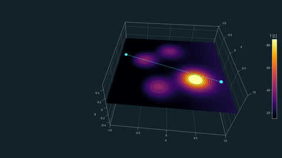

# 2D Plots

Line plots, histograms and other charts go next to the 3D view, in ImGui windows drawn with [ImPlot](https://github.com/epezent/implot). ivfvis prepares the data (`sampleLine()`, `histogram()`), ImPlot draws it, and the two are easily linked: dragging in a plot can change a colormap, moving a slider can move a probe through the data. The `vis_dashboard1` example shows a probe profile and a histogram that sets the colour range.



ImPlot is part of ivfui when ivf2 is built with `IVF2_WITH_IMPLOT` (the default; vcpkg feature `implot`). Every window has its own ImPlot context, created, made current and destroyed with its ImGui context, so plots work in several windows without any setup. Check `IVF2_HAS_IMPLOT` in `<ivf/config.h>` if your code must also build without it.

```cpp
#include <implot.h>

void onDrawUi() override
{
    ImGui::Begin("Dashboard");
    if (ImPlot::BeginPlot("Along the probe"))
    {
        ImPlot::SetupAxes("distance", "T [C]");
        ImPlot::PlotLine("T", m_profile.distance.data(), m_profile.values.data(),
                         static_cast<int>(m_profile.values.size()));
        ImPlot::EndPlot();
    }
    ImGui::End();
}
```

See the [ImPlot documentation](https://github.com/epezent/implot) and its demo (`ImPlot::ShowDemoWindow()`) for all plot types: lines, scatter, bars, shaded areas, heatmaps, error bars, pie charts, draggable lines and points, and more.

## Plot data

| Function | Result |
|----------|--------|
| `sampleLine(grid, scalars, a, b, n)` | `LineSamples`: `n` values of a grid array along the line from `a` to `b`, with the distance from `a` and the positions |
| `histogram(values, bins, range)` | `Histogram`: counts in equal bins (`edges`, `centers`, `counts`, `binWidth()`, `peak()`); NaN and values outside the range are skipped; without a range, the values' own range |

```cpp
auto profile = ivfvis::sampleLine(*grid, "temperature", start, end, 200);
auto counts = ivfvis::histogram(grid->scalars("temperature"), 60);

ImPlot::PlotBars("count", counts.centers.data(), counts.counts.data(),
                 static_cast<int>(counts.counts.size()), counts.binWidth() * 0.9);
```

## Linking plots and the scene

Plots and scene share data, so linking them is a matter of updating one from the other in `onDrawUi()`:

```cpp
// Drag lines in the histogram set the colormap range; slices, colour bars and point
// clouds using the colormap follow on the next frame
bool changed = ImPlot::DragLineX(0, &m_min, ImVec4(0.4f, 0.8f, 1.0f, 1.0f), 2.0f);
changed |= ImPlot::DragLineX(1, &m_max, ImVec4(1.0f, 0.7f, 0.3f, 1.0f), 2.0f);
if (changed)
    m_colormap->setRange(float(m_min), float(m_max));
```

Visual regression tests save screenshots without the UI, so plots do not appear in them.
