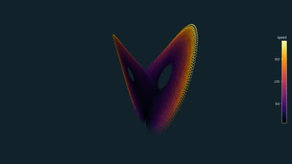

# Point Clouds

`PointCloud` draws the points of a [`PointSet`](index.md#data-sets) as round sprites, coloured by a scalar array through a [colormap](colormaps.md) and optionally sized by another array. All points are drawn with one draw call, so clouds of millions of points stay interactive. The `vis_points1` example shows half a million points along the Lorenz attractor.



```cpp
#include <ivfvis/ivfvis.h>

auto points = ivfvis::PointSet::create(positions);        // std::vector<glm::vec3>
auto speed = points->addScalars("speed");
// ... fill speed[i]

auto cmap = ivfvis::Colormap::create(ivfvis::BuiltinColormap::Inferno);
cmap->setRange(points->range("speed"));

auto cloud = ivfvis::PointCloud::create(points);
cloud->setColorBy("speed", cmap);
cloud->setPointSize(0.03f);                                // diameter in world units
add(cloud);

add(ivfvis::ColorBar::create(cmap));                       // the scale
```

## Colour

| Method | Description |
|--------|-------------|
| `setColorBy(name, colormap)` | Colour each point by scalar array `name` |
| `clearColorBy()` | One colour for all points |
| `setColor(rgb)` | That colour (default light grey) |
| `setColormap(colormap)` | Change the colormap, keeping the array |

Colours are looked up on the GPU from the colormap's table. Changing the colormap's range, scale, steps or colours takes effect on the next frame with no work per point, and discrete steps (`setSteps()`) have sharp edges. Values outside the range and NaN use the colormap's out-of-range and NaN colours.

## Size and shape

| Method | Default | Description |
|--------|---------|-------------|
| `setPointSize(size)` | 0.05 | Point diameter |
| `setSizeMode(mode)` | `World` | `PointSizeMode::World`: size in the node's units, points shrink with distance. `PointSizeMode::Pixels`: size in pixels, constant on screen |
| `setSizeBy(name, minScale, maxScale)` | - | Scale each point by scalar array `name`: its data range maps to `minScale` to `maxScale` times the point size |
| `setShape(shape)` | `Disc` | `PointShape::Disc` (flat round), `Sphere` (round, shaded like a small ball) or `Square` |
| `setOpacity(opacity)` | 1 | Below 1, points are blended (drawn after opaque objects, without depth writes) |

World-sized points suit dense clouds viewed up close (each point keeps its place in the scene); pixel-sized points suit sparse data and overviews, where every point should stay visible. Very large points are limited by the driver's maximum point size (often 64 to 2048 pixels).

## Updating

`PointCloud` reads the `PointSet` when it is drawn. After changing positions or array values, call `update()`; the points are uploaded again before the next frame, and the bounding box (used for culling and picking) is recomputed.

```cpp
for (auto &p : points->positions())
    p += velocity * dt;
cloud->update();
```

## Picking

Point clouds are picked point by point: `pick()` returns the nearest point under the mouse, with its index in `RayHit::point`. Hover and click events (`onEnterNode()`, `onSelectNode()`) work with both selection methods.

```cpp
if (auto hit = pick(mouseX(), mouseY()); hit.point >= 0)
{
    auto i = static_cast<std::size_t>(hit.point);
    ivf::logInfo(ivf::logStr("point ", i, " speed ", points->scalars("speed")[i]), "Picking");
}
```

Ray picking tests every point (a few milliseconds for a million points), so pick on clicks rather than on every mouse move for very large clouds. Points sized in pixels are picked with their size from the last drawn frame.

Point clouds do not cast shadows.
