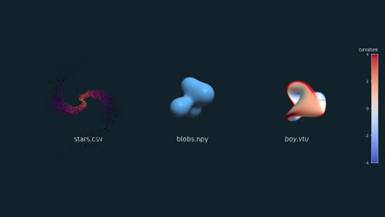

# Reading Data Files

ivfvis reads data from the formats scientific tools write most: CSV tables, NumPy arrays and VTK files. The readers turn files into [data sets](index.md#data-sets) that the rest of ivfvis draws. The `vis_readers1` example reads one file of each kind.



All readers return `ivf::Result`: check it, and on failure the error (also logged) says why, for example file not found, unsupported format or malformed data.

```cpp
#include <ivfvis/readers.h>

auto table = ivfvis::readCsv("stars.csv");
if (!table)
    return -1;                                  // table.error().message says why
```

## CSV

```cpp
auto table = ivfvis::readCsv("measurements.csv");
auto points = ivfvis::pointsFromTable(*table, "x", "y", "z");   // other columns become arrays
```

`readCsv()` returns a `Table` of named columns of numbers. The delimiter (comma, semicolon, tab or spaces) and a header row are detected; cells that are not numbers become NaN. Quoted fields are supported, and lines starting with `#` are skipped.

| `CsvOptions` | Default | Description |
|--------------|---------|-------------|
| `delimiter` | detected | `','`, `';'`, `'\t'` or `' '` (any whitespace) |
| `header` | detected | 1: first row has the names, 0: no header (columns are `column1`, `column2`, ...) |
| `comment` | `'#'` | Lines starting with this character are skipped |

`pointsFromTable(table, x, y, z)` makes a `PointSet` from three columns (an empty name gives 0, for 2D data); every other column with numbers becomes a scalar array to colour or size points by. `table.values(name)` gives a column directly.

## NumPy

```cpp
auto array = ivfvis::readNpy("density.npy");
auto grid = ivfvis::gridFromNpy(*array, "density", origin, spacing);
auto cloud = ivfvis::pointsFromNpy(*ivfvis::readNpy("positions.npy"));
```

`readNpy()` reads `.npy` files written by `numpy.save()`: boolean, integer and float types in either byte order, C or Fortran order. Values are converted to floats.

| Function | Array shapes |
|----------|--------------|
| `gridFromNpy(array, name, origin, spacing)` | `(nx)`, `(ny, nx)` or `(nz, ny, nx)` as a scalar array; `(nz, ny, nx, 3)` as a vector array. Indexing `[k][j][i]` (x last) is NumPy's usual layout for volumes; Fortran-ordered arrays use `(nx, ny, nz)` |
| `pointsFromNpy(array)` | `(n, 2)` or `(n, k >= 3)`: x, y, z and further columns as arrays `column3`, ... |

## VTK

```cpp
auto data = ivfvis::readVtk("result.vtu");      // .vtk, .vtu, .vtp or .vti
if (data->grid)
    add(ivfvis::Volume::create(data->grid, "pressure", cmap));
else
{
    auto mesh = ivfvis::createMeshNode(*data->points, data->triangles);
    ivfvis::colorVertices(*mesh->mesh(), data->points->scalars("pressure"), *cmap);
    ivfvis::useVertexColors(*mesh);
    add(mesh);
}
```

`readVtk()` reads files written by VTK, ParaView and the many simulation codes that export VTK:

| Format | Data sets | Encodings |
|--------|-----------|-----------|
| Legacy `.vtk` (versions 2 to 5.1) | structured points, polydata, unstructured grids; structured and rectilinear grids as points | ASCII and binary |
| XML `.vti` | image data | ASCII, base64, appended raw or base64, uncompressed or zlib |
| XML `.vtu`, `.vtp` | unstructured grids, polydata (all pieces) | as above |

The result, `VtkData`, holds:

- `grid`: a `UniformGrid` for image data and structured points, with the point arrays
- `points`: a `PointSet` with the point arrays, for the other data sets
- `triangles`: the surface: polygons, triangle strips, quads and pixels split into triangles, and the outer faces of volume cells (tetrahedra, hexahedra, wedges, pyramids, voxels)
- `lines`: line and polyline cells

Arrays with one component become scalar arrays and arrays with three components vector arrays; others become one scalar array per component (`name_0`, `name_1`, ...). Cell data is not read.

`createMeshNode(points, triangles)` makes a mesh node with smooth normals whose vertex *i* is point *i*, so the point set's arrays colour it directly.

XML files need ivf2 built with `IVF2_WITH_VTK_XML` (the default; it uses pugixml and miniz through vcpkg). Without it, reading them gives an `ErrorCode::NotSupported` error, while legacy files, CSV and NumPy work in every build.
