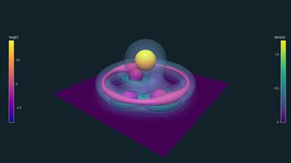

# Isosurfaces and Slices

A scalar field on a [`UniformGrid`](index.md#data-sets), such as a density, temperature or pressure, can be shown as **isosurfaces** (where the field has a given value) and **slice planes** (the field's values on a plane, with contour lines). The `vis_scalar1` example combines both.



## Isosurfaces

```cpp
auto grid = ivfvis::UniformGrid::create({96, 96, 96}, ivf::BoundingBox({-2, -2, -2}, {2, 2, 2}));
grid->fillScalars("density", density);

auto shell = ivfvis::Isosurface::create(grid, "density", 0.25f);
shell->setMaterial(glassMaterial);          // alpha < 1: see-through
add(shell);

auto core = ivfvis::Isosurface::create(grid, "density", 0.7f);
core->setColorBy("temperature", cmap);      // coloured by another array
add(core);
```

`Isosurface` is an `ivf::MeshNode` built by marching cubes. It works like any other mesh: give it a material, let it cast shadows, pick it by its triangles. Normals come from the field's gradient and point towards lower values, so the surface around a peak of the field faces outwards.

| Method | Description |
|--------|-------------|
| `setIsoValue(v)` | Rebuild at another value; fast enough for sliders on grids up to about 128³ |
| `setScalars(name)` | Show another array |
| `setColorBy(name, colormap)` | Colour by an array interpolated to the surface; follows changes of the colormap |
| `clearColorBy()` | Use the material's colour again |
| `update()` | Rebuild after the grid's values changed |
| `triangleCount()` | Size of the surface |

The surface is closed inside the grid and has no cracks: neighbouring cells always split ambiguous faces the same way. Where the field reaches the edge of the grid, the surface is open.

Several isosurfaces of one field show its structure; give the outer ones a low alpha so the inner ones stay visible. Transparent surfaces are sorted and drawn back to front automatically.

## Slice planes

```cpp
auto slice = ivfvis::SlicePlane::create(grid, "density", cmap);
slice->setAxis(ivfvis::SliceAxis::Y, -0.4f);    // the plane y = -0.4
slice->setContours(8);
add(slice);

add(ivfvis::ColorBar::create(cmap));
```

The slice shows the part of the plane inside the grid's box. Its colours are not lit, so they read exactly as on the colour bar. Changes to the colormap (range, steps, colours) show on the next frame.

| Method | Description |
|--------|-------------|
| `setAxis(axis, position)` | The plane perpendicular to `SliceAxis::X`, `Y` or `Z` at a position |
| `setPlane(origin, normal)` | Any plane through the grid |
| `setResolution(n)` | Squares along the slice's longer side (default 128) |
| `setContours(n)` | `n` contour lines evenly inside the colormap's range |
| `setContourValues(values)` | Contour lines at these values |
| `setContourColor(rgb)` | Colour of the contour lines (default black) |
| `update()` | Rebuild after the grid's values changed |

The field is sampled at the corners of the slice's squares and the colours are interpolated between them; contour lines are exact for that interpolation. Raise the resolution for fields with fine detail.

## Without a scene

The geometry is available as plain data, for export or your own drawing:

```cpp
ivfvis::SurfaceData iso = ivfvis::extractIsosurface(*grid, "density", 0.5f, "temperature");
ivfvis::SurfaceData cut = ivfvis::extractSlice(*grid, "density", origin, normal, 128);
std::vector<glm::vec3> lines = ivfvis::contourLines(cut, levels);   // pairs of points

float area = iso.area();
```

`SurfaceData` holds positions, normals, a value per vertex and triangle indices. None of these functions need an OpenGL context.
