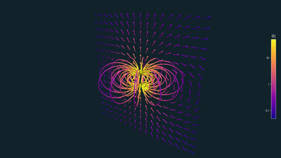

# Glyphs and Streamlines

A vector field (velocity, force, magnetic field, gradient) is shown with **glyphs**, arrows at sample points, and **streamlines**, curves that follow the field. Both work on any [`VectorField`](index.md#vector-fields): grid data, a function or a `FlowField`. The `vis_vectors1` example shows the field of a magnetic dipole.



## Glyphs

```cpp
auto field = ivfvis::VectorField::fromGrid(grid, "velocity");

auto arrows = ivfvis::Glyphs::create(field);
arrows->setSampleGrid({12, 12, 12});      // over the field's bounds
arrows->setScale(0.1f);                   // length = 0.1 * |v|
arrows->setColormap(cmap);                // coloured by |v|
add(arrows);
```

| Method | Default | Description |
|--------|---------|-------------|
| `setSampleGrid(counts)` | 10 x 10 x 10 | Glyphs on a regular grid over the field's bounds |
| `setPositions(points)` | - | Glyphs at your own positions (a plane, a surface, measurement points) |
| `setShape(shape)` | `Arrow` | `GlyphShape::Arrow`, `Cone` or `Line` (unlit, cheapest) |
| `setScaling(mode)` | `Magnitude` | `GlyphScaling::Magnitude`: length = scale x \|v\|. `Constant`: all glyphs `scale` long, colour shows the strength |
| `setScale(s)` | 1 | Length factor or length |
| `setAnchor(anchor)` | `Tail` | `GlyphAnchor::Tail` (arrow starts at the point) or `Center` |
| `setThickness(t)` | 1 | Thickness relative to the length |
| `setMinMagnitude(m)` | 0 | Leave out weaker vectors |
| `setColormap(cmap)` | - | Colour by \|v\|; without one, the node's material colour |

When the strength varies over orders of magnitude, use constant lengths with a [logarithmic colormap](colormaps.md#settings): arrows near strong sources would otherwise cover everything, and arrows in weak regions vanish.

All glyphs form one lit mesh: they cast shadows and are picked by their triangles. `glyphIndex(hit.triangle)` tells which glyph was clicked, and `glyphPosition()`/`glyphVector()` give its data. Call `update()` after the field's data changed.

## Streamlines

```cpp
auto seeds = ivfvis::seedCircle({0, 0, 0}, {0, 1, 0}, 0.8f, 24);

auto lines = ivfvis::Streamlines::create(field, seeds);
lines->setTubes(true);
lines->setTubeRadius(0.015f);
lines->setColormap(cmap);                 // coloured by |v| along the line
add(lines);
```

A streamline starts at a seed point and follows the field's direction in steps of equal length (4th order Runge-Kutta), forward, backward or both ways. It stops when it leaves the field's bounds, where the field is weaker than `minSpeed`, or at the step or length limit.

| `StreamlineOptions` | Default | Description |
|---------------------|---------|-------------|
| `step` | 0 (automatic) | Step length; automatic: 1/200 of the field's bounds diagonal, or 0.01 for unbounded fields |
| `maxSteps` | 2000 | Most steps each way |
| `maxLength` | 0 (none) | Longest length each way |
| `minSpeed` | 1e-6 | Stop where the field is weaker |
| `direction` | `Both` | `TraceDirection::Forward`, `Backward` or `Both` |

| Method | Description |
|--------|-------------|
| `setSeeds(points)` | Start points (traced again) |
| `setOptions(options)` | Tracing settings |
| `setTubes(true)` | Lit tubes instead of unlit lines |
| `setTubeRadius(r)`, `setTubeSides(n)` | Tube size (default 0.02) and roundness (default 8) |
| `setColormap(cmap)` | Colour by field strength; without one, lines use `setColor()` and tubes the material |
| `lines()`, `speedRange()` | The traced lines and the strength along them |

### Seeds

| Function | Seeds |
|----------|-------|
| `seedLine(a, b, n)` | `n` points from `a` to `b` |
| `seedPlane(origin, u, v, nu, nv)` | A grid on the rectangle spanned by `u` and `v` |
| `seedCircle(center, normal, radius, n)` | `n` points on a circle |
| `seedRandom(bounds, n, seed)` | Random points in a box (repeatable) |

Where to seed matters more than how many seeds: place them where the flow enters the region of interest, or around sources, rather than evenly everywhere.

### Without a scene

`traceStreamline(field, seed, options)` and `traceStreamlines(field, seeds, options)` return the lines as `Streamline` objects (points and field strengths) without OpenGL, for analysis or export.
