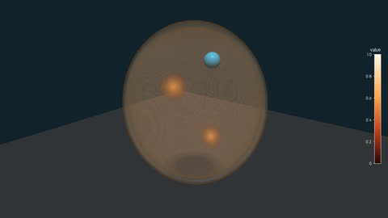

# Volume Rendering

Volume rendering shows a whole 3D scalar field at once, as a semi-transparent cloud: every value contributes colour and opacity, so inner structures show through outer ones. It suits medical scans, simulations of smoke, density or temperature, and any field where isosurfaces would hide too much. The `vis_volume1` example renders a CT-like scan with opaque objects inside.



```cpp
auto grid = ivfvis::UniformGrid::create({128, 128, 128}, ivf::BoundingBox({-1, -1, -1}, {1, 1, 1}));
grid->fillScalars("density", density);

auto cmap = ivfvis::Colormap::create(ivfvis::BuiltinColormap::Inferno);
cmap->setRange(0.0f, 1.0f);

auto volume = ivfvis::Volume::create(grid, "density", cmap);
volume->setOpacity({{0.0f, 0.0f}, {0.3f, 0.0f}, {1.0f, 0.8f}});   // hide low values
add(volume);
```

## The transfer function

For every pixel, a ray through the grid's box is sampled in small steps. Each value is mapped to a colour and an opacity, the **transfer function**, and the samples are blended front to back.

- **Colour** comes from the colormap, over its range (with its scale, steps and reversal).
- **Opacity** comes from a curve over the same range: points (position 0 to 1 in the colormap's range, opacity 0 to 1), linear between them.

```cpp
// Transparent below 0.15, faint tissue around 0.3, solid organs around 0.6, a light shell at 1
volume->setOpacity({{0.0f, 0.0f}, {0.15f, 0.0f}, {0.3f, 0.01f}, {0.45f, 0.01f},
                    {0.6f, 0.9f}, {0.7f, 0.9f}, {0.85f, 0.2f}, {1.0f, 0.2f}});
```

Opacity bands like these pick out materials by their values. Keep the opacity of large regions low: even a small opacity adds up over the length of a ray.

| Method | Default | Description |
|--------|---------|-------------|
| `setColormap(cmap)` | - | Colours and value range; changes show on the next frame |
| `setOpacity(points)` | 0 at the minimum to 1 at the maximum | The opacity curve |
| `setDensity(d)` | 1 | How quickly the volume becomes opaque: with 1, material of opacity 1 hides what is behind it within about a quarter of the volume |
| `setSamples(n)` | 256 | Samples along a ray through the whole volume: more give finer detail and cost more |
| `setShading(true)` | off | Light the volume using the field's gradient (six extra samples per step) |
| `update()` | - | Upload the grid's values again after changing them |

`opacityAt(points, t)` and `transferTable(colormap, points, n)` compute the transfer function on the CPU, for a histogram editor or a legend of your own.

## Mixing with geometry

The volume is drawn after opaque objects (in the transparent layer), and each ray stops where an opaque object is in front of the volume's far side. Isosurfaces, slice planes, glyphs and any other solid object inside or around the volume therefore appear correctly embedded in it. Transparent objects are not taken into account, and the volume casts no shadows.

## Performance

The cost grows with the number of pixels the volume covers times the samples per ray; rays stop early once they are nearly opaque. A 128³ grid at 256 samples renders in real time on current GPUs. To speed it up, lower `setSamples()` while interacting and raise it for screenshots, or turn shading off.

Values are stored on the GPU as half floats (`ivf::Texture3D`, about three significant digits). The grid's spacing may differ per axis; the volume fills the grid's box.

## Texture3D

`ivf::Texture3D` holds the volume's values and works on its own too: a 3D texture of single-channel floats, kept on the CPU and uploaded to each window's OpenGL context when first bound (like meshes), for your own shaders.

```cpp
auto tex = ivf::Texture3D::create();
tex->setData({64, 64, 64}, values);                  // x fastest; Format::R8, R16F (default), R32F
tex->bind(*renderContext(), 3);                     // texture unit 3, uploads if needed
```
